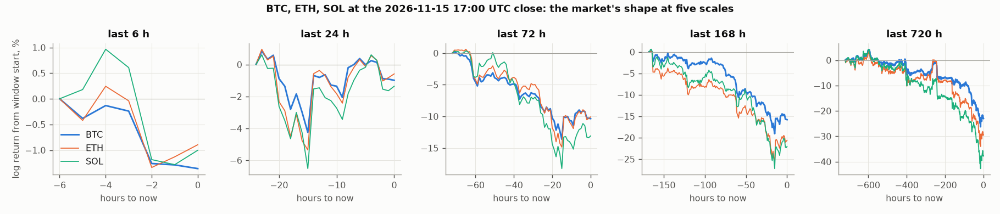
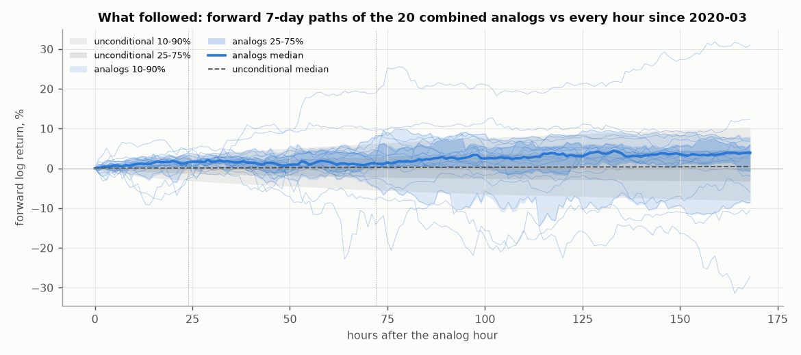
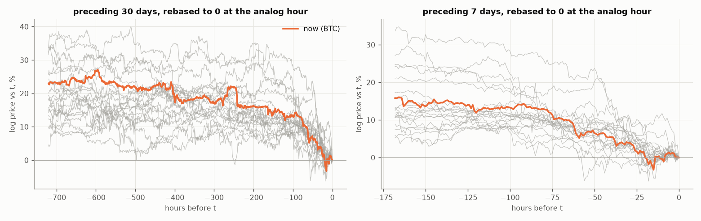
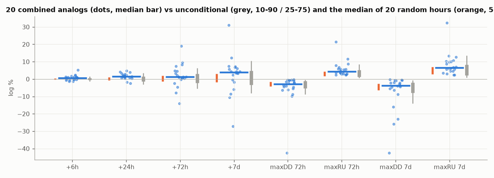
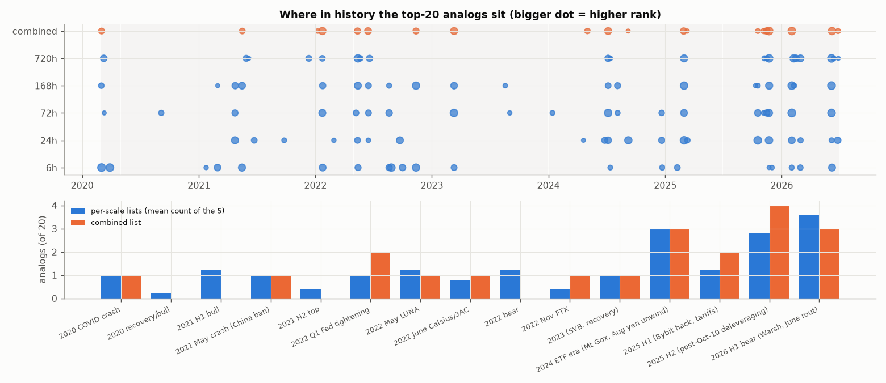
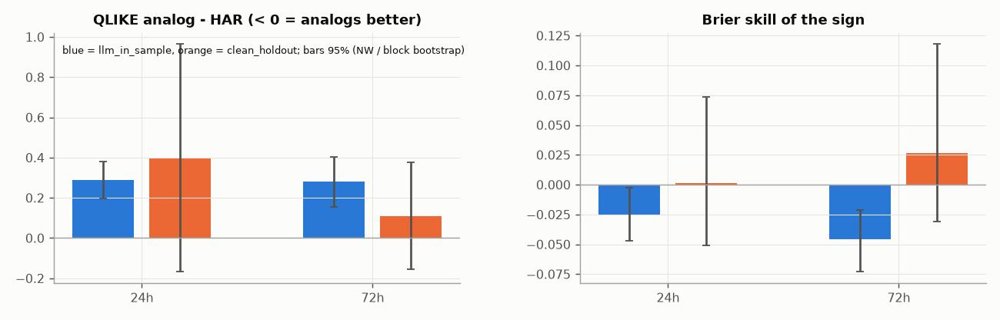

# BTC analogs: where today's market has been before, and what followed (2026-11-15)

Agent ANALOG. Research only. The design (distance, weights, pool, outcomes, H-ANA1 test) was frozen in the diary (2026-11-15 17:56 UTC, kind decision) and in `data/research/analogs/design.json` before any distance or outcome was computed. Code: `src/ai_trader/research/analog_study.py`, `analog_study_report.py`. Percent moves are log returns unless marked otherwise.

> **Read this first.** The analogs were chosen *after* seeing today's market. They describe the past and do not predict. H-ANA1, the test of whether this kind of analog search forecasts anything, came out **contradicts** before the cutoff and **inconclusive** after it, so the analogs' outcomes below are history, not a forecast.

**Data note.** The brief assumed Binance BTC 1h from 2017. The lake has no Binance BTC (venue=binance holds only ETHUSDT), and it was not backfilled (the user leads data decisions). BTC 1h here is Deribit BTC-PERPETUAL from 2020-01-01 to the first Bybit bar (2020-03-25 10:00), then Bybit BTCUSDT. The candidate pool runs 2020-03-01 to 2026-10-16 (58,097 hours; the last 30 days are excluded). Funding exists from 2020-03-25 and OI from 2020-08-04. Missing state features are re-weighted (each distance is averaged over the features both hours have); in 2020, OI covers 48% of hours and funding 82%, and from 2021 on everything is covered. So 2017-2019 (including the 2018 bear) cannot appear as analogs.

## Part A: the market now

As of the 2026-11-15 17:00 UTC close (the latest closed 1h bar; Sunday, inside the TradFi weekend, 43 h in, 6 h to the CME reopen at 23:00 UTC).

| | BTC | ETH | SOL |
|---|---|---|---|
| close | 64,674 | 1,814.1 | 71.39 |
| 6h return (range in vol units, position in range) | -1.4% (1.3, 0.00) | -0.9% (1.1, 0.28) | -1.0% (1.4, 0.12) |
| 24h return (range in vol units, position in range) | -1.0% (2.7, 0.64) | -0.6% (2.3, 0.76) | -1.4% (2.4, 0.72) |
| 72h return (range in vol units, position in range) | -10.4% (4.3, 0.24) | -10.1% (3.4, 0.31) | -13.1% (3.7, 0.28) |
| 168h return (range in vol units, position in range) | -15.8% (4.1, 0.17) | -20.6% (4.0, 0.19) | -22.1% (3.7, 0.19) |
| 720h return (range in vol units, position in range) | -23.0% (3.1, 0.11) | -29.3% (3.0, 0.13) | -37.6% (2.9, 0.11) |
| 24h realised vol, ann. (1y percentile) | 101% (p99) | 131% (p99) | 138% (p99) |
| 7d realised vol, ann. (1y percentile) | 58% (p88) | 80% (p90) | 83% (p87) |
| drawdown from the 30d high | -27.2% (high 84,880) | -33.1% | -42.5% |
| drawdown from the 1y high | -41.5% (high 97,963, 2026-01-14) | -64.2% | -73.5% |
| v0 cell (1h) | R9 liquidation | R9 | R9 |
| funding, last print (90d percentile) | -0.0012% (p4) | -0.0050% (p4) | -0.0195% (p0) |
| OI change 24h / 72h / 7d | +1.6% / +2.4% / +1.3% | -2.6% / +1.9% / -2.7% | -2.2% / -6.0% / -2.9% |
| 7d low (time) | 61,899 (11-15 01:00) | 1,709.1 | 67.32 |

Other context (point in time): DVOL 44.4 (1y percentile p67, 90d p99); Fear & Greed 10. The BTC cell has been R9 for 61 of the last 72 hours (before that, R8 for 7 h).

**Distance to key levels** (BTC; log %, and in 1h ATR14 units of 677):

| level | price | distance | ATRs |
|---|---|---|---|
| 30d high | 84,880 | +27.19% | +29.8 |
| 7d high | 75,940 | +16.06% | +16.6 |
| 7d POC (desk) | 74,455 | +14.08% | +14.4 |
| 72h high | 72,058 | +10.81% | +10.9 |
| 24h high (the bounce high) | 66,179 | +2.30% | +2.2 |
| 24h VAH (desk geometry 17:23) | 65,462 | +1.21% | +1.2 |
| round 65,000 | 65,000 | +0.50% | +0.5 |
| 24h VAL (desk geometry 17:23) | 63,338 | -2.09% | -2.0 |
| flush low = 7d / 30d low (11-15 01:00) | 61,899 | -4.39% | -4.1 |
| est. long-liq cluster (desk, a model) | 61,705 | -4.70% | -4.4 |
| round 60,000 | 60,000 | -7.50% | -6.9 |
| 1y low | 57,756 | -11.31% | -10.2 |

**Shape in plain words.** BTC lost about 23% over 30 days and 16% over 7 days, with most of the 7-day loss (-10%) in the last 72 hours. Price sits in the bottom fifth of its 7-day and 30-day ranges, but is 64% up the last 24 hours' range after bouncing off the 61,899 flush low. The 72h range was 4.3 vol units (measured against the month before), the most stretched of the five scales. Short-term vol is at its 1-year extreme (p99), funding is near its 90-day low, and OI is up 2.4% in 72h while price fell (new shorts). ETH and SOL show the same picture with deeper 30-day drawdowns.



_Normalised log-price path over the last 6h, 24h, 72h, 7d and 30d (BTC bold, ETH, SOL)._

## Part B: the analog search

**How similarity is measured** (frozen before results). For each past hour and each scale (6h, 24h, 72h, 7d, 30d):
- **shape**: 1 minus the Pearson correlation of the z-normalised cumulative log-price path (7 points for 6h, 25 for the others);
- **amplitude**: |log ratio| of the path ranges in vol units (range / (sd of hourly returns over the 720 h before the window x sqrt L));
- **state**: standardised Euclidean over rv percentile, drawdown from the 30d high, v0 cell (direction and vol, half weight each), funding percentile, 72h OI change and the weekend flag.

d = 1.0 shape + 0.5 amplitude + 0.5 state. The **combined** score is the mean percentile rank across the five scales. At most one analog per 7 days (so one episode counts once); the last 30 days are excluded. Similarity in the tables is 1 - d for the per-scale lists, and 1 - mean rank for the combined list (0.99 = in the best 1% on average across scales).

### Top 20 combined (all scales together)

Columns: forward log returns; max drawdown / max run-up from the close; 7-day realised vol (and vs the 7 days before); v0 cell at +1d > +3d > +7d; whether the trailing 24h / 72h low was undercut *before* the trailing high was exceeded (hours after t; 'later' = undercut after the high was exceeded); hours to the 7-day low.

| # | analog hour (UTC) | day | episode | sim | rho 6h/24h/72h/7d/30d | cell | +6h | +24h | +72h | +7d | DD/RU 72h | DD/RU 7d | RV 7d | cells | 24h/72h low first | h to low |
|---|---|---|---|---|---|---|---|---|---|---|---|---|---|---|---|---|
| 1 | 2025-11-22 06:00 | Sat | 2025 H2 (post-Oct-10 deleveraging) | 0.999 | 0.87/0.33/0.87/0.91/0.95 | R9 | -0.2% | +2.4% | +4.5% | +7.4% | -0.9% / +5.7% | -0.9% / +10.0% | 6.1% (0.67x) | R9 > R6 > R6 | no / neither | 5 |
| 2 | 2026-02-01 16:00 | Sun | 2026 H1 bear (Warsh, June rout) | 0.999 | 0.80/0.24/0.84/0.94/0.81 | R9 | -1.4% | +1.6% | -4.6% | -8.6% | -6.2% / +2.3% | -25.9% / +2.3% | 12.7% (1.85x) | R9 > R9 > R6 | yes 8h / yes 8h | 105 |
| 3 | 2026-06-07 15:00 | Sun | 2026 H1 bear (Warsh, June rout) | 0.995 | 0.94/0.36/0.61/0.82/0.95 | R9 | -0.0% | +3.3% | +0.5% | +3.3% | -2.1% / +3.8% | -2.1% / +4.5% | 5.6% (0.59x) | R6 > R8 > R1 | no / no | 67 |
| 4 | 2022-01-22 17:00 | Sat | 2022 Q1 Fed tightening | 0.995 | 0.91/0.18/0.88/0.87/0.88 | R9 | -0.6% | +0.4% | +4.8% | +6.7% | -6.4% / +6.8% | -6.4% / +10.3% | 12.1% (1.17x) | R9 > R6 > R5 | yes 42h / yes 42h | 45 |
| 5 | 2023-03-11 10:00 | Sat | 2023 (SVB, recovery) | 0.992 | 0.90/0.21/0.88/0.93/0.55 | R9 | -0.2% | +1.5% | +19.0% | +31.0% | -0.6% / +21.3% | -0.6% / +32.4% | 11.6% (1.61x) | R9 > R3 > R3 | no / no | 2 |
| 6 | 2024-07-06 04:00 | Sat | 2024 ETF era (Mt Gox, Aug yen unwind) | 0.991 | 0.78/0.11/0.90/0.91/0.86 | R9 | +0.6% | +2.7% | +1.3% | +2.5% | -3.9% / +3.7% | -3.9% / +5.6% | 7.4% (0.95x) | R5 > R6 > R5 | no / neither | 46 |
| 7 | 2022-06-14 20:00 | Tue | 2022 June Celsius/3AC | 0.985 | 0.79/0.63/0.95/0.97/0.71 | R9 | -0.1% | -2.5% | -7.8% | -6.0% | -10.0% / +3.5% | -23.1% / +3.5% | 18.1% (1.32x) | R9 > R9 > R6 | yes 10h / yes 10h | 97 |
| 8 | 2025-11-15 00:00 | Sat | 2025 H2 (post-Oct-10 deleveraging) | 0.985 | 0.44/0.08/0.79/0.74/0.77 | R9 | +1.9% | +1.1% | -2.5% | -10.5% | -3.6% / +2.3% | -15.9% / +2.3% | 9.0% (1.36x) | R9 > R9 > R9 | yes 42h / yes 42h | 157 |
| 9 | 2025-02-27 16:00 | Thu | 2025 H1 (Bybit hack, tariffs) | 0.984 | 0.73/0.51/0.87/0.97/0.88 | R9 | -1.3% | -1.8% | +2.2% | +6.0% | -8.9% / +3.7% | -8.9% / +10.6% | 13.1% (1.93x) | R9 > R5 > R6 | yes 10h / yes 10h | 17 |
| 10 | 2022-05-12 21:00 | Thu | 2022 May LUNA | 0.982 | 0.79/0.53/0.78/0.94/0.93 | R9 | +5.1% | +4.0% | +8.2% | +5.7% | -2.1% / +8.8% | -2.1% / +9.7% | 10.4% (0.56x) | R6 > R6 > R6 | no / neither | 1 |
| 11 | 2022-11-12 06:00 | Sat | 2022 Nov FTX | 0.982 | 0.77/0.05/0.25/0.88/0.46 | R9 | +1.0% | +0.9% | -0.3% | -0.6% | -5.5% / +3.1% | -5.5% / +3.1% | 7.7% (0.49x) | R5 > R6 > R7 | yes 40h / neither | 47 |
| 12 | 2020-03-01 19:00 | Sun | 2020 COVID crash | 0.981 | 0.83/0.20/0.70/0.77/0.63 | None | +1.2% | +4.8% | +3.2% | -1.9% | -0.6% / +5.9% | -3.7% / +8.7% | 6.0% (0.74x) | None > None > None | yes 1h / yes 1h | 166 |
| 13 | 2021-05-16 21:00 | Sun | 2021 May crash (China ban) | 0.976 | 0.93/-0.10/0.59/0.82/0.51 | R9 | +1.0% | +1.5% | -14.1% | -27.1% | -42.6% / +5.6% | -42.6% / +5.6% | 26.8% (1.84x) | R9 > R9 > R9 | yes 7h / yes 7h | 65 |
| 14 | 2024-05-02 04:00 | Thu | 2024 ETF era (Mt Gox, Aug yen unwind) | 0.975 | 0.85/0.37/0.85/0.90/0.81 | R9 | +0.6% | +3.9% | +9.6% | +7.1% | -0.4% / +11.6% | -0.4% / +13.2% | 6.7% (0.76x) | R6 > R2 > R8 | no / no | 2 |
| 15 | 2025-11-05 11:00 | Wed | 2025 H2 (post-Oct-10 deleveraging) | 0.973 | 0.67/0.52/0.94/0.90/0.61 | R9 | +2.5% | +1.7% | +1.1% | +3.4% | -2.1% / +3.1% | -2.1% / +5.9% | 5.5% (0.76x) | R9 > R6 > R6 | no / neither | 50 |
| 16 | 2026-06-26 12:00 | Fri | 2026 H1 bear (Warsh, June rout) | 0.972 | 0.85/0.43/0.81/0.89/0.58 | R9 | +1.0% | +1.6% | +0.9% | +4.3% | -1.6% / +2.5% | -2.8% / +4.6% | 5.5% (0.67x) | R6 > R5 > R2 | yes 110h / yes 110h | 110 |
| 17 | 2025-10-18 05:00 | Sat | 2025 H2 (post-Oct-10 deleveraging) | 0.970 | 0.35/0.55/0.93/0.83/0.32 | R9 | +0.4% | +0.5% | +1.2% | +4.4% | -0.3% / +4.8% | -0.3% / +6.9% | 6.1% (0.95x) | R8 > R5 > R5 | no / no | 29 |
| 18 | 2022-01-08 00:00 | Sat | 2022 Q1 Fed tightening | 0.969 | 0.65/0.39/0.84/0.92/0.66 | R9 | +1.0% | +0.3% | +0.6% | +3.6% | -4.7% / +2.9% | -4.7% / +6.7% | 7.7% (0.95x) | R9 > R6 > R5 | yes 63h / yes 63h | 63 |
| 19 | 2025-03-10 16:00 | Mon | 2025 H1 (Bybit hack, tariffs) | 0.968 | 0.89/0.45/0.92/0.75/0.82 | R9 | -0.6% | +1.5% | +1.2% | +4.3% | -4.4% / +5.4% | -4.4% / +6.4% | 7.8% (0.63x) | R6 > R6 > R5 | yes 1h / yes 1h | 9 |
| 20 | 2024-09-06 21:00 | Fri | 2024 ETF era (Mt Gox, Aug yen unwind) | 0.962 | 0.91/-0.31/0.57/0.84/0.49 | R9 | +1.7% | +2.4% | +7.5% | +12.3% | -0.7% / +7.8% | -0.7% / +12.6% | 6.8% (0.99x) | R8 > R3 > R3 | yes 1h / yes 1h | 1 |

### Top 20 per scale

Per scale, only the outcome columns that matter for reading the list; full rows are in the JSON.

**6h**

| # | analog hour | sim | rho | amp | state d | cell | +24h | +72h | +7d | 7d DD / RU |
|---|---|---|---|---|---|---|---|---|---|---|
| 1 | 2020-03-01 18:00 | 0.650 | 0.87 | 0.05 | 0.38 | None | +4.2% | +2.6% | -2.3% | -4.3% / +8.1% |
| 2 | 2020-03-28 02:00 | 0.608 | 0.98 | 0.03 | 0.71 | None | -1.0% | +3.7% | +7.5% | -7.0% / +14.3% |
| 3 | 2022-08-27 02:00 | 0.603 | 0.97 | 0.14 | 0.59 | R9 | -1.2% | -0.5% | -1.6% | -3.8% / +1.5% |
| 4 | 2022-11-12 06:00 | 0.579 | 0.77 | 0.01 | 0.37 | R9 | +0.9% | -0.3% | -0.6% | -5.5% / +3.1% |
| 5 | 2021-05-15 19:00 | 0.571 | 0.98 | 0.11 | 0.72 | R9 | -5.4% | -11.2% | -24.2% | -50.9% / +3.8% |
| 6 | 2026-06-07 15:00 | 0.560 | 0.94 | 0.26 | 0.50 | R9 | +3.3% | +0.5% | +3.3% | -2.1% / +4.5% |
| 7 | 2022-01-23 17:00 | 0.555 | 0.97 | 0.02 | 0.82 | R9 | -2.4% | +8.3% | +7.1% | -6.8% / +9.9% |
| 8 | 2021-02-28 06:00 | 0.552 | 0.89 | 0.17 | 0.51 | R9 | +3.1% | +9.1% | +9.6% | -3.9% / +16.1% |
| 9 | 2022-09-30 22:00 | 0.549 | 0.97 | 0.08 | 0.76 | R6 | -0.4% | +0.9% | +1.0% | -2.4% / +5.5% |
| 10 | 2022-08-19 22:00 | 0.529 | 0.80 | 0.09 | 0.44 | R9 | +0.2% | +0.1% | -2.1% | -2.7% / +3.8% |
| 11 | 2022-05-14 14:00 | 0.501 | 0.90 | 0.10 | 0.70 | R9 | +4.6% | +5.7% | +1.6% | -0.8% / +8.9% |
| 12 | 2023-03-11 10:00 | 0.497 | 0.90 | 0.45 | 0.36 | R9 | +1.5% | +19.0% | +31.0% | -0.6% / +32.4% |
| 13 | 2025-02-07 23:00 | 0.494 | 0.95 | 0.07 | 0.85 | R6 | +0.4% | +1.4% | +1.1% | -2.1% / +2.9% |
| 14 | 2026-02-28 09:00 | 0.484 | 0.97 | 0.69 | 0.28 | R9 | +4.8% | +5.4% | +6.6% | -0.2% / +15.4% |
| 15 | 2024-12-22 17:00 | 0.484 | 0.96 | 0.01 | 0.94 | R9 | -1.8% | +2.8% | -1.9% | -3.4% / +4.4% |
| 16 | 2026-02-01 09:00 | 0.484 | 0.83 | 0.41 | 0.29 | R9 | -2.2% | -2.6% | -10.7% | -27.1% / +1.0% |
| 17 | 2024-07-12 22:00 | 0.480 | 0.98 | 0.18 | 0.81 | R5 | +1.9% | +9.8% | +15.0% | -0.0% / +15.7% |
| 18 | 2025-12-01 18:00 | 0.476 | 0.96 | 0.05 | 0.92 | R9 | +7.4% | +8.5% | +6.1% | -0.4% / +10.4% |
| 19 | 2021-01-23 14:00 | 0.470 | 0.88 | 0.05 | 0.78 | R6 | +1.2% | -0.3% | +7.2% | -8.4% / +19.3% |
| 20 | 2025-11-22 11:00 | 0.465 | 0.86 | 0.41 | 0.38 | R9 | +2.8% | +4.3% | +7.9% | -0.1% / +10.7% |

_6h list: +24h median +1.1%, +72h +2.7%, +7d +2.5% (65% up)._

**24h**

| # | analog hour | sim | rho | amp | state d | cell | +24h | +72h | +7d | 7d DD / RU |
|---|---|---|---|---|---|---|---|---|---|---|
| 1 | 2025-10-18 02:00 | 0.415 | 0.71 | 0.12 | 0.47 | R9 | -0.2% | +2.5% | +3.6% | -1.0% / +6.2% |
| 2 | 2025-03-01 00:00 | 0.399 | 0.66 | 0.09 | 0.43 | R9 | +2.0% | +2.2% | +2.9% | -3.5% / +12.0% |
| 3 | 2025-11-22 04:00 | 0.371 | 0.73 | 0.33 | 0.40 | R9 | +2.2% | +3.9% | +7.1% | -1.1% / +9.8% |
| 4 | 2024-09-07 12:00 | 0.306 | 0.67 | 0.05 | 0.68 | R9 | +0.4% | +5.2% | +9.4% | -1.3% / +11.0% |
| 5 | 2021-04-24 01:00 | 0.284 | 0.74 | 0.26 | 0.65 | R9 | -0.1% | +7.2% | +14.7% | -6.0% / +15.1% |
| 6 | 2022-09-22 16:00 | 0.256 | 0.80 | 0.02 | 1.07 | R6 | -1.5% | -0.0% | +1.6% | -2.8% / +7.1% |
| 7 | 2026-02-01 13:00 | 0.253 | 0.52 | 0.19 | 0.35 | R9 | -0.6% | -2.9% | -9.6% | -27.0% / +1.2% |
| 8 | 2024-07-06 00:00 | 0.198 | 0.73 | 0.13 | 0.94 | R9 | +2.8% | +0.2% | +2.2% | -4.3% / +5.3% |
| 9 | 2026-06-25 11:00 | 0.185 | 0.78 | 0.12 | 1.07 | R9 | -3.2% | -1.8% | +0.0% | -5.9% / +0.9% |
| 10 | 2024-12-21 04:00 | 0.154 | 0.72 | 0.32 | 0.82 | R6 | -0.5% | -3.3% | -3.0% | -5.2% / +2.5% |
| 11 | 2024-06-25 12:00 | 0.106 | 0.75 | 0.26 | 1.02 | R9 | +0.4% | +0.8% | +2.6% | -1.9% / +4.3% |
| 12 | 2022-05-12 22:00 | 0.104 | 0.73 | 0.02 | 1.23 | R9 | +5.5% | +8.9% | +6.3% | -0.3% / +10.3% |
| 13 | 2021-06-23 05:00 | 0.097 | 0.66 | 0.09 | 1.03 | R6 | -3.8% | -4.4% | +2.8% | -11.6% / +7.9% |
| 14 | 2025-03-11 10:00 | 0.058 | 0.62 | 0.18 | 0.95 | R9 | +1.5% | +1.6% | +1.7% | -3.0% / +4.7% |
| 15 | 2026-03-01 00:00 | 0.057 | 0.51 | 0.39 | 0.51 | R6 | -1.8% | +2.0% | +0.4% | -2.9% / +10.1% |
| 16 | 2026-06-06 10:00 | 0.057 | 0.53 | 0.05 | 0.88 | R9 | +2.5% | +2.8% | +4.4% | -1.5% / +5.5% |
| 17 | 2021-09-25 05:00 | 0.046 | 0.67 | 0.10 | 1.14 | R6 | -1.1% | -0.1% | +10.8% | -4.7% / +12.7% |
| 18 | 2022-06-16 02:00 | 0.045 | 0.62 | 0.14 | 1.00 | R9 | -6.9% | -19.0% | -9.3% | -23.9% / +0.8% |
| 19 | 2022-02-27 20:00 | 0.003 | 0.52 | 0.49 | 0.54 | R6 | +9.5% | +15.1% | +2.9% | -1.7% / +18.9% |
| 20 | 2024-04-19 21:00 | -0.000 | 0.50 | 0.31 | 0.69 | R6 | +1.0% | +3.7% | -0.1% | -2.0% / +4.8% |

_24h list: +24h median +0.1%, +72h +1.8%, +7d +2.7% (80% up)._

**72h**

| # | analog hour | sim | rho | amp | state d | cell | +24h | +72h | +7d | 7d DD / RU |
|---|---|---|---|---|---|---|---|---|---|---|
| 1 | 2026-02-01 12:00 | 0.688 | 0.85 | 0.06 | 0.28 | R9 | -1.3% | -3.5% | -10.4% | -27.3% / +0.9% |
| 2 | 2026-06-06 00:00 | 0.686 | 0.84 | 0.00 | 0.31 | R9 | -0.3% | +3.3% | +4.0% | -2.7% / +5.3% |
| 3 | 2023-03-10 22:00 | 0.545 | 0.91 | 0.37 | 0.35 | R9 | +1.4% | +18.3% | +30.0% | -1.6% / +30.6% |
| 4 | 2024-07-06 01:00 | 0.524 | 0.94 | 0.01 | 0.82 | R9 | +2.3% | -0.1% | +2.2% | -4.2% / +5.3% |
| 5 | 2025-11-22 04:00 | 0.520 | 0.90 | 0.37 | 0.40 | R9 | +2.2% | +3.9% | +7.1% | -1.1% / +9.8% |
| 6 | 2022-01-22 17:00 | 0.473 | 0.88 | 0.08 | 0.73 | R9 | +0.4% | +4.8% | +6.7% | -6.4% / +10.3% |
| 7 | 2025-03-01 00:00 | 0.449 | 0.85 | 0.38 | 0.43 | R9 | +2.0% | +2.2% | +2.9% | -3.5% / +12.0% |
| 8 | 2025-10-18 05:00 | 0.446 | 0.93 | 0.53 | 0.45 | R9 | +0.5% | +1.2% | +4.4% | -0.3% / +6.9% |
| 9 | 2022-08-20 00:00 | 0.387 | 0.79 | 0.39 | 0.40 | R9 | +1.5% | +2.7% | -2.9% | -3.6% / +5.0% |
| 10 | 2025-11-15 04:00 | 0.384 | 0.91 | 0.45 | 0.59 | R9 | -0.6% | -6.0% | -13.3% | -17.9% / +0.2% |
| 11 | 2021-04-24 01:00 | 0.339 | 0.91 | 0.48 | 0.65 | R9 | -0.1% | +7.2% | +14.7% | -6.0% / +15.1% |
| 12 | 2022-06-16 03:00 | 0.339 | 0.85 | 0.02 | 1.00 | R9 | -8.7% | -20.0% | -9.8% | -24.3% / +0.3% |
| 13 | 2022-05-08 08:00 | 0.315 | 0.76 | 0.21 | 0.67 | R9 | -3.1% | -12.2% | -14.9% | -26.5% / +0.8% |
| 14 | 2024-12-20 22:00 | 0.304 | 0.91 | 0.38 | 0.82 | R6 | +0.3% | -2.8% | -2.2% | -4.3% / +3.4% |
| 15 | 2020-09-04 23:00 | 0.284 | 0.94 | 0.14 | 1.18 | R9 | -4.7% | -0.8% | -1.0% | -6.2% / +0.9% |
| 16 | 2024-08-04 18:00 | 0.268 | 0.82 | 0.50 | 0.61 | R9 | -5.6% | -4.0% | +4.1% | -16.8% / +8.1% |
| 17 | 2024-01-13 19:00 | 0.243 | 0.88 | 0.36 | 0.93 | R9 | +0.2% | +0.4% | -2.9% | -6.1% / +1.8% |
| 18 | 2025-11-05 11:00 | 0.219 | 0.94 | 0.48 | 0.97 | R9 | +1.7% | +1.1% | +3.4% | -2.1% / +5.9% |
| 19 | 2023-09-01 22:00 | 0.215 | 0.88 | 0.54 | 0.80 | R9 | +0.2% | -0.5% | +0.3% | -1.8% / +2.5% |
| 20 | 2020-03-10 04:00 | 0.214 | 0.93 | 0.15 | 1.28 | None | +0.3% | -46.4% | -39.3% | -78.5% / +3.1% |

_72h list: +24h median +0.2%, +72h +0.2%, +7d +1.2% (55% up)._

**168h**

| # | analog hour | sim | rho | amp | state d | cell | +24h | +72h | +7d | 7d DD / RU |
|---|---|---|---|---|---|---|---|---|---|---|
| 1 | 2026-06-05 23:00 | 0.701 | 0.95 | 0.21 | 0.30 | R9 | -1.7% | +3.0% | +3.1% | -3.5% / +4.5% |
| 2 | 2026-02-01 12:00 | 0.678 | 0.95 | 0.25 | 0.28 | R9 | -1.3% | -3.5% | -10.4% | -27.3% / +0.9% |
| 3 | 2025-03-01 00:00 | 0.566 | 0.91 | 0.27 | 0.43 | R9 | +2.0% | +2.2% | +2.9% | -3.5% / +12.0% |
| 4 | 2022-11-12 05:00 | 0.560 | 0.90 | 0.36 | 0.31 | R9 | +0.5% | -0.0% | -0.8% | -5.8% / +2.7% |
| 5 | 2025-11-22 15:00 | 0.494 | 0.91 | 0.49 | 0.34 | R9 | +2.4% | +2.6% | +7.0% | -0.6% / +9.7% |
| 6 | 2022-05-13 21:00 | 0.472 | 0.79 | 0.05 | 0.59 | R6 | -1.4% | +0.6% | -2.2% | -4.0% / +5.7% |
| 7 | 2021-05-16 02:00 | 0.436 | 0.92 | 0.59 | 0.38 | R9 | -6.9% | -16.2% | -23.8% | -51.2% / +3.5% |
| 8 | 2023-03-11 11:00 | 0.421 | 0.94 | 0.67 | 0.36 | R9 | +1.9% | +20.5% | +31.6% | -0.3% / +32.7% |
| 9 | 2021-04-24 18:00 | 0.411 | 0.91 | 0.31 | 0.69 | R9 | -0.3% | +9.0% | +14.0% | -6.4% / +15.4% |
| 10 | 2022-01-23 17:00 | 0.411 | 0.96 | 0.28 | 0.82 | R9 | -2.4% | +8.3% | +7.1% | -6.8% / +9.9% |
| 11 | 2024-08-04 18:00 | 0.405 | 0.92 | 0.43 | 0.61 | R9 | -5.6% | -4.0% | +4.1% | -16.8% / +8.1% |
| 12 | 2022-06-16 01:00 | 0.394 | 0.96 | 0.15 | 0.98 | R9 | -10.7% | -17.8% | -10.5% | -25.3% / +1.4% |
| 13 | 2024-07-06 04:00 | 0.386 | 0.91 | 0.23 | 0.82 | R9 | +2.7% | +1.3% | +2.5% | -3.9% / +5.6% |
| 14 | 2020-03-01 01:00 | 0.365 | 0.85 | 0.56 | 0.42 | None | +0.1% | +2.7% | +2.9% | -1.7% / +7.6% |
| 15 | 2026-02-08 12:00 | 0.348 | 0.72 | 0.03 | 0.72 | R9 | -2.9% | -5.7% | -1.0% | -8.7% / +1.8% |
| 16 | 2022-08-20 00:00 | 0.336 | 0.89 | 0.70 | 0.40 | R9 | +1.5% | +2.7% | -2.9% | -3.6% / +5.0% |
| 17 | 2025-10-18 05:00 | 0.329 | 0.83 | 0.55 | 0.45 | R9 | +0.5% | +1.2% | +4.4% | -0.3% / +6.9% |
| 18 | 2023-08-18 21:00 | 0.325 | 0.88 | 0.09 | 1.02 | R9 | -0.1% | +0.1% | -0.1% | -3.1% / +2.8% |
| 19 | 2025-10-11 04:00 | 0.240 | 0.66 | 0.20 | 0.63 | R9 | -1.5% | +1.0% | -4.8% | -8.2% / +3.2% |
| 20 | 2021-02-28 20:00 | 0.236 | 0.84 | 0.66 | 0.55 | R9 | +8.3% | +13.6% | +12.7% | -0.7% / +16.9% |

_168h list: +24h median -0.2%, +72h +1.3%, +7d +2.7% (55% up)._

**720h**

| # | analog hour | sim | rho | amp | state d | cell | +24h | +72h | +7d | 7d DD / RU |
|---|---|---|---|---|---|---|---|---|---|---|
| 1 | 2026-06-05 21:00 | 0.820 | 0.97 | 0.01 | 0.30 | R9 | -1.5% | +3.0% | +2.9% | -3.6% / +4.4% |
| 2 | 2025-11-22 15:00 | 0.754 | 0.95 | 0.05 | 0.34 | R9 | +2.4% | +2.6% | +7.0% | -0.6% / +9.7% |
| 3 | 2022-05-13 22:00 | 0.627 | 0.92 | 0.02 | 0.57 | R6 | -1.1% | +0.5% | -2.9% | -4.8% / +4.9% |
| 4 | 2026-02-07 05:00 | 0.558 | 0.91 | 0.24 | 0.47 | R6 | -2.0% | -1.3% | -2.8% | -8.3% / +2.1% |
| 5 | 2025-03-01 00:00 | 0.435 | 0.90 | 0.49 | 0.43 | R9 | +2.0% | +2.2% | +2.9% | -3.5% / +12.0% |
| 6 | 2026-02-28 15:00 | 0.416 | 0.58 | 0.07 | 0.26 | R9 | +3.7% | +3.3% | +5.4% | -0.4% / +13.9% |
| 7 | 2026-02-14 15:00 | 0.397 | 0.83 | 0.29 | 0.57 | R6 | -0.8% | -4.1% | -1.8% | -6.1% / +1.8% |
| 8 | 2020-03-08 17:00 | 0.368 | 0.80 | 0.58 | 0.28 | None | -6.1% | -6.4% | -45.0% | -83.2% / +0.9% |
| 9 | 2024-07-06 01:00 | 0.364 | 0.87 | 0.20 | 0.82 | R9 | +2.3% | -0.1% | +2.2% | -4.2% / +5.3% |
| 10 | 2022-06-19 19:00 | 0.332 | 0.89 | 0.22 | 0.90 | R9 | -1.1% | -0.2% | +4.5% | -3.2% / +7.7% |
| 11 | 2021-05-29 07:00 | 0.324 | 0.84 | 0.00 | 1.03 | R9 | -2.1% | +1.1% | +3.1% | -9.1% / +7.7% |
| 12 | 2021-12-11 05:00 | 0.316 | 0.88 | 0.40 | 0.73 | R9 | +0.7% | -3.3% | -4.5% | -6.9% / +4.6% |
| 13 | 2022-01-22 17:00 | 0.313 | 0.88 | 0.40 | 0.73 | R9 | +0.4% | +4.8% | +6.7% | -6.4% / +10.3% |
| 14 | 2022-05-21 11:00 | 0.281 | 0.83 | 0.15 | 0.94 | R8 | +3.0% | +0.2% | -1.7% | -4.7% / +4.6% |
| 15 | 2025-11-15 01:00 | 0.281 | 0.75 | 0.37 | 0.57 | R9 | +0.2% | -3.2% | -11.6% | -16.5% / +1.7% |
| 16 | 2025-11-07 23:00 | 0.272 | 0.70 | 0.11 | 0.75 | R6 | -1.2% | +2.3% | -8.5% | -9.5% / +3.7% |
| 17 | 2026-06-13 09:00 | 0.220 | 0.82 | 0.12 | 1.08 | R5 | +1.0% | +4.7% | -0.6% | -2.5% / +5.4% |
| 18 | 2024-07-13 02:00 | 0.174 | 0.79 | 0.38 | 0.85 | R5 | +3.1% | +11.4% | +13.7% | -0.3% / +15.2% |
| 19 | 2021-06-05 20:00 | 0.173 | 0.72 | 0.06 | 1.03 | R9 | -0.1% | -8.5% | -0.1% | -14.3% / +7.2% |
| 20 | 2026-06-27 09:00 | 0.169 | 0.65 | 0.14 | 0.83 | R6 | -0.1% | -1.9% | +3.4% | -4.5% / +4.1% |

_720h list: +24h median +0.1%, +72h +0.3%, +7d +1.0% (50% up)._

### What followed, in aggregate (top 20 combined vs every hour)

'Random-20 band' is the 5-95% range of the median of 20 random pool hours (5000 draws): an analog median outside it is unusual for a random set of 20 hours, but still says nothing about forecasting (Part D).

| outcome | analogs median [90% bootstrap] | analogs q10 / q90 | share > 0 | unconditional median | unconditional q10 / q90 | random-20 band (median) | analogs sd vs random-20 sd band |
|---|---|---|---|---|---|---|---|
| +6h | +0.6% [-0.1%, +1.0%] | -0.7% / +1.9% | 60% | +0.0% | -1.4% / +1.5% | [-0.3%, +0.4%] | 1.5% vs [0.8%, 2.4%] |
| +24h | +1.5% [+1.1%, +2.4%] | +0.1% / +3.9% | 90% | +0.1% | -3.1% / +3.4% | [-0.7%, +0.9%] | 1.8% vs [1.8%, 4.6%] |
| +72h | +1.2% [+0.7%, +3.2%] | -4.9% / +8.4% | 75% | +0.3% | -5.5% / +6.2% | [-1.3%, +1.9%] | 6.7% vs [3.3%, 7.8%] |
| +7d | +3.9% [+2.5%, +5.6%] | -8.8% / +7.9% | 70% | +0.5% | -8.1% / +10.4% | [-1.9%, +3.0%] | 11.0% vs [5.0%, 12.2%] |
| max DD 72h | -2.8% [-4.7%, -1.6%] | -9.0% / -0.6% | 0% | -2.7% | -8.8% / -0.5% | [-4.2%, -1.6%] | 9.2% vs [2.1%, 8.9%] |
| max run-up 72h | +4.3% [+3.5%, +5.7%] | +2.5% / +9.1% | 100% | +2.8% | +0.5% / +8.5% | [+1.8%, +4.3%] | 4.4% vs [2.1%, 5.7%] |
| max DD 7d | -3.8% [-5.5%, -2.1%] | -23.4% / -0.6% | 0% | -4.2% | -14.0% / -0.7% | [-6.4%, -2.6%] | 11.0% vs [3.2%, 16.9%] |
| max run-up 7d | +6.6% [+5.6%, +9.7%] | +3.0% / +12.7% | 100% | +4.4% | +0.8% / +13.6% | [+2.8%, +6.9%] | 6.6% vs [3.3%, 8.0%] |

- **Path.** The trailing 24h low was undercut before the 24h high was exceeded in 12 of 20 analogs (12 undercut it at some point within 7 days); for the 72h low: 11 first, 11 at any point. The 7-day low came a median 46 h after the analog hour (IQR 8-74 h); 35% within 24 h.
- **Vol.** The following week's realised vol was a median 0.95x the week before: about as high as the crash week, not a quick calm-down (the spread is wide: 0.5x to 1.9x).
- **A tilt up, but not a forecast.** 90% of the 20 were up 24h later and the 7-day median was +3.9%, outside the random-20 band; but the 7-day q10 was -8.8% and the 7-day max drawdown q10 -23.4% (unconditional -14.0%). The same tilt, measured walk-forward (Part D), has *negative* Brier skill in-sample: past analog up-shares made worse sign calls than the base rate. Part of the tilt comes from picking hours just after a low: the search matches the 24h bounce off the flush low, and several analog hours (#1, #5, #10, #20) were within 1-5 h of their 7-day low.
- **Regime.** v0 cell at +1d: {'R5': 2, 'R6': 5, 'R8': 2, 'R9': 10}; +3d: {'R2': 1, 'R3': 2, 'R5': 3, 'R6': 8, 'R8': 1, 'R9': 4}; +7d: {'R1': 1, 'R2': 1, 'R3': 2, 'R5': 5, 'R6': 6, 'R7': 1, 'R8': 1, 'R9': 2}. R9 hands over mostly to R6 (whipsaw) and R5, in line with R-PX-8 / RB1.
- **The spread is the message.** The set holds both policy-rescue rebounds (SVB 2023 +31% in 7 days, Williams Nov 2025) and 'the low was still ahead' legs (Jun 2022 Celsius, Nov 2025 week 1, Feb 2026 Warsh, May 2021). On these features the past doesn't tell you which branch you are on.



_Forward 7-day log-return paths of the 20 combined analogs (blue) against the unconditional fan of all pool hours (grey)._



_Preceding paths of the 20 combined analogs (grey) overlaid on the current BTC path (orange), rebased at t = 0._



_Outcomes of the 20 combined analogs against the unconditional distribution and the 5-95% band of the median of 20 random hours._

### Where in history the analogs cluster

| episode | 6h | 24h | 72h | 168h | 720h | combined |
|---|---|---|---|---|---|---|
| 2020 COVID crash | 2 | 0 | 1 | 1 | 1 | 1 |
| 2020 recovery/bull | 0 | 0 | 1 | 0 | 0 | 0 |
| 2021 H1 bull | 2 | 1 | 1 | 2 | 0 | 0 |
| 2021 May crash (China ban) | 1 | 1 | 0 | 1 | 2 | 1 |
| 2021 H2 top | 0 | 1 | 0 | 0 | 1 | 0 |
| 2022 Q1 Fed tightening | 1 | 1 | 1 | 1 | 1 | 2 |
| 2022 May LUNA | 1 | 1 | 1 | 1 | 2 | 1 |
| 2022 June Celsius/3AC | 0 | 1 | 1 | 1 | 1 | 1 |
| 2022 bear | 3 | 1 | 1 | 1 | 0 | 0 |
| 2022 Nov FTX | 1 | 0 | 0 | 1 | 0 | 1 |
| 2023 (SVB, recovery) | 1 | 0 | 2 | 2 | 0 | 1 |
| 2024 ETF era (Mt Gox, Aug yen unwind) | 2 | 5 | 4 | 2 | 2 | 3 |
| 2025 H1 (Bybit hack, tariffs) | 1 | 2 | 1 | 1 | 1 | 2 |
| 2025 H2 (post-Oct-10 deleveraging) | 2 | 2 | 4 | 3 | 3 | 4 |
| 2026 H1 bear (Warsh, June rout) | 3 | 4 | 2 | 3 | 6 | 3 |

| year | 6h | 24h | 72h | 168h | 720h | combined |
|---|---|---|---|---|---|---|
| 2020 | 2 | 0 | 2 | 1 | 1 | 1 |
| 2021 | 3 | 3 | 1 | 3 | 3 | 1 |
| 2022 | 6 | 4 | 4 | 5 | 4 | 5 |
| 2023 | 1 | 0 | 2 | 2 | 0 | 1 |
| 2024 | 2 | 5 | 4 | 2 | 2 | 3 |
| 2025 | 3 | 4 | 5 | 4 | 4 | 6 |
| 2026 | 3 | 4 | 2 | 3 | 6 | 3 |

v0 cell at the combined analog hours: {'R9': 19, 'none (warm-up)': 1}.

- The combined list is dominated by **recent bear-phase flushes**: Nov 2025, Feb and Jun 2026, Feb-Mar 2025. These have the same market structure as today (ETF-era, perp-heavy, weekend liquidity holes) and similar vol percentiles.
- The second cluster is **2022** (Jan Fed repricing x2, May LUNA, Jun Celsius/3AC, Nov FTX), then **2024** (May, Jul Mt Gox, Sep), with single episodes from 2020 (Mar 1, before the COVID crash), 2021 (May China ban) and 2023 (SVB). Aug 2024 (yen carry unwind) appears on the 72h and 7d lists but not in the combined top 20.
- The longer scales (7d, 30d) pick the same few months (Jun 2026, Nov 2025, Feb 2026, May 2022): few past months had a 23% 30-day loss with this shape. The 6h scale is the noisiest (only 7 points, so many weak matches across the whole history).
- Weekends are over-represented: 13 of the 20 combined analog hours are inside the TradFi weekend, vs about 29% of all hours. The weekend flag is in the state vector, and many past flushes also bottomed on thin weekend liquidity.



_Dates of the top-20 analogs per scale and combined, and their count by market episode._

## Part C: why. What was happening at the top 10 combined analogs

Our own tables first. Point-in-time context at the analog hour: Fear & Greed (alternative.me, daily), DVOL and its 1y percentile (Deribit, from 2021-03), Wikipedia 'Bitcoin' views of the previous day as a z-score vs the 90 days before, and scheduled macro events from `data/research/news/events` within -3/+7 days. `research/narratives/events.yaml` and `research/calendar/` only cover 2026-11, so they add nothing for past analogs. The narrative for each date comes from a web search (treated as data, sources listed).

| # | analog | F&G (7d before) | DVOL (1y pct) | wiki z | scheduled events -3d..+7d |
|---|---|---|---|---|---|
| 1 | 2025-11-22 06:00 | 11 (10) | 58 (p83) | +3.1 | NFP 11-20 |
| 2 | 2026-02-01 16:00 | 14 (25) | 47 (p68) | +0.3 | - |
| 3 | 2026-06-07 15:00 | 12 (28) | 50 (p80) | +0.7 | NFP 06-05, CPI 06-10 |
| 4 | 2022-01-22 17:00 | 13 (23) | 75 (p7) | +0.5 | FOMC decision 01-26 |
| 5 | 2023-03-11 10:00 | 33 (50) | 59 (p21) | +1.1 | NFP 03-10, CPI 03-14 |
| 6 | 2024-07-06 04:00 | 26 (30) | 50 (p42) | -1.1 | NFP 07-05, CPI 07-11 |
| 7 | 2022-06-14 20:00 | 8 (15) | 100 (p96) | +2.4 | FOMC decision 06-15 |
| 8 | 2025-11-15 00:00 | 16 (24) | 49 (p60) | +1.3 | NFP 11-20 |
| 9 | 2025-02-27 16:00 | 10 (49) | 52 (p21) | -0.6 | - |
| 10 | 2022-05-12 21:00 | 12 (27) | 124 (p98) | +2.0 | CPI 05-11 |
| now | 2026-11-15 17:00 | 10 | 44 (p67) | | NVDA earnings 11-17, FOMC minutes 11-18 (desk calendar) |

**1. 2025-11-22 06:00 UTC (Sat), similarity 0.999: +24h +2.4%, +72h +4.5%, +7d +7.4%; 7d max DD -0.9%, low after 5 h.**
Cause: A six-week slide from the October 2025 record (about 126k) on spot-ETF outflows, fading odds of a December Fed cut and AI-equity doubts after Nvidia's Nov 20 earnings reversal; BTC hit about 80.5k on Friday Nov 21. The analog hour is the Saturday after that low. What resolved it: NY Fed President Williams said on Nov 21 there was 'room for a further adjustment in the near term'; December cut odds jumped above 70% and BTC bounced to about 86k at once and about 91k within the week. A policy-expectations rescue. Sources: [1](https://www.albawaba.com/business/pr/bitcoin-jumps-805k-lows-86k-after-fed-1617407), [2](https://cryptoslate.com/?p=508072), [3](https://cointelegraph.com/markets/bitcoin-stocks-crumble-after-nvidia-earnings-and-fed-uncertainty-over-next-rate-cut)

**2. 2026-02-01 16:00 UTC (Sun), similarity 0.999: +24h +1.6%, +72h -4.6%, +7d -8.6%; 7d max DD -25.9%, low after 105 h.**
Cause: A weekend liquidation cascade after Trump nominated Kevin Warsh as Fed chair (read as hawkish) and a record precious-metals crash on Jan 30-31 forced margin calls across portfolios; spot ETFs had lost about $681M the week before. BTC fell below 76k, its first time under 80k since April 2025, with about $2.2B liquidated in 24h. What resolved it: Not within the week. The slide extended to about 60k on Thursday Feb 5 (the worst day since FTX, about $2.7B liquidated), and BTC then rebounded 11-15% on Feb 6. The low came 4 days later and about 20% lower. Sources: [1](https://www.kucoin.com/news/flash/crypto-market-sees-2-2b-in-liquidations-as-bitcoin-drops-below-76k), [2](https://www.ibtimes.co.uk/warsh-shock-how-hawkish-fed-nominee-triggered-16bn-weekend-liquidity-trap-bitcoin-1775533), [3](https://www.theblock.co/post/388759/bitcoin-sees-flash-crash-60000), [4](https://fortune.com/2026/02/06/bitcoin-claws-back-above-70000-after-worst-day-since-ftx-crash/)

**3. 2026-06-07 15:00 UTC (Sun), similarity 0.995: +24h +3.3%, +72h +0.5%, +7d +3.3%; 7d max DD -2.1%, low after 67 h.**
Cause: The worst week since FTX (BTC -17%, ETH -22% in the week to Jun 6). A strong May payrolls print (172k vs 88k expected) lifted rates, spot ETFs had a 13-day outflow streak as money rotated to AI infrastructure and the SpaceX IPO, and Strategy made its first BTC sale in years to fund preferred dividends. The 2026 low was 59.1k on Jun 5-6. What resolved it: An 'oversold relief rally' over the 7-8 June weekend (+7.5% to about 63.8k) and an in-line May CPI on Jun 10 (core below forecast). The week ended slightly up, still range-bound. Sources: [1](https://www.theblock.co/news/markets/2026-06-04-the-rally-that-wasnt-bitcoin-slides-14-in-one-week-as-etf-outflows-strategy-sale-and-oil-prices-hit-sentiment-403659), [2](https://www.theblock.co/news/markets/2026-06-07-bitcoin-recovers-63000-kospi-plunges-403919), [3](https://www.blockhead.co/2026/06/08/crypto-markets-weekend-selloff-eases-key-data-ahead/)

**4. 2022-01-22 17:00 UTC (Sat), similarity 0.995: +24h +0.4%, +72h +4.8%, +7d +6.7%; 7d max DD -6.4%, low after 45 h.**
Cause: Markets repriced faster Fed tightening ahead of the Jan 26 FOMC, alongside a global tech sell-off and Russia-Ukraine tension. BTC fell from about 40.7k on Jan 21 to about 34.3k on the weekend of Jan 22, about 50% below the November 2021 record: its worst week in 8 months. What resolved it: A final low near 33k on Monday Jan 24, when US stocks reversed intraday, then chop around the hawkish FOMC and a February rally toward 45k. The flush was the low of that leg, not of the bear market. Sources: [1](https://fortune.com/2022/01/21/crypto-is-crashing-and-experts-predict-more-pain-ahead/), [2](https://forklog.com/en/bitcoin-ends-its-worst-week-in-eight-months/), [3](https://www.fxstreet.com/amp/cryptocurrencies/news/crypto-markets-shakeout-as-federal-reserve-leaves-us-interest-rates-on-hold-202201270904)

**5. 2023-03-11 10:00 UTC (Sat), similarity 0.992: +24h +1.5%, +72h +19.0%, +7d +31.0%; 7d max DD -0.6%, low after 2 h.**
Cause: Silicon Valley Bank failed on Friday Mar 10, with part of Circle's USDC reserves inside it. USDC depegged to about $0.87 on Saturday Mar 11 and BTC traded under 20k. What resolved it: On Sunday Mar 12, the Fed, Treasury and FDIC backstopped all SVB deposits and created the Bank Term Funding Program. USDC repegged and BTC rallied about 19% in 72h and 31% in 7 days: an external policy rescue, the largest upside outcome in the set. Sources: [1](https://www.bloomberg.com/news/articles/2023-03-13/bitcoin-btc-increases-more-than-5-after-us-supports-banking-sector), [2](https://techcrunch.com/2023/03/13/bitcoin-rallies-18-percent-in-wake-of-svb-crisis/), [3](https://coinloan.io/blog/coinloan-weekly-market-rebound-usdc-recovery-impact-of-svb-shutdown/)

**6. 2024-07-06 04:00 UTC (Sat), similarity 0.991: +24h +2.7%, +72h +1.3%, +7d +2.5%; 7d max DD -3.9%, low after 46 h.**
Cause: A supply overhang. The Mt. Gox estate began repaying creditors (47k BTC moved on Jul 5) while the German government sold seized BTC; BTC hit about 53.5k on Friday Jul 5, a four-month low. What resolved it: The German wallet was emptied around Jul 12 and many Mt. Gox coins were held rather than sold. BTC chopped for a week, then rallied to about 68k after the Jul 13 assassination attempt on Trump raised his election odds. The supply shock ended, and a political catalyst followed. Sources: [1](https://www.theblock.co/news/markets/2024-07-04-bitcoin-dips-mt-gox-moves-btc-303594), [2](https://forklog.com/en/bitcoin-dips-below-54000-amid-mt-gox-movements-experts-warn-of-further-decline/), [3](https://fortune.com/crypto/2024/07/08/bitcoin-slumps-mt-gox-governments-liquidating-crypto/)

**7. 2022-06-14 20:00 UTC (Tue), similarity 0.985: +24h -2.5%, +72h -7.8%, +7d -6.0%; 7d max DD -23.1%, low after 97 h.**
Cause: The crypto credit unwind after LUNA. Celsius froze withdrawals on Jun 12-13 and Three Arrows Capital was being liquidated, while the hot May CPI (Jun 10) set up a 75 bp Fed hike on Jun 15, the largest since 1994. BTC lost 20k. What resolved it: It did not resolve. After a brief post-FOMC bounce to about 22.5k, BTC made a new low at about 17.6k on Saturday Jun 18 as forced sellers dumped. The bear market's final low came only after FTX in November. Sources: [1](https://cointelegraph.com/markets/bitcoin-price-climbs-to-22-5k-after-fed-75-basis-point-hike-aims-to-cap-runaway-inflation), [2](https://forklog.com/en/june-2022-in-figures-bitcoin-below-20000-steth-discount-and-collapse-of-well-known-crypto-firms/amp), [3](https://www.coinbase.com/institutional/research-insights/research/weekly-market-commentary/weekly-market-commentary-june-17-2022)

**8. 2025-11-15 00:00 UTC (Sat), similarity 0.985: +24h +1.1%, +72h -2.5%, +7d -10.5%; 7d max DD -15.9%, low after 157 h.**
Cause: The start of the same November 2025 leg as analog #1. BTC broke below 95k on Friday Nov 14 (a six-month low) on the largest spot-ETF outflow since February ($867M on Nov 13), with December cut odds falling under 50%. What resolved it: Not within the week. The slide continued to about 80.5k on Nov 21, until the Williams comments of analog #1. This is the 'low still ahead' branch. Sources: [1](https://www.marketpulse.com/markets/bitcoin-drops-below-95000-market-under-pressure-as-investor-confidence-wanes/), [2](https://www.blockhead.co/2025/11/17/bitcoin-drops-below-95k-in-deepest-weekly-drawdown-since-may/)

**9. 2025-02-27 16:00 UTC (Thu), similarity 0.984: +24h -1.8%, +72h +2.2%, +7d +6.0%; 7d max DD -8.9%, low after 17 h.**
Cause: Three things at once: the Feb 21 Bybit hack (about $1.5B of ETH stolen, the largest ever), heavy spot-ETF outflows (about $2.1B in six days) and new tariff threats (25% on EU goods, Canada/Mexico tariffs due Mar 4). BTC fell below 83k on Feb 27 and to about 78-80k on Feb 28. What resolved it: On Sunday Mar 2, Trump posted about a US strategic crypto reserve and BTC spiked to about 94k. Most of that gain was given back within days once the tariffs took effect. The path ran through a squeeze and a reversal. Sources: [1](https://www.thenationalnews.com/business/money/2025/02/27/bitcoin-cryptos/), [2](https://cointelegraph.com/magazine/timeline-trump-tariffs-bitcoin-drop), [3](https://www.theblock.co/amp/post/344559/the-daily-trumps-crypto-reserve-plan-sparks-criticism-bitcoin-and-ether-slide-as-new-tariffs-take-effect-and-more)

**10. 2022-05-12 21:00 UTC (Thu), similarity 0.982: +24h +4.0%, +72h +8.2%, +7d +5.7%; 7d max DD -2.1%, low after 1 h.**
Cause: The Terra collapse. UST lost its peg from May 9 and LUNA went to about zero; the Luna Foundation Guard sold its BTC reserve, Tether briefly slipped under $0.99, and BTC hit about 26.7k on May 12, with more than $200B wiped from crypto in a day. What resolved it: Forced selling ended once the LFG reserve was spent and Terra halted its chain. BTC bounced to about 30k within days, then ranged until the June credit unwind (analog #7). Sources: [1](https://cointelegraph.com/news/bitcoin-falls-below-27k-to-december-2020-lows-as-tether-stablecoin-peg-slips-under-99-cents), [2](https://fortune.com/2022/05/12/crypto-crash-bitcoin-ether-bnb-luna-prices-dropping/), [3](https://forklog.com/en/week-in-review-ust-stablecoin-crashes-crypto-market-as-elon-musk-freezes-twitter-deal/)

**Pattern across the ten.** Five resolved through an outside catalyst arriving within days: SVB backstop, Williams' rate-cut signal, a sovereign seller finishing (Germany 2024), the Terra reserve exhausted, a policy headline (the crypto reserve). Two were just oversold relief rallies (Jan 2022, Jun 2026), and these chopped rather than trended. Three ran into a further leg down because the forced selling wasn't finished: a Fed shock on top of a credit unwind (Jun 2022), and ETF outflows plus fading cut odds (Nov 2025 week 1, Feb 2026). Today's setup (ETF outflow streak, a hawkish-Fed narrative, AI-capex doubt, and Nvidia earnings and FOMC minutes inside the week) has elements of both branches.

## Part D: H-ANA1, does the analog search forecast anything? (walk-forward, as registered)

Origins are daily 08:00 UTC closes, the same origins as the project's log-HAR-t x weekday (`options_compression.predictive`: log-HAR-t + constant Kou jumps, weekday dummies, monthly expanding refits, 365-day warm-up). For each origin, the 20 declustered combined analogs come only from hours whose 72h outcome was known 7 days before the origin; feature sds also come from that pool. The analog variance forecast is vol-scaled: s168_t^2 x mean_k(R_k^2 / s168_k^2). HAR's is s^2 E[u^2]. Loss: QLIKE on R^2; paired difference, NW t (lag 7 / 9). Sign: p_up = (ups + 1) / 22 vs an expanding base rate, Brier skill with a 10-day block bootstrap.

| horizon | segment | origins (n eff: non-overlap / NW) | QLIKE analog | QLIKE HAR | diff (NW t) | share of days analog better | unscaled analog diff (t) | Brier skill [95%] | sign hit rate | verdict |
|---|---|---|---|---|---|---|---|---|---|---|
| 24h | llm_in_sample | 1976 (1976 / 1956) | 2.126 | 1.838 | +0.288 (+6.3) | 45% | +0.242 (+7.5) | -0.025 [-0.047, -0.002] | 52% | contradicts |
| 24h | clean_holdout | 137 (137 / 111) | 2.108 | 1.709 | +0.399 (+1.4) | 49% | +0.236 (+1.9) | +0.002 [-0.051, +0.073] | 55% | inconclusive |
| 72h | llm_in_sample | 1948 (649 / 1081) | 1.988 | 1.708 | +0.279 (+4.4) | 43% | +0.129 (+4.5) | -0.046 [-0.073, -0.021] | 50% | contradicts |
| 72h | clean_holdout | 135 (45 / 98) | 2.269 | 2.159 | +0.110 (+0.8) | 51% | -0.086 (-0.3) | +0.026 [-0.031, +0.118] | 55% | inconclusive |

Segments: llm_in_sample 2021-02-01 to 2026-06-30; clean_holdout from 2026-07-01 (137 origins, about 4.6 months). Calibration (Mincer-Zarnowitz in logs, ln R^2 = a + b ln F), in-sample 24h: analog b 0.56 (corr 0.22), HAR b 1.20 (corr 0.36).

**Verdict: llm_in_sample contradicts, clean_holdout inconclusive.** llm_in_sample: QLIKE difference +0.288 (t +6.3) at 24h and +0.279 (t +4.4) at 72h; clean_holdout: QLIKE difference +0.399 (t +1.4) at 24h and +0.110 (t +0.8) at 72h. A negative difference with t < -2 at both horizons was needed: instead the analog variance forecast is significantly *worse* than log-HAR-t in-sample (about 16% higher QLIKE), and still worse, though not significantly, in the holdout. The unscaled variant is no better (it only ties in the 72h holdout, t -0.3). The analogs' log-variance forecasts are also weakly correlated with what happened (MZ corr about 0.2 vs 0.36 for HAR). Brier skill of the sign is negative in-sample, with CIs below 0 at both horizons, and about zero in the holdout, as expected: direction is not predictable (R-ML-5).



_H-ANA1: mean QLIKE difference (analogs minus log-HAR-t x weekday) and Brier skill of the sign, per horizon and segment._

Trials: 1 hypothesis x 2 segments x 2 horizons x (QLIKE + Brier), plus 1 secondary variant (unscaled). Recorded with `hypotheses.record` for both segments.

## What this means

- **The analogs are a map of past episodes, not a forecast.** H-ANA1 shows that the same machinery, run walk-forward every day since 2021, does not beat log-HAR-t at forecasting the size of the next 24h/72h move, and has no skill on the sign. Use the volatility tools for size (R-ANA-1) and treat the sign as unknown (R-ANA-2, R-ML-5).
- **Descriptively, the analogs agree with RB1.** After states like today's, the following week was wide (7-day max drawdown and max run-up both large), the 24h low was often undercut, and R9 handed over to R6/R5. Policy or supply-exhaustion rescues produced the big up-weeks; unfinished forced selling produced the further legs down.
- **What to watch for this week** (from the 'why' pattern, not a signal): a catalyst that ends the forced selling (ETF flows turning, a dovish Fed read in the FOMC minutes on 11-18, Nvidia on 11-17 for the AI-capex leg) versus a continuation of outflows into thin liquidity.

## Rule candidates

Validated with `ai_trader.research.rules.validate` (no problems, alone and together with research/rules.yaml). Not merged into rules.yaml.

```yaml
- id: R-ANA-1
  kind: avoid
  rule: WHEN the market looks like a past episode (multi-scale analog search on price shape, vol percentile, drawdown, cell, funding, OI, weekend) THEN do not use what followed the analogs as a forecast
    of the next 24h/72h move size; use log-HAR-t x weekday
  when: an analog list or 'this looks like <date>' argument is offered for BTC
  then: move-size expectations come from the volatility tools (log-HAR-t x weekday, field card), not from analog outcomes
  scope:
    assets:
    - BTCUSDT
    horizon: 24h-72h
    sides: both
  effect: 'QLIKE analog minus HAR: 24h in-sample +0.288 (t +6.3), holdout +0.399 (t +1.4); 72h in-sample +0.279 (t +4.4), holdout +0.110 (t +0.8); verdicts contradicts / inconclusive'
  confidence: B
  evidence:
  - H-ANA1
  - research/reports/analogs_2026-11-15.md
  review: a registered analog variant with QLIKE t < -2 vs log-HAR-t in both segments
  status: active
- id: R-ANA-2
  kind: avoid
  rule: WHEN reading the direction of past analogs THEN treat their up/down split as no information about the next 24h/72h sign
  when: analog up-share is quoted as a direction call
  then: no directional weight from analogs; the sign stays at the base rate
  scope:
    assets:
    - BTCUSDT
    horizon: 24h-72h
    sides: both
  effect: 'Brier skill vs expanding base rate: 24h in-sample -0.025 [-0.047, -0.002], holdout +0.002 [-0.051, +0.073]; 72h in-sample -0.046 [-0.073, -0.021], holdout +0.026 [-0.031, +0.118]'
  confidence: C
  evidence:
  - H-ANA1
  - research/reports/analogs_2026-11-15.md
  review: Brier skill CI above 0 in both segments for a registered variant
  status: provisional
- id: R-ANA-3
  kind: expect
  rule: WHEN BTC is in a weekend post-crash state like 2026-11-15 (R9, 30d drawdown > 20%, rv pct > 0.95, funding pct < 0.1) THEN expect a two-branch week (policy or relief rebound vs a further leg down
    days later), not a known direction
  when: cell R9, dd30 < -0.20, rv_pct > 0.95, funding_pct < 0.10, weekend
  then: plan for both branches; the 24h low being undercut within the week is common; no edge in either direction from the analogs
  scope:
    assets:
    - BTCUSDT
    horizon: 1d-7d
    sides: both
  effect: '20 combined analogs (chosen after seeing today): 7d median +3.9%, q10 -8.8%, q90 +7.9%, up 70%; unconditional median +0.5%; trailing 24h low undercut within 7d 12/20'
  confidence: C
  evidence:
  - H-ANA1
  - H-RB1
  - research/reports/analogs_2026-11-15.md
  review: descriptive only; retire if the forward sample of such states shows a consistent direction
  status: provisional
```
