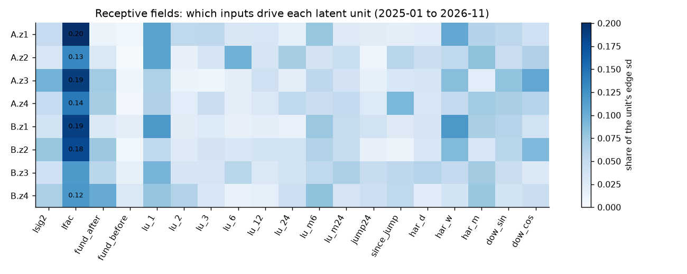
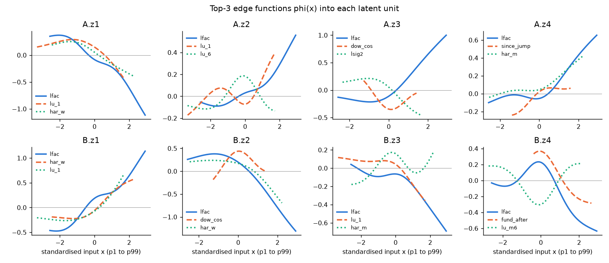
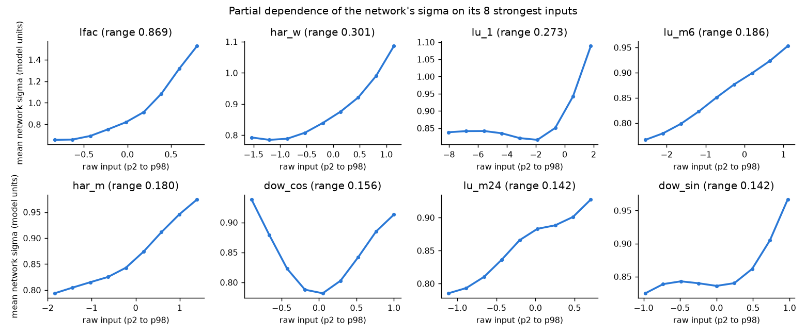
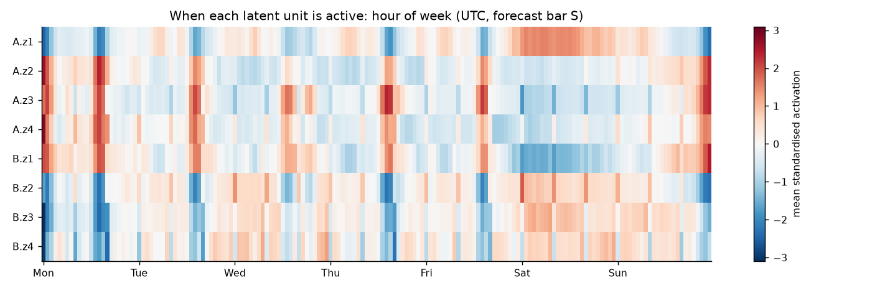
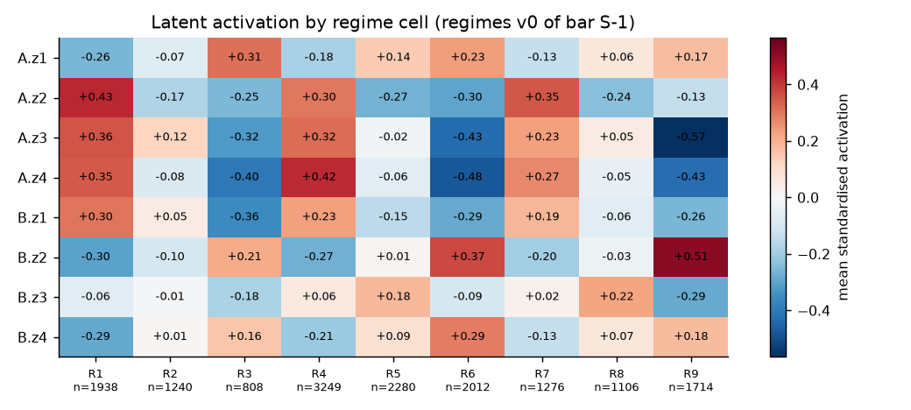
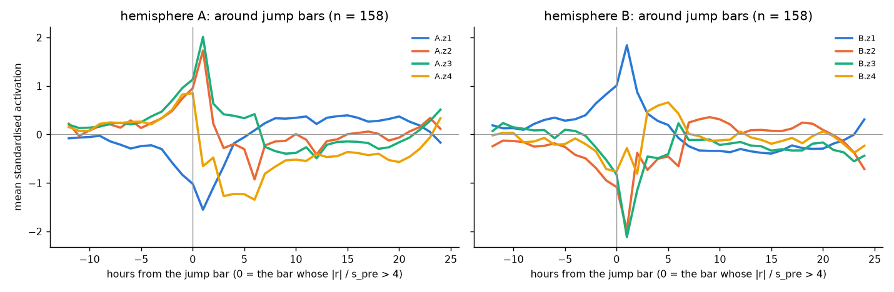
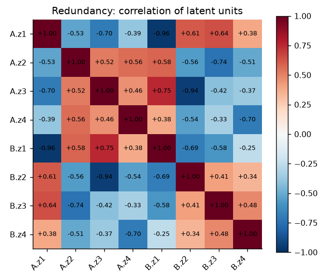
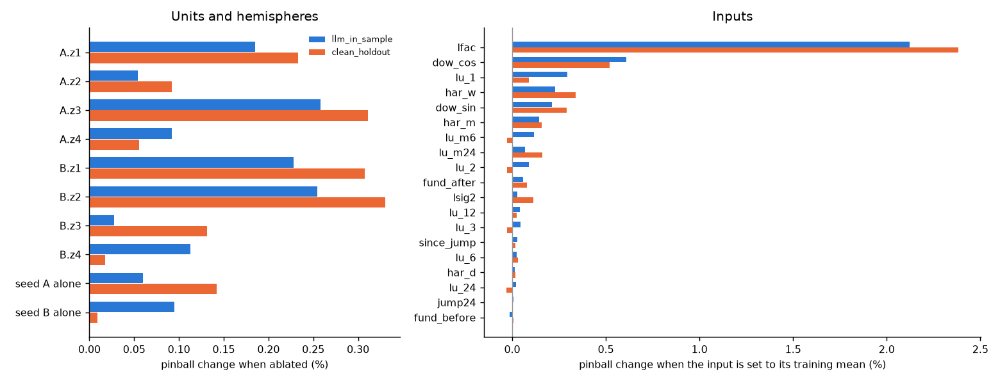

# Neuron atlas of the live 1h network (2026-11-15)

Descriptive, historical study of the frozen live v1 1h network (polynomial-edge PNN, refit 2026-11,
`wf_1h/2026-11.pt`, sha `e7c756d55281b7c0`, both seeds as the live line averages them). It feeds the live brain map
(`research/live/dashboard/brain.html`) and the "orderly complexity" protocol at the end. **Nothing here is a test.**
The network was fit on rows up to 2025-11-12 and early-stopped on 2025-11-14..2026-10-30, so almost every hour below
is in-sample or validation *for the network itself*. Segments follow the research protocol anyway:
`llm_in_sample` (before 2026-07-01, 13,104 h) and `clean_holdout` (from 2026-07-01, 3,239 h).

- Data: `data/models/pnn/cache/btc_1h_2026-11-13.parquet` (the H-PNN1 features), 2025-01-01 00:00 to
  2026-11-12 22:00 UTC, 16,343 complete hours (fit block 7,584, validation 8,448, test 311).
- Forward pass: `ai_trader.livedash.brain.forward_batch` (float64; equal to the live line's torch pass to 1.7e-7 on
  all 43 stored lines). Code: `scripts/brain_atlas.py`. Numbers: `research/reports/brain_atlas_2026-11-15.json`.
- Units: hemisphere A = seed 0, B = seed 1; latent core z1..z4 per hemisphere (8 units), head o1..o7 per hemisphere
  (14 units), quantiles = the mean of the two hemispheres' quantiles.
- Activations are standardised by each unit's own 2025-26 mean and sd.
- Pinball is the mean over the 7 taus in model units (y = r / sqrt(s2)). Full network: 0.2231 overall, 0.2244 in
  `llm_in_sample`, 0.2181 in `clean_holdout`. A constant forecast (the unconditional quantiles) is 3.8% worse
  (+3.7% / +4.5%). The whole network's edge over "no model" is about 4% of pinball, and every ablation below
  should be read against that.

## 1. Receptive fields: what drives each unit

Share of each latent unit's edge variation (sd of phi_ji(x_i) over hours, normalised per unit). Signs come from
corr(phi, x).

| unit | top inputs (share, sign) | corr with net sigma | corr with q50 | reading |
|---|---|---|---|---|
| A.z1 | lfac .20 (-), lu_1 .11 (-), har_w .11 (-), lu_m6 .08 (-) | -0.88 | +0.08 | **calm detector**: low seasonal factor, small last move, low weekly RV |
| B.z1 | lfac .19 (+), har_w .12 (+), lu_1 .12 (+), lu_m6 .08 (+) | +0.88 | -0.05 | the mirror of A.z1 (r = -0.96) |
| A.z3 | lfac .19 (+), dow_cos .11, lsig2 .10 (-), har_w .09 (+) | +0.85 | -0.27 | **relative-vol clock**: seasonal factor and weekly RV *relative to the base*; falls as the base vol rises |
| B.z2 | lfac .18 (-), dow_cos .09, har_w .09 (-), lsig2 .08 (+) | -0.82 | +0.31 | the mirror of A.z3 (r = -0.94) |
| A.z2 | lfac .13 (+), lu_1 .11 (+), lu_6 .10 (U-shaped), har_m .08 (+) | +0.70 | -0.15 | **recent-shock unit**: last-hour move plus the monthly level |
| B.z3 | lfac .12 (-), lu_1 .09 (-), har_m .07, lu_m24 .07, har_d .06 (-) | -0.66 | +0.05 | closest to the mirror of A.z2 (r = -0.74) |
| A.z4 | lfac .14 (+), since_jump .09 (+), har_m .07, fund_after .07 (+), dow_sin .07 | +0.61 | **-0.54** | **after-shock / skew unit**: time since the last jump, the funding hour; moves the median |
| B.z4 | lfac .12 (-), fund_after .10 (-), lu_m6 .08, lu_1 .08 (+) | -0.54 | **+0.47** | partly mirrors A.z4 (r = -0.70); the other skew carrier |

`lfac` (the hour-of-week seasonal variance factor) is the top input of **all eight** units, with 12-20% of each
unit's edge variation. The network spends a large part of its capacity re-encoding a deterministic seasonal profile.

Edge shapes. The strong units are near-monotone: in the z1 pair, lfac, lu_1 and har_w all slope the same way, and in
A.z3 lfac rises while lsig2 falls. The weak units use bumps. A.z2 has an inverted U in lu_6 (peak at a typical size)
and a wiggly, then steeply rising, lu_1. B.z4 has a hump in lfac and a U in lu_m6. These non-monotone edges sit in
the units with the smallest ablation value (<= 0.1% of pinball, section 4). That hints the degree-4 curvature there
may be fitting noise rather than structure. fund_after (binary) and dow_* (7 values) take only a few values, so
their curves are interpolations between those points.

Partial dependence of the network's sigma (model units, ICE mean over 3,000 hours, inputs from p2 to p98):

| input | lfac | har_w | lu_1 | lu_m6 | har_m | dow_cos | lu_m24 | dow_sin | lu_24 | lu_2 | har_d | lsig2 | jump24 | fund_* | since_jump |
|---|---|---|---|---|---|---|---|---|---|---|---|---|---|---|---|
| sigma range | 0.87 | 0.30 | 0.27 | 0.19 | 0.18 | 0.16 | 0.14 | 0.14 | 0.09 | 0.08 | 0.07 | 0.07 | 0.03 | 0.03 | 0.03 |

The 14 head units (o1..o7 per hemisphere) read their latents in two patterns. The tail and spread heads
(o1-o3, o5-o7) draw on z1 and z3 in A, and on z1 and z2 in B. The median head o4 draws mostly on **z4** (A.o4: 0.42 of
its edge sd from z4, 0.30 from z2; B.o4: z3 0.34, z4 0.37). So **z4 is each hemisphere's location/skew channel and
z1-z3 carry scale.**

## 2. When each unit is active

- **Hour of week.** This is the strongest structure in every unit: the peak-to-trough amplitude of the hourly mean is
  3.5-4.3 sd. A.z1 (calm) peaks Saturday 05 UTC and bottoms Monday 00 UTC. A.z3 (relative vol) peaks Thursday 14 UTC
  (US open) and bottoms Saturday 00 UTC. A.z2 peaks Monday 00 UTC (the weekend-to-week transition). The latent core
  is first of all a weekly clock.
- **Regime cells** (regimes v0 of bar S-1, known at S):
  
  The vol units sit *above* their mean in the low-vol cells (A.z3: R1 +0.36, R4 +0.32, R7 +0.23) and *below* it in
  the high-vol cells (R3 -0.32, R6 -0.43, R9 liquidation -0.57); the mirrors do the opposite. The units forecast vol
  *relative to the base s2*, so this is mean reversion: when the base is already high, the network expects the next
  hour to be smaller in base units. A.z2 (recent shock) is high in R1/R4/R7 (+0.43/+0.30/+0.35). B.z4 tracks R6
  whipsaw (+0.29) and R9 (+0.18).
- **Around jumps** (n = 158 jump bars, |r| / s_pre > 4; lag 0 = the jump bar, whose inputs predate the jump):
  
  Every vol unit drifts toward "more vol" over the 5 h *before* jump bars (A.z3 +0.34 sd on average over lags -12..-1;
  +1.1 sd at lag 0). Jumps cluster in high-seasonal hours and after shocks, and the units see that. At lag +1 (the
  jump is now in lu_1) A.z3, A.z2 and B.z1 spike to +1.7..+2.0 sd and revert within 3-6 h. **A.z4 behaves
  differently**: it collapses to -1.3 sd at +3..+6 h and stays negative for about 20 h, while B.z4 rises to +0.6 at
  +3..+5 h. The z4 units carry the after-shock memory (since_jump), not the spike.

## 3. Sparsity

| unit | share \|a\| > 1 sd | share \|a\| > 2 sd | excess kurtosis |
|---|---|---|---|
| A.z1 / A.z2 / A.z3 / A.z4 | 30.2% / 29.6% / 26.7% / 29.7% | 5.1% / 4.7% / 6.1% / 5.0% | 0.15 / 0.81 / 1.07 / 0.46 |
| B.z1 / B.z2 / B.z3 / B.z4 | 31.1% / 27.1% / 28.6% / 30.8% | 5.0% / 5.9% / 4.9% / 4.6% | 0.10 / 1.26 / 0.98 / 0.34 |

A Gaussian gives 31.7% and 4.6%. **No unit is sparse.** The code is dense and distributed: every unit is "on" about
as often as a normal variable. A.z3 and B.z2 (the relative-vol pair) are the most heavy-tailed, kurtosis about 1.

## 4. Redundancy

- **The two hemispheres learned the same two main units**, with the sign flipped: A.z1 ~ -B.z1 (r = -0.96) and
  A.z3 ~ -B.z2 (r = -0.94). The other two pairs are looser: A.z2 ~ -B.z3 (-0.74) and A.z4 ~ -B.z4 (-0.70).
- **Ablation** (unit set to its 2025-26 mean, that hemisphere's head re-run; change in mean pinball, %):

  | removed | all | llm_in_sample | clean_holdout |
  |---|---|---|---|
  | A.z1 | +0.20 | +0.19 | +0.22 |
  | A.z2 | +0.06 | +0.05 | +0.09 |
  | A.z3 | +0.27 | +0.26 | +0.31 |
  | A.z4 | +0.09 | +0.09 | +0.06 |
  | B.z1 | +0.24 | +0.23 | +0.31 |
  | B.z2 | +0.27 | +0.25 | +0.33 |
  | B.z3 | +0.05 | +0.03 | +0.13 |
  | B.z4 | +0.09 | +0.11 | +0.02 |
  | hemisphere B removed (seed A alone) | +0.08 | +0.06 | +0.14 |
  | hemisphere A removed (seed B alone) | +0.08 | +0.10 | +0.01 |

  No single unit is worth more than 0.3% of pinball, about 8% of the network's 4% edge over a constant. Losing a
  whole hemisphere costs only 0.08%: the 2-seed ensemble is mostly variance reduction, not extra function. The
  weakest units are A.z2, B.z3 and the z4 pair (<= 0.1%).
- **Input ablation** (input set to its training mean; % change in pinball, all / llm_in_sample / clean_holdout):

  | input | lfac | dow_cos | lu_1 | har_w | dow_sin | har_m | lu_m6 | lu_m24 | lu_2 | fund_after | lsig2 | lu_12 | lu_3 | since_jump | lu_6 | har_d | lu_24 | jump24 | fund_before |
  |---|---|---|---|---|---|---|---|---|---|---|---|---|---|---|---|---|---|---|---|
  | all | +2.17 | +0.59 | +0.26 | +0.25 | +0.23 | +0.15 | +0.09 | +0.09 | +0.07 | +0.06 | +0.04 | +0.04 | +0.03 | +0.03 | +0.03 | +0.01 | +0.01 | +0.01 | -0.01 |
  | in-sample | +2.12 | +0.61 | +0.30 | +0.23 | +0.21 | +0.14 | +0.12 | +0.07 | +0.09 | +0.06 | +0.03 | +0.04 | +0.04 | +0.03 | +0.02 | +0.01 | +0.02 | +0.01 | -0.01 |
  | holdout | +2.38 | +0.52 | +0.09 | +0.34 | +0.29 | +0.16 | -0.03 | +0.16 | -0.03 | +0.08 | +0.11 | +0.03 | -0.03 | +0.02 | +0.03 | +0.02 | -0.03 | +0.00 | +0.01 |

  

  Taken one at a time, the calendar inputs (lfac, dow_cos, dow_sin) are worth +2.17, +0.59 and +0.23%, about 3.0 of the network's 3.8 points over a constant (ablations are not additive, so this is a rough share).
  Four inputs are dead: fund_before, jump24, lu_24 and har_d, each under 0.03% in both segments, and jump24
  contributes through since_jump at most. lu_1, the single noisy squared return of the last bar, is the most
  useful *data* input in-sample (+0.30%) but drops to +0.09% in the holdout.

### What the atlas means for the live brain map

On the map, the five intra-hour inputs (lu_1, lu_m6, lu_m24, jump24, since_jump) reach the core mostly through
lu_1 -> {A.z1, B.z1, A.z2} and lu_m6 -> {A.z1, B.z1}. Expect the z1 pair and A.z2 to fire most as price moves, and
z4 to fire on range excursions (since_jump). The hour-of-week inputs, the strongest drivers here, are frozen within
the hour, so the live map shows the network's *least* important pathway firing. That is honest, and it is the
reason H-BR1 has a prior of only 0.30.

## 5. A proposed "orderly complexity" protocol

The aim is to grow the network one unit or one input at a time, each step pre-registered and kept only if it beats
the smaller network out of sample. This follows principle 5's linear-first complexity budget: the cheapest
structure that explains the data wins, subtraction comes before addition, and every step is a falsifiable hypothesis.

1. **Baselines are fixed per round.** The incumbent N0 (the network above), the linear log-HAR-t quantile baseline
   stored in the same checkpoint, and the constant quantiles. An addition must beat N0, and N0 must still beat
   log-HAR-t on the same months (otherwise the round is about the baseline, not the addition).
2. **One change per hypothesis.** One input, one unit, or one structural change (seeds, degree). Each is registered in
   `research/hypotheses.yaml` (family `brain_growth`) *before* any fit: the exact feature construction (point in
   time, `as_of` tested), the parameter delta, and the success rule.
3. **The same training recipe as N0.** Purged monthly walk-forward (expanding, `pnn_study` blocks), the same seeds,
   hyperparameter grid, early stopping and Standardizer. Nothing is tuned per candidate.
4. **Success rule.** The paired per-hour pinball difference (candidate - N0) has mean < 0 with HAC (Newey-West on
   daily means) t < -2 in `clean_holdout`, and is not significantly worse (t < +2) in `llm_in_sample`. The gain must
   also beat the parameter cost: at least 0.05% of pinball per 100 added parameters (a new input costs
   4 x 5 = 20 parameters per seed; a new latent unit costs 19 x 5 + 1 + 7 x 5 = 131 per seed). Holm correction
   across the hypotheses of one round.
5. **Atlas check before acceptance.** Re-run `scripts/brain_atlas.py` on the candidate. The new input or unit must
   carry a non-trivial receptive field, and a new unit must have |corr| < 0.9 with every existing unit (no
   mirror-duplicate). Its ablation must be at least the size of the weakest existing unit.
6. **Forward before live.** An accepted candidate runs as a shadow line (like live_nn_v2) for at least 300 hours and
   must not be worse forward. Only then does it replace v1, which starts a new track record (principle 8: new model
   id, new prompt or tool versions).
7. **Record everything.** Every result goes to `hypotheses_results.jsonl`, including rejections, and to the diary.
   A rejected change is not retried in a new form without a new registration.

### Proposed first additions (suggested by the atlas; **not registered**: for the main session and the user to decide)

1. **Subtract the dead inputs first.** Drop fund_before, jump24, lu_24 and har_d (each under 0.03% ablation in both
   segments): 19 -> 15 inputs, -80 parameters per seed. Rule: the 15-input net is not worse (paired t < +2 in both
   segments). This shrinks the network before anything is added and makes the remaining receptive fields easier to read.
2. **Move the seasonal factor out of the network.** lfac dominates all eight units and carries 2.2% of pinball. Make
   it a deterministic scale, like s2: model y = r / sqrt(s2 fac) and drop lfac (and possibly dow_*) as inputs. This
   is a linear-first move: a known multiplicative profile instead of learned nonlinear capacity. It should free the
   units to encode state rather than the clock. Success: pinball not worse, and in the atlas re-run lfac no longer
   tops the receptive fields.
3. **One input: a cleaner last-hour variance.** Replace or add to lu_1 (one noisy squared return; its usefulness
   falls from +0.30% to +0.09% in the holdout) with the log 1-minute realised variance of bar S-1 over s2, computed
   from the lake's 1m bars (point-in-time at S). This is the historical, testable cousin of the live nowcast recipe.
   If it wins, it also tells H-BR1 which partial-hour statistic to feed.
4. **One input: scheduled-event hour.** The units' strongest non-clock peaks sit at US-session hours (Thursday
   14 UTC). Add a 0/1 flag for a scheduled macro release inside bar S, from `research/calendar` (known in advance,
   so no lookahead). It costs 20 parameters per seed.
5. **One structural step: one hemisphere with latent 5 instead of two redundant hemispheres of 4.** The seeds
   duplicate z1 and z3 (|r| >= 0.94) and either seed alone costs only 0.08%. Test a single seed with LATENT = 5
   (one new unit, +131 parameters against the 2 x 4 ensemble's duplicated core) against N0. If it holds, the freed
   seed budget becomes a clean "one unit at a time" ladder (5 -> 6 ...), each rung registered separately.

Order: 1 and 2 (subtractions or re-scalings) first, then 3 and 4 (single inputs, each against the winner of 1-2),
then 5. That keeps the complexity budget monotone and each comparison one-dimensional.
