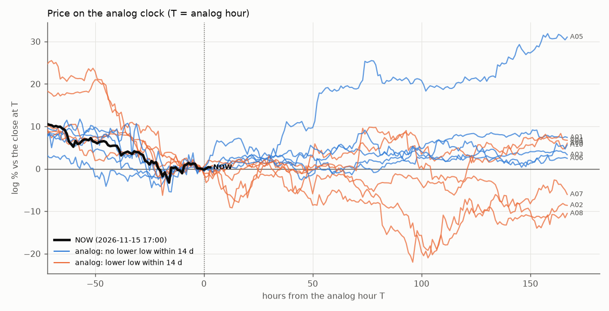
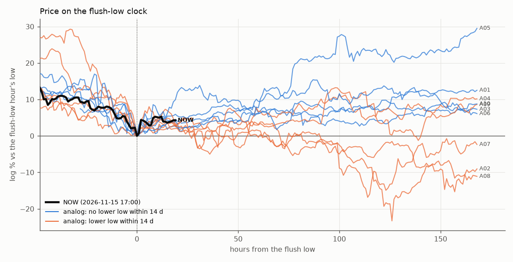
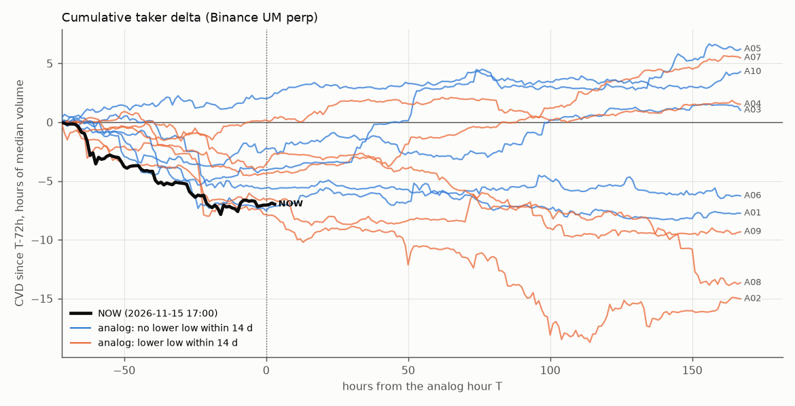
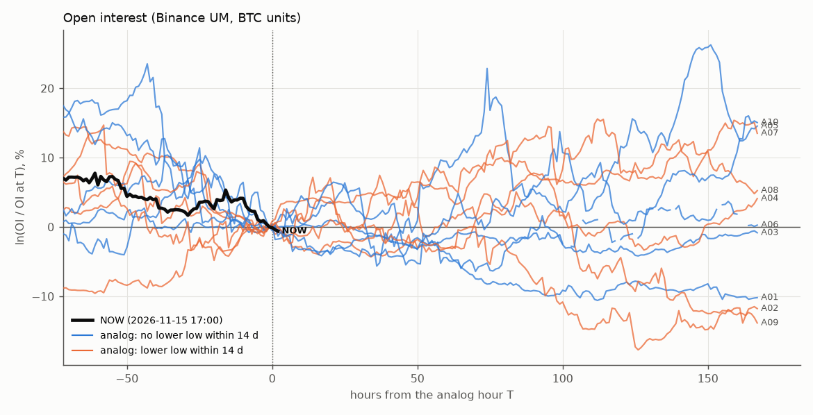
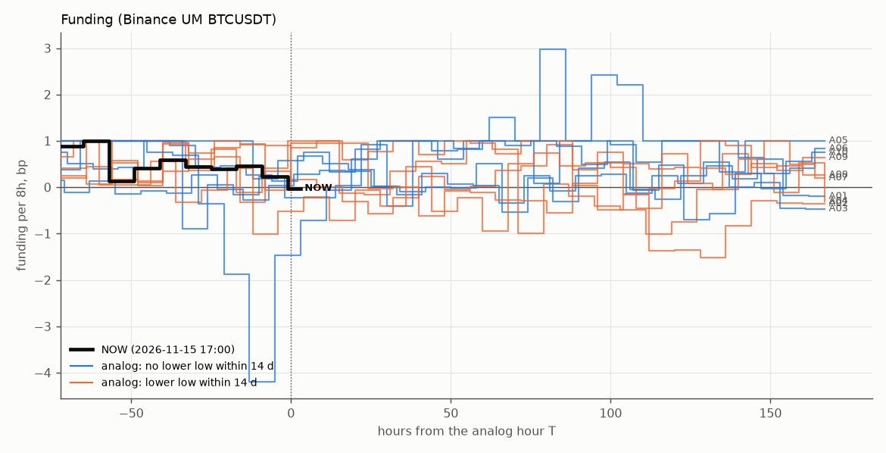
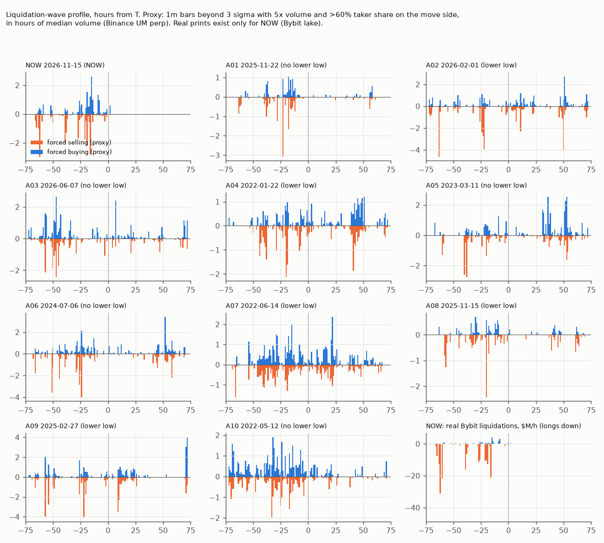
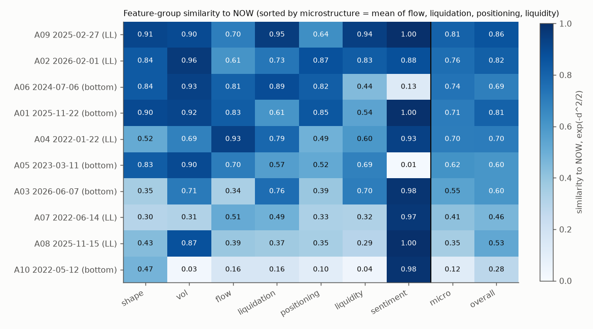
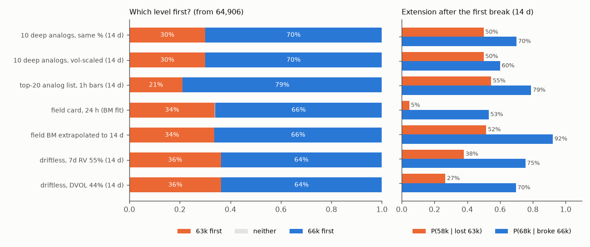

# Deep analogs: what the order books, flows and positioning looked like at the top-10 analogs, and whether 61,899 was the bottom (2026-11-15)

Agent DEEP. Research only. Code: `src/ai_trader/research/deep_analogs_study.py` (download and reduce), `deep_analogs_features.py` (fingerprints, similarity, outcomes, level models), `deep_analogs_figures.py`, `deep_analogs_report.py`. Numbers: `research/reports/deep_analogs_2026-11-15.json`; aggregates and the download manifest: `data/research/deep_analogs/`. Moves are log returns unless marked otherwise. Price reference for the level work: **P0 = 64,906 (Bybit last, 2026-11-15 20:26 UTC)**.

> **Read this first.** This is a description, chosen after seeing today. The ten episodes are the top-10 combined analogs of `analogs_2026-11-15.md`, and that search was run on today's market. H-ANA1 (analog searches like this do not forecast: *contradicts* before the knowledge cutoff, *inconclusive* after it) still holds. Ten episodes are far too few for any frequency here to be a reliable probability; read every "x of 10" as "it has happened, roughly this often, in a handful of cases".

## The short answer

- **Microstructure.** On flows, liquidations, positioning and liquidity, the analogs closest to now are A09 (2025-02-27, Bybit hack and tariffs, similarity 0.81), A02 (2026-02-01, before the Feb 5 crash to 60k, 0.76), A06 (2024-07-06, Mt Gox and German sales, 0.74), A01 (2025-11-22, the Nov 2025 low, 0.71) and A04 (2022-01-22, 0.70). Those five split 3 to 2 towards a lower low (A09, A02, A04 undercut; A06, A01 did not). The microstructure does not pick a branch.
- **What happened next.** 5 of 10 analogs undercut their flush low within 14 days. Three were deep continuations (A02 -23%, A07 -17%, A08 -15% below the low). Two were shallow retests that then rallied (A04 -3% then +18%; A09 -0.2% at once, +10% bounce, then -7% on day 11). The 5 that held rallied +8% to +36% within 14 days.
- **Capitulation markers.** The forced-selling half of a bottom is present (9:1 long liquidations, volume about 9x normal, Fear & Greed 10, top traders cut their long positioning). The positioning-reset half is missing: open interest fell only about 6.5-7% into the low (the analogs: median -13% on Binance, up to -28% on Bybit), funding is barely negative, DVOL is only 44, and there is no sign of sellers being absorbed (the CVD low came at the price low, not after it).
- **The user's levels**, from P0 = 64,906 (63k is -2.98%, 66k is +1.67%):
  - Every source puts **66k first** at about 64-79% and **63k first** at about 21-36%.
    - Most of that tilt is geometry: 66k is closer, and a driftless random walk alone gives 64/36.
    - All 10 analogs traded at least +1.7% above their analog close within 14 days.
  - **Losing 63k → 58k:** 27-55% conditional, depending on the source.
  - **Breaking 66k → 68k:** 60-79% conditional.
  - A 66k break does not end the risk. A08 went +2.4% first and then fell 15%.
- **Verdict: P(the bottom is in, i.e. no print below 61,899 within 14 days) = 0.40; P(lower low) = 0.60.** The thesis YAML is at the end.

## Data actually used (and what is missing)

| source | what | coverage |
|---|---|---|
| Binance UM perp (data.binance.vision) | 1m klines with taker-buy volume (delta, CVD, volume climax, liquidation proxy) | all 11 episodes, T-33d..T+14d; NOW to 2026-11-15 20:25 via public REST |
| Binance `metrics` | OI (5 min), top-trader account and position L/S, global account L/S, taker L/S volume ratio | all; top-trader ratios are empty in 2022-01 (A04) and 2022-05 (A10) |
| Binance fundingRate | 8h funding | all (Nov 2026 via REST) |
| Binance spot 1m | spot-perp basis | all |
| Binance `bookDepth` | notional within +-0.2/1/2/3/4/5% | from 2023 (A01-A03, A05, A06, A08, A09); not yet published for 2026-11-15, so NOW uses Bybit `flow_3s` depth within 100 bp |
| Binance liquidationSnapshot | real liquidation orders | **UM (USDT) does not exist in the archive.** Coin-margined BTCUSD_PERP exists only from 2023-06-25 into 2024: just A06 has it (72h: $15.8M longs vs $2.7M shorts) |
| Bybit public trades | tick trades, T date +-1 (NOW: 11-13, 11-14, then `flow_3s`), 1m aggregates, $250k+ and $1M+ prints, 10x-median delta bursts | all 11 |
| Bybit ob200 | 200-level book, 1m samples | only from 2025: A01, A02, A03, A08, NOW (11-14). BTC's 200 levels span only about 7-10 bp across both sides, so ob200 **cannot** measure depth at 25/50/100 bp; it only measures liquidity at the touch |
| Bybit funding, 4h OI (lake) + REST 1h OI | cross-check | all |
| Bybit liquidations (lake) | real prints | NOW only (lake from 2026-11-08) |
| Deribit DVOL, Fear & Greed (lake) | | all |
| OKX BTC-USDT-SWAP 1H (REST, no key) | price cross-check | all: median gap vs Binance -0.3 to +5 bp; OKX funding history only reaches ~3 months back, so it is used for NOW only |
| Deribit options summary | | not used (no cheap history) |

Downloads were one file at a time, with raw files deleted after each was reduced (peak transient about 0.44 GB). The aggregates total 109 MB, and every URL is recorded in `manifest.json` and `manifest_ob200.json`.

**Liquidation proxy.** Real liquidation prints exist only for NOW, so every episode gets the same proxy, computed on Binance 1m bars. A minute counts as forced selling when all three hold:
- the 1m return is below -3 sigma (1m sd over T-30d..T-3d);
- quote volume is above 5x its median;
- taker sells are more than 60% of the volume.

Forced buying is the mirror image.

## Now, in plain words (T = 2026-11-15 17:00 UTC)

**Price.** BTC is 27% below its 30-day high and 10% down over 72 hours. It closed at 64,674, 4.3% above the 61,956 Binance low (61,899 on Bybit) printed 15 hours earlier.

**Volume.** Volume peaked at 9.3x its 30-day median hourly volume; the low hour was 8.5x.

**Flows.** Takers were net sellers by 3.7% of volume over 72 hours, the most one-sided of all 11 episodes. CVD bottomed in the same hour as price (no lead). Since the low, takers have been flat (+0.6%), so the bounce was not bought aggressively. In the first three hours after T, Bybit takers turned buyers (+21% delta).

**Liquidations.** Bybit liquidated $187M of longs vs $20M of shorts in 72 hours. The forced-selling proxy came to 23.6 hours of median volume.

**Positioning.**
- Binance OI fell 6.5% into the low and has not rebuilt (-1.7%). Bybit OI fell 6.9% and rebuilt +3.4% (the "new shorts" of the post-cascade report).
- Funding is barely negative: Binance -0.02 bp per 8h, Bybit -0.12 bp.
- Top-trader position L/S fell 16% in 72 hours (top traders cut longs). The global account L/S fell 10%.

**Liquidity.** Basis is -4.6 bp. Depth within 100 bp thinned to 65% of its pre-cascade level and is back to 88%. Bybit's touch book (ob200) on 11-14 was thicker than in the 2025-26 analogs ($13.9M vs $8-9M within the 200 levels).

**Vol and sentiment.** 24h realised vol is 83% annualised (2.5x its 30-day median). DVOL is 44.4 (+13% vs its 30-day median). Fear & Greed is 10.



_Price on the analog clock (log % vs the close at T). Blue: no lower low within 14 days; orange: lower low; black: now._



## What happened after each analog

Flush low = the lowest 1m print in the 72 h before T (Binance perp). Rebound = highest high within 14 days vs the close at T. Catalysts are from news coverage (sources at the end).

| # | T (UTC) | flush low | lower low in 14 d? | how deep, when | high before the undercut / max 14 d | 30 d | what drove it |
|---|---|---|---|---|---|---|---|
| A01 | 2025-11-22 06:00 | 80,600 (11-21) | **no** | min +3.5% above, 5 h after T | +11.1% | held (+5% at 30 d) | NY Fed Williams (11-21): "room for further adjustment"; December cut odds ~39% → ~70-85%; BTC back above 91k |
| A02 | 2026-02-01 16:00 | 75,500 (01-31) | **yes, deep** | -23.3%, 104 h (59,800 on Feb 5) | +1.1% / +2.2% | -23% | No relief catalyst: ETF outflows (net sellers in 2026), forced liquidations (> $2.5B), the "crisis of faith" crash to 60k |
| A03 | 2026-06-07 15:00 | 59,080 (06-05) | **no** | min +2.7%, 66 h | +8.3% | undercut -2.3% about 4 weeks later (the 57.7k 1-year low in early July) | Strategy's BTC sale, 13 days of ETF outflows, Iran tensions; the bounce faded into July |
| A04 | 2022-01-22 17:00 | 33,950 (01-22) | **yes, shallow** | -3.3%, 44 h (Mon 01-24 equity sell-off before the 01-26 FOMC) | +3.9% / +17.8% | +9.7% | Fed tightening; a capitulation retest, then a rally once the FOMC was out |
| A05 | 2023-03-11 10:00 | 19,522 (03-10) | **no** | +2.2%, 2 h | +36.3% | +34% | SVB: Fed BTFP / FDIC backstop on 03-12 (the textbook "central bank intervenes" bottom) |
| A06 | 2024-07-06 04:00 | 53,330 (07-05) | **no** | +1.7%, 45 h | +17.8% | undercut -2.2% at the 08-05 yen-carry crash | Mt Gox repayments + German government selling; the sales finished 07-12 and BTC rallied to about 66k |
| A07 | 2022-06-14 20:00 | 20,823 (06-14) | **yes, deep** | -16.9%, 97 h (17,593 on 06-18) | +0.8% / +3.6% | -17% | Celsius freeze, 3AC insolvency, Fed +75 bp on 06-15: forced sellers still to come |
| A08 | 2025-11-15 00:00 | 93,955 (11-14) | **yes, deep** | -15.3%, 156 h (80,600 on 11-21) | +2.4% | -15% | Fading December cut odds, ETF outflows, the AI-equity wobble around Nvidia's results: the lower low that became A01 |
| A09 | 2025-02-27 16:00 | 82,222 (02-26) | **yes, shallow then deeper** | first undercut 9.5 h (78k), lowest -7.1% at 273 h (76,560 on 03-11) | +0.2% / +10.5% | -7% | Bybit hack (02-21), tariffs; the 03-02 "strategic reserve" post spiked it to about 94k, then it faded when the 03-06/07 details brought no new buying |
| A10 | 2022-05-12 21:00 | 26,631 (05-12) | **no** | +4.8%, 328 h | +9.5% | held 30 d; broke down in June (A07) | LUNA/UST collapse; a 4-week relief before the June leg |

**What the outcomes say:**
- **Held within 14 days (5):** A01, A03, A05, A06, A10. Each held because a seller ran out (German sales, LUNA unwind) or a policy put arrived (Williams, the BTFP).
- **Undercut (5):** A02, A04, A07, A08, A09. The deep ones (A02, A07, A08) had a forced seller still in the pipe: ETF redemptions, Celsius/3AC, or fading cut odds.
- **Undercut, then rallied anyway (2 of the 5):** A04 and A09.
  - A04 ended the 14 days +16%; A09 bounced +10% before the deeper low on day 11.
  - So a lower low is not the same as a bad 14-day return. Of the 5 that undercut, 2 were higher after 7 days.
- **Held 14 days, undercut later (2 of the 5 holders):** A03 and A06 broke their lows within about 4 weeks, on new shocks.



_Cumulative taker delta since T-72h, in hours of median volume. Now is among the most negative at T: the selling was aggressive and nothing has absorbed it yet._



_Open interest relative to T. Several analogs that bottomed (A05, A06, A10) had flushed far more OI on the way in._





_The liquidation-wave profile (proxy, Binance 1m) and, for now, the real Bybit prints. Now's real long liquidations came in four waves (11-12 evening, 11-13, 11-14 evening, 11-15 night)._

Basis and DVOL overlays: `basis.png`, `dvol.png` in the figures folder.

## How similar is now, really

Similarity per feature group = exp(-d²/2), where d is the RMS gap to now over the group's features, each scaled by its spread across the 11 episodes. "Micro" is the mean of the flow, liquidation, positioning and liquidity groups; "overall" adds shape, vol and sentiment.



**Ranking on microstructure:**

| rank | analog | micro | flow | liquidation | positioning | liquidity | overall | outcome |
|---|---|---|---|---|---|---|---|---|
| 1 | A09 2025-02-27 | 0.81 | 0.70 | 0.95 | 0.64 | 0.94 | 0.86 | lower low (shallow, then -7% on day 11) |
| 2 | A02 2026-02-01 | 0.76 | 0.61 | 0.73 | 0.87 | 0.83 | 0.82 | lower low (deep, -23%) |
| 3 | A06 2024-07-06 | 0.74 | 0.81 | 0.89 | 0.82 | 0.44 | 0.69 | held, +18% |
| 4 | A01 2025-11-22 | 0.71 | 0.83 | 0.61 | 0.85 | 0.54 | 0.81 | held, +11% |
| 5 | A04 2022-01-22 | 0.70 | 0.93 | 0.79 | 0.49 | 0.60 | 0.70 | lower low (shallow, -3%), then +18% |
| 6 | A05 2023-03-11 | 0.62 | 0.70 | 0.57 | 0.52 | 0.69 | 0.60 | held, +36% |
| 7 | A03 2026-06-07 | 0.55 | 0.34 | 0.76 | 0.39 | 0.70 | 0.60 | held, +8% |
| 8 | A07 2022-06-14 | 0.41 | 0.51 | 0.49 | 0.33 | 0.32 | 0.46 | lower low (deep, -17%) |
| 9 | A08 2025-11-15 | 0.35 | 0.39 | 0.37 | 0.35 | 0.29 | 0.53 | lower low (deep, -15%) |
| 10 | A10 2022-05-12 | 0.12 | 0.16 | 0.16 | 0.10 | 0.04 | 0.28 | held, +10% |

**Truly similar on microstructure, not just shape.**
- **The closest group.** A09, A02, A06, A01 and A04 match now on flow and liquidation as well as on price shape. Weighting all ten outcomes by micro similarity gives P(lower low within 14 d) = 0.53 and P(a deep lower low, more than 10% below the flush low) = 0.26.
- **The tail cases match only on shape.**
  - A07 and A10 (2022): vol was far higher (rv24 168-211% vs 83%) and funding far more negative.
  - A08: flushed almost no OI and had positive funding.
- **A06 is the one positive reading among the closest.** It matches on flow and positioning but had sentiment at 26 (not 10) and thicker liquidity. It was a seller-exhaustion bottom with an identifiable end date for the selling.

Note on A02: it is the second-closest on microstructure, and its positioning similarity (0.87) is the highest. Its next week was the Feb 5 crash.

## Capitulation markers: now vs the analogs that held and the ones that undercut

Medians of the 5 that held (A01, A03, A05, A06, A10) and the 5 that made a lower low (A02, A04, A07, A08, A09). "Closer to" uses the cross-episode spread and needs a gap of at least 0.15 sd. n is 5 per group, so every row is anecdotal.

| marker | now | held (median) | lower low (median) | now closer to |
|---|---|---|---|---|
| volume climax, max 1h / 30d median | 9.3x | 11.7x | 8.1x | lower low |
| volume in the low hour | 8.5x | 6.6x | 7.8x | lower low |
| forced-selling proxy, h of median vol (72 h) | 23.6 | 18.5 | 21.5 | lower low |
| OI flush into the low (Binance) | -6.5% | -12.9% | -12.9% | **neither: both groups flushed about twice as much** |
| OI flush into the low (Bybit) | -6.9% | -14.6% | -23.5% | neither (same message, and the undercut group flushed even more) |
| OI change, low → T (Binance) | -1.7% | +0.2% | +3.4% | held |
| funding at T (Binance, bp/8h) | -0.02 | +0.04 | +0.34 | held |
| funding 72h min | -0.02 | -0.28 | -0.11 | neither |
| negative funding prints in 72 h | 1 | 3 | 1 | lower low |
| top-trader position L/S, 72 h change | -16% | -7% | +4% | **held** (top traders were cutting longs into the lows that held) |
| taker buy/sell ratio, 24 h | 0.97 | 1.01 | 1.00 | lower low |
| taker delta share, 72 h | -3.7% | -2.2% | -2.6% | lower low |
| taker delta, low → T | +0.6% | +1.1% | -0.4% | held |
| hours the CVD low led the price low (negative = CVD kept falling after the price low) | 0 | -16 (A01 -16, A03 -23, A06 -21) | 0 (all within -2..+12) | **lower low** (no absorption yet) |
| price retrace minus CVD retrace | 0.17 | 0.21 | 0.08 | neither |
| basis, last 6 h | -4.6 bp | -4.7 | -4.9 | held |
| depth +-1% at T vs pre-cascade | 0.88 | 1.01 | 0.86 | lower low |
| depth min vs pre-cascade | 0.65 | 0.73 | 0.73 | neither |
| 24h RV / 30d median | 2.5x | 2.3x | 2.5x | lower low |
| DVOL vs its 30d median | +13% | +24% | +10% | **lower low** (no implied-vol capitulation) |
| Fear & Greed | 10 | 12 | 10 | lower low |
| drawdown from the 30d high | -27% | -29% | -23% | held |
| rebound off the low at T | +4.3% | +4.6% | +3.3% | held |

Tally over all 28 markers in the JSON (the table shows 23): 8 closer to the held group, 12 closer to the lower-low group, 8 neither. The cleanest separator in this sample is the CVD lead. In 3 of the 5 that held (A01, A03, A06), takers kept selling 16-23 hours after the price low while price held; in none of the 5 that undercut did that last more than 2 hours. Now: 0 hours. Funding at T and top-trader positioning lean the other way (towards the held group), but they are noisier: A02, which undercut by 23%, also had top traders cutting (-13%).

## The case for "this is the bottom"

1. **The forced-selling wave happened, in size and in waves.**
   - Bybit liquidated $187M of longs vs $20M of shorts in 72 hours (9:1).
   - Hourly volume hit 9.3x its median; the low hour was 8.5x.
   - The forced-selling proxy (23.6 h of median volume) matches A02, A06 and A09.
2. **Positioning was cut where it matters.**
   - Top-trader position L/S fell 16% in 72 hours. In the analogs that held it fell 2-20% (median 7%); in those that undercut, the median rose 4% (A08 +12%, A09 +15%), though A02 also fell 13%.
   - Funding is flat to negative, not rich.
3. **Sentiment is at the floor.**
   - Fear & Greed is 10, and the drawdown is 27% from the 30-day high and 41% from the 1-year high.
   - This is the depth at which A01 (Nov 2025) and A05 (SVB) turned.
4. **The bounce is starting to be bought.**
   - Since T, Bybit takers are net buyers (+21% delta in 3 hours) and price is back near 65k.
   - The touch book on Bybit is thicker than in the 2025-26 analogs.
5. **Geometry favours a bounce first.** In all 10 analogs price traded at least +1.7% above the analog close within 14 days, and in 7 of 10 that came before -3%.

## The case for further selling

1. **The positioning reset is missing.**
   - Open interest fell only 6.5% (Binance) and 6.9% (Bybit) into the low. Both analog groups flushed about twice as much (median -13% Binance; -8% to -28% Bybit).
   - The closest small-flush analog, A08 (-5.7% Bybit, -5.2% Binance), made a 15% lower low a week later.
   - On Bybit, OI has since rebuilt +3.4% while funding went negative: new shorts. R-RB-4 says that is not squeeze fuel.
2. **No absorption.**
   - CVD bottomed with price. In 3 of the 5 analogs that held, takers kept selling 16-23 hours after the low while price held, which is the classic sign of passive buyers absorbing them. That never lasted more than 2 hours in the 5 that undercut, and it has not happened here.
   - Over 72 hours, net taker selling (-3.7% of volume) is the heaviest of the 11 episodes.
3. **No volatility capitulation.** DVOL is 44, only +13% vs its 30-day median; the held group's median was +24%. Options are not pricing panic, so the "final washout" has room to happen.
4. **No catalyst, and the flows are against it.**
   - Spot ETFs are on a 7-day outflow streak (about $2.1-2.35B in November per the 11-15 headlines).
   - Every analog that held had either a seller with an end date (German sales, LUNA) or a policy put (Williams, the BTFP). Now has neither.
5. **The macro theses are not easing.**
   - **Thesis a (bear flattening) is strengthening.** The 2y rose 28 bp over 5 observations to 4.86% (1-year high 4.92%) and the 10y rose 20 bp, so the curve flattened. 10y real yields rose 22 bp in 5 observations.
   - **Thesis d (credit) is mixed.** The credit legs are not: HY OAS fell 12 bp over 5 observations; IG is +5 bp over 20.
   - **Thesis b (equity) is weaker on 5 days**: the S&P 500 is +2.5% and VIX is back to 18.7. Over 20 days the Nasdaq 100 is -4.3%.
   - That divergence is itself a warning. BTC fell about 15% in a week when US equities rose: the weakness is crypto-specific, and an equity wobble (Nvidia on 11-17, FOMC minutes on 11-18) would add to it rather than offset it.
6. **The base rates already favour a touch.**
   - At current vol, a driftless walk touches a level 4.7% below within 14 days 59-66% of the time (77% at the 24h RV).
   - The post-cascade study (R-RB-2): after a flush the low usually lies ahead, a median 54 hours later and later still in the 2026 holdout.
   - The top-20 analog list on 1h bars: 12 of 19 made a lower low within 14 days (63%).

## The user's levels

**The question as stated.** Below 63k, does price test 58k (the 1-year low is 57,756)? Above 66k, does it go to 68k or more (Deribit max pain 68,000-68,500; the 72h high is 72,058)?

From P0 = 64,906 the levels are:
- 63k: -2.98%;
- 66k: +1.67%;
- 68k: +4.66%;
- 58k: -11.25%;
- 61,899: -4.74%.

The analog columns apply the same log distances to each analog's close at T. "Vol-scaled" multiplies them by the analog's 7d RV / now's 7d RV (now 55%).

| source | P(63k before 66k) | P(66k before 63k) | P(58k \| lost 63k) | P(68k \| broke 66k) |
|---|---|---|---|---|
| 10 deep analogs, same % (14 d) | 30% (A02, A07, A09) | 70% | 50% (3 of 6) | 70% (7 of 10) |
| 10 deep analogs, vol-scaled | 30% | 70% | 50% (3 of 6) | 60% |
| top-20 analog list, Bybit 1h (14 d) | 21% | 79% | 55% (6 of 11) | 79% (15 of 19) |
| field card, 24 h (Brownian fit to the touch probabilities: drift +0.63%/d, sigma 5.2%/d) | 34% | 66% | 5% within 24 h | 53% within 24 h |
| field fit extrapolated to 14 d (not what the field was built for) | 34% | 66% | 52% | 92% |
| driftless, 7d RV 55% (14 d, Monte Carlo) | 36% | 64% | 38% | 75% |
| driftless, DVOL 44% (14 d) | 36% | 64% | 27% | 70% |
| driftless, infinite horizon (analytic) | 36% | 64% | 36% (58k before 66k, once at 63k) | 61% (68k before 63k, once at 66k) |



**In plain words.**
- **Which level first.** 66k-first at about two in three is mostly geometry: 66k is closer, and a driftless walk alone gives 64%. The analogs add a little on top (70-79%), but 10-19 cases cannot tell 64% from 79%.
- **Losing 63k.** The test of 58k follows about a third to a half of the time. It is a coin flip in the analogs (3 of 6; 6 of 11 in the top-20) and lower under driftless vol (27-38%). Unconditionally, P(58k within 14 days) is 20-30% under driftless vol, and about 30% in the analogs (A02, A07, A08 printed the equivalent).
- **Breaking 66k.** 68k follows 60-79% of the time. Breaking 66k does not settle the question: A08 and A09 both went up first and still made lower lows.

## Verdict

**P(the bottom is in: no print below 61,899 on Bybit BTCUSDT before 2026-11-29 20:45 UTC) = 0.40. P(a lower low within 14 days) = 0.60.**

**Building it up:**
1. **The starting point is the driftless touch probability of the 61,899 level in 14 days: 0.59-0.66.** That is just vol, with no information about direction.
2. **The analogs pull it slightly towards 0.5:**
   - own-low undercut 5 of 10;
   - micro-weighted 0.53;
   - the same-distance level 0.50 (vol-scaled 0.40);
   - the top-20 list 0.63.
3. **The markers pull it back up.**
   - The missing OI reset, the missing absorption, the missing vol spike and the missing catalyst are the things that separated A01, A05 and A06 from A02, A07 and A08.
   - The ETF outflows and the decoupling from equities point the same way.
4. **What keeps it from going higher than 0.6:**
   - The sentiment floor.
   - The 9:1 liquidation wave.
   - Top traders having already cut.
   - The bounce now being bought.
   - In the analogs, half of the lower lows were shallow (-3% to -7%) and were followed by big rallies.

So my working picture is a bounce first (66k more likely than 63k first), then a retest. The retest undercuts 61.9k a bit more often than not, and reaches 58k about a quarter of the time.

**What would change my mind:**
- **Towards "the bottom is in":**
  - a second, larger OI flush that price absorbs (OI -10% with price holding above 62k);
  - CVD making a lower low while price makes a higher low;
  - a catalyst: the ETF streak breaking, or a dovish surprise.
- **Towards a deep lower low:** Bybit OI rebuilding further while funding goes more negative, with the bounce failing under 66k (the A02/A08 path).

**Thesis entry** (validated alone and with the current ledger by `ai_trader.narrative.theses.validate`; not added to `research/desk/theses.yaml`).
- **Scoring caveat.** `theses.py` scores Brier on the sign of the 14-day return, which is not this event. My P(14-day return < 0) is only about 0.5, so score this entry on its `resolution` field.

```yaml
  - id: T-CLAUDE-20261115-deep
    component: deep
    title: "Not the bottom yet: BTC prints below the 61,899 flush low within 14 days (P = 0.60)"
    author: claude
    created_ts: 2026-11-15T20:45:00Z
    claim: >-
      The 2026-11-15 01:00 UTC flush low (61,899 on Bybit BTCUSDT) is undercut by any print within 14 days, i.e.
      before 2026-11-29 20:45 UTC. Probability 0.60 for the lower low, 0.40 for "the bottom is in". Expected shape if
      it happens: a bounce first (the deep analogs that undercut rallied +0 to +4% from the analog close first, A09
      +10%), then the undercut; about half of the undercuts were shallow retests (-3% to -7% below the low) and half
      deep (-15% to -23%); P(a print at or below 58,000 within 14 days) about 0.25-0.30.
    mechanism: >-
      The forced-selling part of a capitulation happened (Bybit long liquidations about 9:1 over shorts, volume climax
      about 9x, Fear & Greed 10, top traders cut their long positioning). The positioning reset did not: open interest
      fell only about 6.5-7% into the low (median -13% in the analogs on Binance, up to -28% on Bybit), funding is only
      just negative, DVOL is 44 (far below the analogs' spikes), and the CVD low coincided with the price low instead of
      the sellers continuing into a holding price (the absorption seen in the analogs that bottomed). There is no
      catalyst yet, spot ETF outflows are running (7 days, about 2.1-2.35 billion USD in November), the front end is
      repricing up (2y +28 bp in 5 obs, user thesis a), and BTC fell about 15% in a week when the S&P 500 rose, i.e. a
      crypto-specific bid is missing. The driftless base rate of touching a level 4.7% below in 14 days at current
      vol is already about 0.6-0.66; the analogs (0.50-0.63) do not move it much.
    direction: short
    direction_note: >-
      The claim is a lower low, not a 14-day return call: in the analogs, 2 of the 5 that undercut still ended the
      14 days higher (A04 +16%, after a -3% retest). theses.py scores Brier on the sign of the 14-day return, which is
      a different event (my P(14d return < 0) is about 0.5); score this one on `resolution` below.
    assets: [BTCUSDT]
    horizon_days: 14
    probability: 0.60
    resolution:
      event: "min(Bybit BTCUSDT 1m low) over [created_ts, created_ts + 14 d] < 61899"
      also_record: ["the date and depth of the lowest print", "the high before that print", "whether 58,000 printed"]
    trigger: on_create
    proxies:
      - {id: btc_close_below_63k, series: "lake:BTCUSDT", transform: level, op: "<", value: 63000,
         note: "daily close below the user's 63k: the lower-low path is under way"}
      - {id: btc_3d_down, series: "lake:BTCUSDT", transform: logret_3, op: "<", value: 0.0}
      - {id: eth_lags_btc_3d, series: "lake:ETHUSDT", vs: "lake:BTCUSDT", transform: rel_logret_3, op: "<", value: 0.0,
         note: "alt beta still weak = no risk appetite back"}
      - {id: y2_up_5obs, series: "fred:DGS2", transform: chg_5, op: ">", value: 0.0, note: "front end still repricing up (user thesis a)"}
      - {id: hy_wider_5obs, series: "fred:BAMLH0A0HYM2", transform: chg_5, op: ">", value: 0.0}
      - {id: vix_above_20, series: "fred:VIXCLS", transform: level, op: ">", value: 20.0}
    invalidation:
      any:
        - {series: "lake:BTCUSDT", transform: level, op: ">=", value: 72058,
           note: "a daily close above the 72h high (72,058): the bounce has become a recovery; a later undercut is still scored"}
    status: active
    watch: ["CME reopen 2026-11-15 23:00 UTC", "Nvidia results 2026-11-17 22:00 UTC", "FOMC minutes 2026-11-18 19:00 UTC",
            "spot ETF flows (outflow streak)", "Binance/Bybit OI: a second flush of >= 10% would be the missing reset"]
    links: [research/reports/deep_analogs_2026-11-15.md, research/reports/analogs_2026-11-15.md,
            research/reports/post_cascade_2026-11-15.md, H-ANA1, R-RB-2]
```

## Method details and limits

- **Clock.** T is the close time of the reference 1h bar. The fingerprint uses only data before T. The flush low is the lowest 1m low in [T-72h, T). Outcomes use Binance 1m data to T+14d and Bybit 1h bars (lake) to T+30d.
- **First passage** is measured on 1m highs and lows, so a minute that touches both levels is counted as half each. None did.
- **Brownian models** are monitored every 15 minutes with the Broadie-Glasserman barrier shift; 40,000 paths each.
- **Field fit.** The drift and vol were least-squares fitted to the six 24h touch probabilities on the field card in `research/live/LATEST.md` (line nn-20261115T19, R9 card; RMSE 0.005).
- **Similarity.**
  - Features are scaled by their spread across the 11 episodes, so a group's score depends on which episodes are in the set.
  - Groups use whatever features both episodes have: A04, A07 and A10 lack top-trader ratios, and 2022 lacks bookDepth.
  - The "sentiment" group is just Fear & Greed, so it is near 1 for most episodes and near 0 for A05 and A06.
- **Data gaps.**
  - Binance OI before 2022 is also less reliable.
  - Bybit large-print stats for NOW cover only the archive part of the last 24 h, because the lake's `flow_3s` has no per-print sizes.
  - The liquidation proxy is a proxy. The only real liquidation data are NOW's (Bybit) and A06's (Binance coin-margined).
- **Trials.** One descriptive pass with no hypothesis registered; nothing here goes into rules.yaml. The fair test would be a registered hypothesis on capitulation markers (e.g. "OI flush below -10% and CVD-lead > 0 → no lower low in 14 d"), checked over all BTC flush events of the post-cascade study, not these ten.

## Sources (catalysts; web content treated as data)

- Williams / December cut odds, Nov 2025: [The Block](https://www.theblock.co/news/markets/2025-11-26-bitcoin-rebounds-above-91000-380655), [Cointelegraph](https://cointelegraph.com/news/bitcoiners-us-federal-reserve-rate-cut-odds-surge-december-btc-price)
- Feb 2026 crash to 60k: [The Block](https://www.theblock.co/post/388759/bitcoin-sees-flash-crash-60000), [Bloomberg](https://www.bloomberg.com/news/articles/2026-02-06/bitcoin-selloff-explained-what-triggered-the-crypto-selloff-and-what-comes-next)
- June 2026 rout: [The Block 06-04](https://www.theblock.co/news/markets/2026-06-04-the-rally-that-wasnt-bitcoin-slides-14-in-one-week-as-etf-outflows-strategy-sale-and-oil-prices-hit-sentiment-403659), [The Block 06-10](https://www.theblock.co/news/markets/2026-06-10-in-the-shadow-of-geopolitics-and-ai-bitcoin-hovers-near-cycle-lows-as-etf-outflows-and-rate-fears-deepen-worst-stretch-of-2026-404237); July 2026 low near 57.7k: [Trading Economics](https://tradingeconomics.com/btcusd:cur/news/563281)
- July 2024 German sales / Mt Gox: [Cointelegraph](https://cointelegraph.com/news/bitcoin-price-reclaims-62k-analysts-worst-behind-us), [Decrypt](https://decrypt.co/240210/bitcoin-briefly-touches-66000-as-rebound-continues)
- Now: desk news snapshots 2026-11-15 17:23 / 19:54 (Decrypt "Bitcoin ETFs Lose $2.1 Billion in November as Outflow Streak Hits Seven Days"; NewsBTC "Bitcoin ETFs Lose $2.35 Billion in Two Weeks"); macro from `data/research/macro` (FRED, last obs 11-12/11-13).
- 2022 episodes (Fed Jan 2022, LUNA, Celsius/3AC), SVB (Mar 2023) and Feb-Mar 2025 (Bybit hack, reserve order) are standard history.
