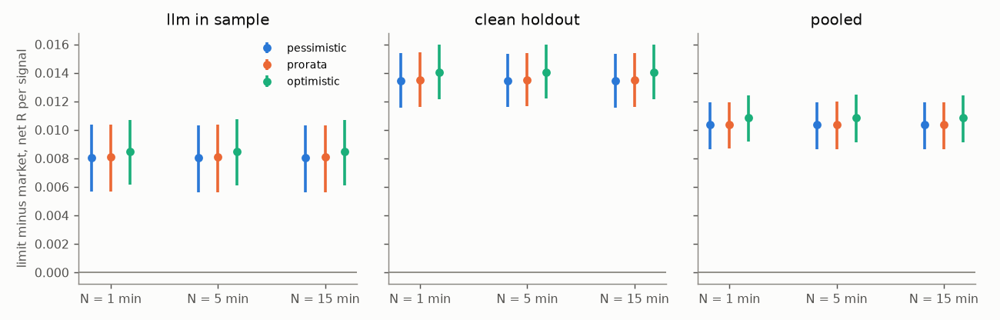
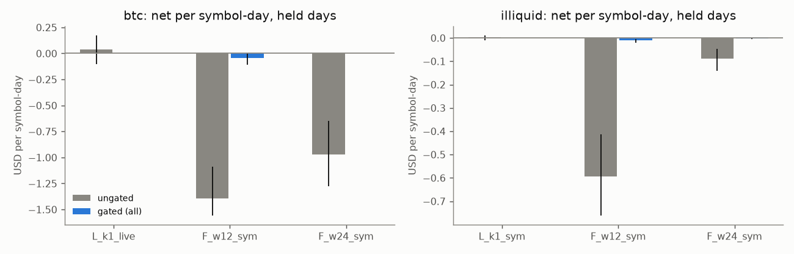
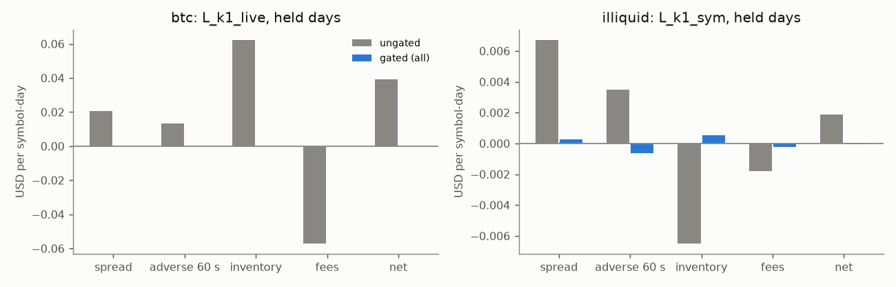

# Execution on replayed real Bybit order books: limit vs market entries (H-EXE1) and regime-gated market making (H-MMR3), 2026-11-15

Agent EXE. Research only: no orders, no Bybit trading calls. Every number comes from the real ob200 book (quote-saver.bycsi.com) and the real public trade tape (public.bybit.com) of each symbol-day, replayed through at-match. Our orders are virtual (they never change the book). The design was frozen before any P&L (diary 2026-11-14 23:00 UTC, `data/research/execution/design.json`).

## Verdicts

- **H-EXE1 (limit at the touch beats a market entry): supports**, in both segments (llm_in_sample and clean_holdout) and pooled. The gain is real but small: about **+0.01 R per signal**.
- **H-MMR3 (quoting only in quiet sideways phases turns market making positive): inconclusive.** At the live width the gate simply stops the quoter from trading.

## In plain words

**Limit vs market entries (H-EXE1).**
- We took the paper book's own signals, 275 of them: 125 shock_regime and 150 trend_4h, on BTC, ETH and SOL from 2026-01-05 to 2026-11-13. Each entry was replayed two ways on that day's real order book:
  - a market order at the decision time;
  - a PostOnly limit joining the best bid (buys) or ask (sells), moved to the new touch whenever the price ran away, and cancelled after 1, 5 or 15 minutes.
- **The limit always filled.** At the paper book's order values (0.7k to 8k USDT), every limit filled under every queue model. The median wait was 1-3 seconds and the longest 37 seconds. So the 1, 5 and 15 minute windows give identical results, and **no winner was missed**: the missed-winner share is 0 of 275.
- **Limit minus market: +0.010 R per signal** (95% CI +0.009 to +0.012).
  - llm_in_sample: +0.008 R (+0.006 to +0.010).
  - clean_holdout: +0.014 R (+0.012 to +0.015).
  - The pessimistic and optimistic queue models give the same numbers to within 0.001 R.
- **Where the gain comes from:**
  - **The fee gap:** maker 2.0 bp instead of taker 5.5 bp, worth +0.015 R.
  - **Minus a worse price:** about -0.005 R (CI -0.006 to -0.003). Chasing the touch means the limit fills on average 1.1-1.6 bp beyond the decision-time mid, in the direction of the trade. The market order fills only 0.1-0.3 bp beyond it, because the spread on these majors is 0.01-1.1 bp. So the limit pays about 1.2 bp more on price, and that costs back a third of the fee saving.
  - **By sleeve:** shock_regime gains more (+0.016 R) than trend_4h (+0.006 R) because its stops are tighter. The median stop is 1.8% for shock_regime and 3.8% for trend_4h, and a fixed 3.5 bp saving is a bigger share of a tighter stop.
- **Adverse selection did not show up as missed fills here.** The concern from R-MMR-1, that a limit fills more often on trades that go against you, needs some orders to go unfilled, and at these sizes on these books none did. It shows up instead as the slightly worse fill price.

**Regime-gated market making (H-MMR3).**
- We re-ran agent M's 80 symbol-days with the same fit / held-out split. The gate allowed quoting only when all four conditions held:
  - 60-minute volatility in its bottom tercile;
  - the 4-hour move under 1 sigma;
  - no 4-sigma hourly shock in the last 6 hours;
  - jump intensity at or below its median. For BTC this is the probability field's P(jump) from the pre-cutoff fit; for TRX, ETC and XLM it is a Hawkes-type count of recent 1-minute jumps.

  The gate was open 11-18% of the held-out minutes.
- **At the live width the gate does nothing useful.** The live quoter sits 40-50 bp from the mid, and in quiet phases price never comes that far. Gated BTC made 0 fills on held days, and the illiquid contracts 0.2 a day. Gated minus ungated is therefore just minus the ungated P&L, which was already about zero:
  - BTC: -0.039 USD per symbol-day (CI -0.173 to +0.103);
  - illiquid: -0.002 (-0.011 to +0.009).

  Neither group's CI clears zero, so the verdict is **inconclusive**.
- **At tight widths the gate is a strong loss limiter, but not an edge** (a secondary comparison, declared before the run; not part of the verdict).
  - Ungated, a 12 bp fixed quote sigma (orders about 8 bp from the mid) loses 1.40 USD per day on BTC and 0.59 on the illiquid group.
  - The gate cuts these losses by +1.35 and +0.58 USD a day (CIs well above 0), mostly by removing about 99% of the fills.
  - The gated quoter still does not make money. For example, illiquid F_w12 gated: -0.011 USD per day (CI -0.020 to -0.005).
  - In quiet phases the spread captured roughly equals the adverse move within 1 second: +0.011 vs -0.012 USD per day for illiquid F_w12. Ungated, the ratio is +0.30 vs -0.50. **Quiet phases do reduce adverse selection, as the user expected, but not below the 2 bp maker fee.**
- **No single gate component made a difference at the live width.** Gating on jump intensity alone gave the best levels (illiquid +0.006 USD per day, CI +0.002 to +0.012), but its difference from ungated quoting is not significant: +0.004 (-0.002 to +0.014). That is exploratory, one of 4-5 components.
- **Flattening at market when the gate closes** (the `_flat` variants) changed nothing material.

## What this means for the paper book

- **Entering the sleeves' signals with a pegged limit at the touch is slightly better than a market order and costs nothing in missed trades** at today's sizes on BTC, ETH and SOL. That is the user's preferred style, and the replay backs it.
  - The benefit is small: +0.01 R per trade, about 1% of the risk.
  - It depends on the maker-taker fee gap.
  - Larger orders, thinner contracts or slower re-pegging could change it.
- **Market making only in quiet phases avoids losses rather than earning money.**
  - At the live width there is nothing to gain: the gate turns quoting off.
  - At tight widths the gate is a good safety switch, but quiet-phase fills still do not cover the maker fee at VIP0.

## Caveats and what could be wrong

- **Virtual orders.** Our limit and market orders never enter the book, so there is no market impact and no reaction from other traders. The sizes are small: under 8k USDT against BTC, ETH and SOL books.
- **Queue position:**
  - The BTC archive is a 100 ms feed (agent M: about 59% of BTC prints fall outside the pre-trade touch), so its queue positions are coarse.
  - Many limit fills come from prints through our price (23-72% of orders, depending on symbol and queue model) or from the book crossing our price. Those fills are the same under all three queue models.
  - Even under the pessimistic model, every order filled.
- **Decision time.** Orders are sent at the slot + 5 minutes. The real paper book decides up to 30 minutes later; the comparison is the same, but the absolute R values differ.
- **Exits.** Exits after the signal day use 1h bars with the stop-first rule. They are identical in both arms (the exit kind agreed on every signal), so they affect the sleeves' R values but not the difference.
- **The sleeves themselves are not tested here.** Market-arm net R is -0.068 per signal pooled (CI -0.315 to +0.190) and +0.009 in clean_holdout. These numbers are context, not a result.
- **Multiple windows.** Registered: "for at least one N". Because every order filled within 1 minute, the three windows are the same test, so there is no multiplicity in practice.
- **H-MMR3 inputs.**
  - The gate thresholds come from fit days only.
  - The BTC jump measure is the field fitted before 2026-07-01, so it is point-in-time.
  - The ungated reruns reproduce agent M's replay exactly on 78 of 80 symbol-days. TRXUSDT 2026-10-30 and 11-01 (fit days) differ because agent M ran them without the previous day's warm-up bars (their documented caveat), while these runs had them.
- **Signal generation.** It used a fast path: one frame per symbol, truncated at known_ts <= as_of. This was checked identical to the slow as-of read on 36 random slots. The bias gate (execution.gate) and the one-position-per-symbol rule were not applied. Instead, trend_4h signals are taken at onset, an outcome-free rule.

## Data

- **H-EXE1.** 275 signals on 245 symbol-days (BTC 78, ETH 109, SOL 88 signals), 2026-01-05 .. 2026-11-13: 159 signals before the cutoff and 116 after.
- **H-MMR3.** 80 symbol-days, 2026-10-25 .. 2026-11-13: BTCUSDT, TRXUSDT, ETCUSDT and XLMUSDT. Six BTC days served both studies.
- **Downloads.** 319 symbol-days: 638 archives, 55.4 GB in total. Each was downloaded once, replayed, verified and deleted.
  - The manifest is `data/research/execution/manifest.json`; no raw files are left.
  - At most two days were held at a time, under 1 GB.
  - Every day passed verification: 0 engine trades or rejects, the replayer's book equal to the engine's at every check, and the ledger identity exact for the market-making runs.
- **Storage.** 6.79 GB before and 6.84 GB after; the study's own outputs are 44 MB, including the 19 MB private binary.
- **Runtime.** 6.2 hours of single-threaded replay in total (release build, 2 workers), median 70 s per symbol-day.
- **Code.**
  - `crates/atx/src/exec_replay.rs` is new (`atx exec-replay`, 5 unit tests).
  - `crates/atx/src/mm_replay.rs` gained a per-variant regime gate (`gate`, `gate_flatten`, plus 1 unit test). The live `mm.rs` is unchanged.
  - The study driver is `src/ai_trader/research/execution_study.py`.
  - `cargo test --workspace` and `cargo clippy --workspace --all-targets` are clean.

## Figures





## Tables: H-EXE1

| segment | signals | market net R [95% CI] | touch spread (bp) | market slippage vs mid (bp) | market reaches target |
|---|---|---|---|---|---|
| llm_in_sample | 159 | -0.124 [-0.453, +0.232] | 0.38 | +0.19 | 0.29 |
| clean_holdout | 116 | +0.009 [-0.360, +0.392] | 0.39 | +0.22 | 0.32 |
| pooled | 275 | -0.068 [-0.315, +0.190] | 0.38 | +0.20 | 0.30 |

Paired difference limit_N minus market, net R per signal (both sleeves pooled):

| segment | queue | N (min) | n | diff [95% CI] | filled part | missed part | any fill | unfilled | partial | price gain if filled (bp) | limit R | market R |
|---|---|---|---|---|---|---|---|---|---|---|---|---|
| llm_in_sample | prorata | 1 | 159 | +0.008 [+0.006, +0.010] | +0.008 | +0.000 | 1.00 | 0.00 | 0.00 | -1.68 | -0.116 | -0.124 |
| llm_in_sample | prorata | 5 | 159 | +0.008 [+0.006, +0.010] | +0.008 | +0.000 | 1.00 | 0.00 | 0.00 | -1.68 | -0.116 | -0.124 |
| llm_in_sample | prorata | 15 | 159 | +0.008 [+0.006, +0.010] | +0.008 | +0.000 | 1.00 | 0.00 | 0.00 | -1.68 | -0.116 | -0.124 |
| llm_in_sample | pessimistic | 1 | 159 | +0.008 [+0.006, +0.010] | +0.008 | +0.000 | 1.00 | 0.00 | 0.00 | -1.68 | -0.116 | -0.124 |
| llm_in_sample | pessimistic | 5 | 159 | +0.008 [+0.006, +0.010] | +0.008 | +0.000 | 1.00 | 0.00 | 0.00 | -1.68 | -0.116 | -0.124 |
| llm_in_sample | pessimistic | 15 | 159 | +0.008 [+0.006, +0.010] | +0.008 | +0.000 | 1.00 | 0.00 | 0.00 | -1.68 | -0.116 | -0.124 |
| llm_in_sample | optimistic | 1 | 159 | +0.008 [+0.006, +0.011] | +0.008 | +0.000 | 1.00 | 0.00 | 0.00 | -1.59 | -0.115 | -0.124 |
| llm_in_sample | optimistic | 5 | 159 | +0.008 [+0.006, +0.011] | +0.008 | +0.000 | 1.00 | 0.00 | 0.00 | -1.59 | -0.115 | -0.124 |
| llm_in_sample | optimistic | 15 | 159 | +0.008 [+0.006, +0.011] | +0.008 | +0.000 | 1.00 | 0.00 | 0.00 | -1.59 | -0.115 | -0.124 |
| clean_holdout | prorata | 1 | 116 | +0.014 [+0.012, +0.015] | +0.014 | +0.000 | 1.00 | 0.00 | 0.00 | -0.49 | +0.022 | +0.009 |
| clean_holdout | prorata | 5 | 116 | +0.014 [+0.012, +0.015] | +0.014 | +0.000 | 1.00 | 0.00 | 0.00 | -0.49 | +0.022 | +0.009 |
| clean_holdout | prorata | 15 | 116 | +0.014 [+0.012, +0.015] | +0.014 | +0.000 | 1.00 | 0.00 | 0.00 | -0.49 | +0.022 | +0.009 |
| clean_holdout | pessimistic | 1 | 116 | +0.013 [+0.012, +0.015] | +0.013 | +0.000 | 1.00 | 0.00 | 0.00 | -0.50 | +0.022 | +0.009 |
| clean_holdout | pessimistic | 5 | 116 | +0.013 [+0.012, +0.015] | +0.013 | +0.000 | 1.00 | 0.00 | 0.00 | -0.50 | +0.022 | +0.009 |
| clean_holdout | pessimistic | 15 | 116 | +0.013 [+0.012, +0.015] | +0.013 | +0.000 | 1.00 | 0.00 | 0.00 | -0.50 | +0.022 | +0.009 |
| clean_holdout | optimistic | 1 | 116 | +0.014 [+0.012, +0.016] | +0.014 | +0.000 | 1.00 | 0.00 | 0.00 | -0.39 | +0.023 | +0.009 |
| clean_holdout | optimistic | 5 | 116 | +0.014 [+0.012, +0.016] | +0.014 | +0.000 | 1.00 | 0.00 | 0.00 | -0.39 | +0.023 | +0.009 |
| clean_holdout | optimistic | 15 | 116 | +0.014 [+0.012, +0.016] | +0.014 | +0.000 | 1.00 | 0.00 | 0.00 | -0.39 | +0.023 | +0.009 |
| pooled | prorata | 1 | 275 | +0.010 [+0.009, +0.012] | +0.010 | +0.000 | 1.00 | 0.00 | 0.00 | -1.17 | -0.058 | -0.068 |
| pooled | prorata | 5 | 275 | +0.010 [+0.009, +0.012] | +0.010 | +0.000 | 1.00 | 0.00 | 0.00 | -1.17 | -0.058 | -0.068 |
| pooled | prorata | 15 | 275 | +0.010 [+0.009, +0.012] | +0.010 | +0.000 | 1.00 | 0.00 | 0.00 | -1.17 | -0.058 | -0.068 |
| pooled | pessimistic | 1 | 275 | +0.010 [+0.009, +0.012] | +0.010 | +0.000 | 1.00 | 0.00 | 0.00 | -1.18 | -0.058 | -0.068 |
| pooled | pessimistic | 5 | 275 | +0.010 [+0.009, +0.012] | +0.010 | +0.000 | 1.00 | 0.00 | 0.00 | -1.18 | -0.058 | -0.068 |
| pooled | pessimistic | 15 | 275 | +0.010 [+0.009, +0.012] | +0.010 | +0.000 | 1.00 | 0.00 | 0.00 | -1.18 | -0.058 | -0.068 |
| pooled | optimistic | 1 | 275 | +0.011 [+0.009, +0.012] | +0.011 | +0.000 | 1.00 | 0.00 | 0.00 | -1.08 | -0.057 | -0.068 |
| pooled | optimistic | 5 | 275 | +0.011 [+0.009, +0.012] | +0.011 | +0.000 | 1.00 | 0.00 | 0.00 | -1.08 | -0.057 | -0.068 |
| pooled | optimistic | 15 | 275 | +0.011 [+0.009, +0.012] | +0.011 | +0.000 | 1.00 | 0.00 | 0.00 | -1.08 | -0.057 | -0.068 |

By sleeve (pro-rata, pooled segments):

| sleeve | N | n | diff [95% CI] | any fill | market R if filled | market R if unfilled |
|---|---|---|---|---|---|---|
| shock_regime | 1 | 125 | +0.016 [+0.013, +0.019] | 1.00 | -0.137 | n/a |
| shock_regime | 5 | 125 | +0.016 [+0.013, +0.019] | 1.00 | -0.137 | n/a |
| shock_regime | 15 | 125 | +0.016 [+0.013, +0.019] | 1.00 | -0.137 | n/a |
| trend_4h | 1 | 150 | +0.006 [+0.004, +0.007] | 1.00 | -0.010 | n/a |
| trend_4h | 5 | 150 | +0.006 [+0.004, +0.007] | 1.00 | -0.010 | n/a |
| trend_4h | 15 | 150 | +0.006 [+0.004, +0.007] | 1.00 | -0.010 | n/a |

Missed signals (not fully filled; pro-rata), their outcome under the market arm:

| segment | N | missed (n) | share of signals | market R of the missed (mean) | missed with market R > 0 | missed reaching the target | missed R total |
|---|---|---|---|---|---|---|---|
| llm_in_sample | 1 | 0 | 0.00 | n/a | n/a | n/a | +0.00 |
| llm_in_sample | 5 | 0 | 0.00 | n/a | n/a | n/a | +0.00 |
| llm_in_sample | 15 | 0 | 0.00 | n/a | n/a | n/a | +0.00 |
| clean_holdout | 1 | 0 | 0.00 | n/a | n/a | n/a | +0.00 |
| clean_holdout | 5 | 0 | 0.00 | n/a | n/a | n/a | +0.00 |
| clean_holdout | 15 | 0 | 0.00 | n/a | n/a | n/a | +0.00 |
| pooled | 1 | 0 | 0.00 | n/a | n/a | n/a | +0.00 |
| pooled | 5 | 0 | 0.00 | n/a | n/a | n/a | +0.00 |
| pooled | 15 | 0 | 0.00 | n/a | n/a | n/a | +0.00 |

## Tables: H-MMR3

Gated minus ungated, paired per symbol-day (USD per symbol-day; held days unless marked):

| group | days | queue | width | gate | diff net [95% CI] | d spread | d adverse 1 s | d adverse 60 s | d inventory | d fees | d fills |
|---|---|---|---|---|---|---|---|---|---|---|---|
| btc | held | pessimistic | L_k1_live | all | -0.0391 [-0.1733, +0.1026] | -0.0205 | +0.0514 | -0.0178 | -0.0578 | +0.0571 | -3.8 |
| btc | held | prorata | L_k1_live | all | -0.0391 [-0.1733, +0.1027] | -0.0205 | +0.0513 | -0.0134 | -0.0623 | +0.0571 | -3.8 |
| btc | held | prorata | L_k1_live | allHawkes | -0.0511 [-0.1766, +0.0758] | -0.0199 | +0.0493 | -0.0268 | -0.0584 | +0.0540 | -3.6 |
| btc | held | prorata | L_k1_live | all_flat | -0.0391 [-0.1733, +0.1027] | -0.0205 | +0.0513 | -0.0134 | -0.0623 | +0.0571 | -3.8 |
| btc | held | prorata | L_k1_live | onlyJ | +0.0199 [-0.1422, +0.1835] | -0.0171 | +0.0402 | +0.0031 | -0.0048 | +0.0386 | -2.6 |
| btc | held | prorata | L_k1_live | onlyR | -0.0056 [-0.0765, +0.0722] | -0.0047 | +0.0147 | -0.0077 | -0.0113 | +0.0180 | -1.2 |
| btc | held | prorata | L_k1_live | onlyS | +0.0264 [+0.0000, +0.0793] | -0.0014 | +0.0005 | +0.0119 | +0.0128 | +0.0030 | -0.2 |
| btc | held | prorata | L_k1_live | onlyV | -0.0511 [-0.1766, +0.0758] | -0.0199 | +0.0493 | -0.0268 | -0.0584 | +0.0540 | -3.6 |
| btc | held | prorata | F_w12_sym | all | +1.3524 [+1.0389, +1.5365] | -0.2695 | +0.6094 | +0.5614 | +0.1388 | +0.9218 | -60.0 |
| btc | held | prorata | F_w12_sym | all_flat | +1.3672 [+1.0574, +1.5410] | -0.2695 | +0.6097 | +0.5678 | +0.1498 | +0.9191 | -60.0 |
| btc | held | prorata | F_w24_sym | all | +0.9709 [+0.6503, +1.2777] | -0.3123 | +0.6746 | +0.3939 | +0.1179 | +0.7714 | -51.5 |
| btc | held | prorata | F_w24_sym | all_flat | +0.9709 [+0.6503, +1.2777] | -0.3123 | +0.6746 | +0.3939 | +0.1179 | +0.7714 | -51.5 |
| btc | held | optimistic | L_k1_live | all | -0.0391 [-0.1733, +0.1027] | -0.0205 | +0.0513 | -0.0134 | -0.0623 | +0.0571 | -3.8 |
| btc | fit | pessimistic | L_k1_live | all | -0.0136 [-0.0994, +0.0660] | -0.0328 | +0.0663 | +0.0766 | -0.0967 | +0.0393 | -2.5 |
| btc | fit | prorata | L_k1_live | all | -0.0136 [-0.0994, +0.0660] | -0.0328 | +0.0663 | +0.0766 | -0.0967 | +0.0393 | -2.5 |
| btc | fit | prorata | L_k1_live | allHawkes | -0.0756 [-0.1906, +0.0207] | -0.0224 | +0.0338 | +0.0210 | -0.1008 | +0.0266 | -1.7 |
| btc | fit | prorata | L_k1_live | all_flat | -0.0358 [-0.1286, +0.0540] | -0.0328 | +0.0663 | +0.0733 | -0.1128 | +0.0365 | -2.5 |
| btc | fit | prorata | L_k1_live | onlyJ | +0.0023 [-0.0836, +0.0941] | -0.0252 | +0.0569 | +0.0751 | -0.0758 | +0.0282 | -1.8 |
| btc | fit | prorata | L_k1_live | onlyR | -0.0507 [-0.1269, +0.0073] | -0.0093 | +0.0108 | +0.0186 | -0.0677 | +0.0078 | -0.5 |
| btc | fit | prorata | L_k1_live | onlyS | +0.0000 [+0.0000, +0.0000] | +0.0000 | +0.0000 | +0.0000 | +0.0000 | -0.0000 | +0.0 |
| btc | fit | prorata | L_k1_live | onlyV | -0.0794 [-0.1929, +0.0156] | -0.0191 | +0.0292 | +0.0143 | -0.0980 | +0.0234 | -1.5 |
| btc | fit | prorata | F_w12_sym | all | +1.1831 [+0.8445, +1.4785] | -0.2558 | +0.5078 | +0.6996 | -0.0413 | +0.7806 | -48.2 |
| btc | fit | prorata | F_w12_sym | all_flat | +1.1745 [+0.8375, +1.4707] | -0.2568 | +0.5096 | +0.7006 | -0.0443 | +0.7750 | -48.2 |
| btc | fit | prorata | F_w24_sym | all | +0.3283 [+0.0218, +0.7092] | -0.1582 | +0.2513 | +0.2513 | -0.0431 | +0.2783 | -17.6 |
| btc | fit | prorata | F_w24_sym | all_flat | +0.3283 [+0.0218, +0.7092] | -0.1582 | +0.2513 | +0.2513 | -0.0431 | +0.2783 | -17.6 |
| btc | fit | optimistic | L_k1_live | all | -0.0136 [-0.0994, +0.0660] | -0.0328 | +0.0663 | +0.0766 | -0.0967 | +0.0393 | -2.5 |
| illiquid | held | pessimistic | L_k1_sym | all | +0.0058 [-0.0076, +0.0249] | -0.0050 | +0.0046 | -0.0035 | +0.0130 | +0.0013 | -1.5 |
| illiquid | held | prorata | L_k1_sym | all | -0.0019 [-0.0109, +0.0087] | -0.0065 | +0.0057 | -0.0041 | +0.0070 | +0.0016 | -1.6 |
| illiquid | held | prorata | L_k1_sym | all_flat | -0.0022 [-0.0111, +0.0082] | -0.0066 | +0.0056 | -0.0039 | +0.0068 | +0.0015 | -1.6 |
| illiquid | held | prorata | L_k1_sym | onlyJ | +0.0044 [-0.0021, +0.0140] | -0.0027 | +0.0015 | -0.0016 | +0.0081 | +0.0006 | -0.6 |
| illiquid | held | prorata | L_k1_sym | onlyR | +0.0011 [-0.0067, +0.0104] | -0.0031 | +0.0033 | -0.0033 | +0.0067 | +0.0008 | -0.8 |
| illiquid | held | prorata | L_k1_sym | onlyS | -0.0005 [-0.0014, +0.0000] | -0.0003 | +0.0001 | -0.0002 | -0.0002 | +0.0001 | -0.1 |
| illiquid | held | prorata | L_k1_sym | onlyV | -0.0012 [-0.0104, +0.0096] | -0.0057 | +0.0053 | -0.0037 | +0.0068 | +0.0015 | -1.5 |
| illiquid | held | prorata | F_w12_sym | all | +0.5822 [+0.3956, +0.7525] | -0.2902 | +0.4889 | +0.4309 | +0.0279 | +0.4136 | -413.6 |
| illiquid | held | prorata | F_w12_sym | all_flat | +0.5778 [+0.3901, +0.7481] | -0.2940 | +0.4918 | +0.4350 | +0.0265 | +0.4104 | -414.2 |
| illiquid | held | prorata | F_w24_sym | all | +0.0869 [+0.0459, +0.1377] | -0.1117 | +0.1213 | +0.0890 | +0.0124 | +0.0972 | -103.3 |
| illiquid | held | prorata | F_w24_sym | all_flat | +0.0876 [+0.0473, +0.1385] | -0.1121 | +0.1216 | +0.0888 | +0.0143 | +0.0966 | -103.2 |
| illiquid | held | optimistic | L_k1_sym | all | -0.0055 [-0.0126, +0.0017] | -0.0073 | +0.0061 | -0.0029 | +0.0029 | +0.0018 | -2.2 |
| illiquid | fit | pessimistic | L_k1_sym | all | -0.0081 [-0.0124, -0.0042] | -0.0053 | +0.0039 | +0.0016 | -0.0057 | +0.0013 | -1.5 |
| illiquid | fit | prorata | L_k1_sym | all | -0.0084 [-0.0137, -0.0037] | -0.0057 | +0.0042 | +0.0014 | -0.0055 | +0.0013 | -1.7 |
| illiquid | fit | prorata | L_k1_sym | all_flat | -0.0084 [-0.0137, -0.0037] | -0.0057 | +0.0042 | +0.0016 | -0.0056 | +0.0012 | -1.7 |
| illiquid | fit | prorata | L_k1_sym | onlyJ | -0.0040 [-0.0081, -0.0005] | -0.0031 | +0.0026 | +0.0011 | -0.0027 | +0.0007 | -0.7 |
| illiquid | fit | prorata | L_k1_sym | onlyR | -0.0036 [-0.0084, -0.0003] | -0.0022 | +0.0021 | +0.0011 | -0.0030 | +0.0006 | -0.5 |
| illiquid | fit | prorata | L_k1_sym | onlyS | +0.0000 [+0.0000, +0.0000] | +0.0000 | +0.0000 | +0.0000 | +0.0000 | -0.0000 | +0.0 |
| illiquid | fit | prorata | L_k1_sym | onlyV | -0.0074 [-0.0124, -0.0030] | -0.0049 | +0.0038 | +0.0015 | -0.0052 | +0.0012 | -1.5 |
| illiquid | fit | prorata | F_w12_sym | all | +0.5226 [+0.2534, +0.8744] | -0.2989 | +0.4447 | +0.4879 | -0.0040 | +0.3376 | -331.0 |
| illiquid | fit | prorata | F_w12_sym | all_flat | +0.5183 [+0.2483, +0.8716] | -0.3028 | +0.4476 | +0.4910 | -0.0035 | +0.3337 | -331.1 |
| illiquid | fit | prorata | F_w24_sym | all | +0.0826 [+0.0007, +0.1957] | -0.1228 | +0.1450 | +0.1374 | -0.0133 | +0.0813 | -85.6 |
| illiquid | fit | prorata | F_w24_sym | all_flat | +0.0833 [+0.0016, +0.1957] | -0.1233 | +0.1454 | +0.1375 | -0.0118 | +0.0809 | -85.6 |
| illiquid | fit | optimistic | L_k1_sym | all | -0.0091 [-0.0140, -0.0046] | -0.0066 | +0.0045 | +0.0016 | -0.0056 | +0.0016 | -2.2 |

Levels (held days, pro-rata; USD per symbol-day):

| group | width | gate | net [95% CI] | spread | adverse 1 s | adverse 60 s | inventory | fees | fills | gate off share | symbol-stop share |
|---|---|---|---|---|---|---|---|---|---|---|---|
| btc | L_k1_live | all | +0.0000 [+0.0000, +0.0000] | +0.0000 | +0.0000 | +0.0000 | +0.0000 | -0.0000 | 0.0 | 0.89 | 0.00 |
| btc | L_k1_live | allHawkes | -0.0120 [-0.0360, +0.0000] | +0.0006 | -0.0020 | -0.0134 | +0.0038 | -0.0030 | 0.2 | 0.85 | 0.00 |
| btc | L_k1_live | all_flat | +0.0000 [+0.0000, +0.0000] | +0.0000 | +0.0000 | +0.0000 | +0.0000 | -0.0000 | 0.0 | 0.89 | 0.00 |
| btc | L_k1_live | onlyJ | +0.0589 [-0.0129, +0.1675] | +0.0034 | -0.0111 | +0.0165 | +0.0575 | -0.0185 | 1.2 | 0.70 | 0.00 |
| btc | L_k1_live | onlyR | +0.0334 [-0.0818, +0.1252] | +0.0158 | -0.0366 | +0.0057 | +0.0510 | -0.0391 | 2.6 | 0.20 | 0.00 |
| btc | L_k1_live | onlyS | +0.0655 [-0.0655, +0.1871] | +0.0191 | -0.0508 | +0.0253 | +0.0751 | -0.0540 | 3.6 | 0.05 | 0.00 |
| btc | L_k1_live | onlyV | -0.0120 [-0.0360, +0.0000] | +0.0006 | -0.0020 | -0.0134 | +0.0038 | -0.0030 | 0.2 | 0.78 | 0.00 |
| btc | L_k1_live | ungated | +0.0391 [-0.1027, +0.1733] | +0.0205 | -0.0513 | +0.0134 | +0.0623 | -0.0571 | 3.8 | 0.00 | 0.00 |
| btc | F_w12_sym | all | -0.0436 [-0.1068, +0.0000] | +0.0034 | -0.0089 | -0.0253 | -0.0127 | -0.0090 | 0.6 | 0.89 | 0.00 |
| btc | F_w12_sym | all_flat | -0.0288 [-0.0678, +0.0000] | +0.0034 | -0.0085 | -0.0189 | -0.0017 | -0.0117 | 0.6 | 0.89 | 0.00 |
| btc | F_w12_sym | ungated | -1.3961 [-1.5573, -1.0875] | +0.2730 | -0.6183 | -0.5867 | -0.1516 | -0.9308 | 60.6 | 0.00 | 0.90 |
| btc | F_w24_sym | all | +0.0000 [+0.0000, +0.0000] | +0.0000 | +0.0000 | +0.0000 | +0.0000 | -0.0000 | 0.0 | 0.89 | 0.00 |
| btc | F_w24_sym | all_flat | +0.0000 [+0.0000, +0.0000] | +0.0000 | +0.0000 | +0.0000 | +0.0000 | -0.0000 | 0.0 | 0.89 | 0.00 |
| btc | F_w24_sym | ungated | -0.9709 [-1.2777, -0.6503] | +0.3123 | -0.6746 | -0.3939 | -0.1179 | -0.7714 | 51.5 | 0.00 | 0.30 |
| illiquid | L_k1_sym | all | -0.0000 [-0.0003, +0.0001] | +0.0003 | -0.0002 | -0.0006 | +0.0006 | -0.0002 | 0.2 | 0.82 | 0.00 |
| illiquid | L_k1_sym | all_flat | -0.0003 [-0.0008, +0.0000] | +0.0001 | -0.0003 | -0.0004 | +0.0003 | -0.0003 | 0.2 | 0.82 | 0.00 |
| illiquid | L_k1_sym | onlyJ | +0.0063 [+0.0017, +0.0122] | +0.0040 | -0.0044 | +0.0019 | +0.0016 | -0.0012 | 1.2 | 0.43 | 0.00 |
| illiquid | L_k1_sym | onlyR | +0.0030 [+0.0004, +0.0057] | +0.0036 | -0.0026 | +0.0002 | +0.0002 | -0.0010 | 1.0 | 0.24 | 0.00 |
| illiquid | L_k1_sym | onlyS | +0.0014 [-0.0091, +0.0102] | +0.0064 | -0.0058 | +0.0033 | -0.0067 | -0.0017 | 1.7 | 0.06 | 0.00 |
| illiquid | L_k1_sym | onlyV | +0.0007 [+0.0000, +0.0016] | +0.0010 | -0.0006 | -0.0002 | +0.0003 | -0.0004 | 0.4 | 0.75 | 0.00 |
| illiquid | L_k1_sym | ungated | +0.0019 [-0.0089, +0.0109] | +0.0067 | -0.0059 | +0.0035 | -0.0065 | -0.0018 | 1.8 | 0.00 | 0.00 |
| illiquid | F_w12_sym | all | -0.0112 [-0.0202, -0.0049] | +0.0114 | -0.0124 | -0.0103 | -0.0034 | -0.0088 | 9.1 | 0.82 | 0.00 |
| illiquid | F_w12_sym | all_flat | -0.0156 [-0.0259, -0.0080] | +0.0075 | -0.0095 | -0.0062 | -0.0049 | -0.0120 | 8.5 | 0.82 | 0.00 |
| illiquid | F_w12_sym | ungated | -0.5934 [-0.7611, -0.4142] | +0.3015 | -0.5013 | -0.4412 | -0.0313 | -0.4224 | 422.8 | 0.00 | 0.10 |
| illiquid | F_w24_sym | all | -0.0018 [-0.0050, +0.0006] | +0.0024 | -0.0024 | -0.0028 | -0.0003 | -0.0011 | 1.0 | 0.82 | 0.00 |
| illiquid | F_w24_sym | all_flat | -0.0012 [-0.0029, +0.0003] | +0.0019 | -0.0021 | -0.0030 | +0.0015 | -0.0017 | 1.1 | 0.82 | 0.00 |
| illiquid | F_w24_sym | ungated | -0.0887 [-0.1407, -0.0479] | +0.1140 | -0.1237 | -0.0918 | -0.0127 | -0.0983 | 104.3 | 0.00 | 0.00 |

## Rule candidates

Validated with `ai_trader.research.rules.validate` (no problems, alone and together with research/rules.yaml).

```yaml
- id: R-EXE-1
  kind: prefer
  rule: "WHEN entering a shock_regime or trend_4h signal on BTCUSDT, ETHUSDT or SOLUSDT at paper-book order values THEN prefer a PostOnly limit joining the touch, re-pegged to the touch, over a market order"
  when: "a sleeve candidate (agent.session) on a Bybit USDT perp major; order value about 0.7-8k USDT; crypto fees (maker 2.0 bp, taker 5.5 bp); peg rule of atx exec-replay (amend to the new touch when it moves away, cancel after 1 minute)"
  then: "expect the limit to fill within seconds (median 1-3 s, all within 37 s) and to beat the market entry by about +0.01 R per signal net of a slightly worse fill price; no missed entries at these order values"
  scope: {assets: [BTCUSDT, ETHUSDT, SOLUSDT], horizon: "entry, first minute", sides: both}
  effect: "275 signals 2026-01-05..11-13 replayed on real ob200 books (pro-rata): limit minus market +0.010 R/signal [95% CI +0.009, +0.012], llm_in_sample +0.008 [+0.006, +0.010], clean_holdout +0.014 [+0.012, +0.015]; same for N = 1/5/15 min and for the pessimistic / optimistic queue models; fill rate 100%; shock_regime +0.016, trend_4h +0.006 R"
  confidence: B
  evidence: [H-EXE1, research/reports/execution_2026-11-15.md]
  review: "larger order values (partial fills), thinner contracts, a live paper comparison of pegged entries, or a fee tier where the maker-taker gap narrows below ~1.5 bp"
  status: active
- id: R-EXE-2
  kind: expect
  rule: "WHEN a pegged limit entry at the touch fills on a major perp THEN expect its price to be about 1-1.5 bp worse than an immediate market order's, so the gain is the fee gap minus that drift, not spread capture"
  when: "PostOnly limit joining the best bid / ask at the decision time, re-pegged up (buys) or down (sells) as the touch moves away, BTC / ETH / SOL USDT perps, touch spread 0.01-1.1 bp"
  then: "expect the limit fill about 1.1-1.6 bp from the decision-time mid in the signal direction (market order +0.1-0.3 bp); the 3.5 bp maker-taker gap is the whole edge; it is worth about 0.01-0.02 R at stops of 1.8-3.8% and shrinks with wider stops"
  scope: {assets: [BTCUSDT, ETHUSDT, SOLUSDT], horizon: "entry, first minute", sides: both}
  effect: "pro-rata, N = 1 min, 275 signals: fee part +0.015 R, price part -0.0047 R [95% CI -0.0061, -0.0034]; limit fill vs mid +1.1 bp (shock) / +1.6 bp (trend), market +0.29 / +0.13 bp"
  confidence: B
  evidence: [H-EXE1, research/reports/execution_2026-11-15.md]
  review: "a different peg rule (no chasing, or improving the touch) tested the same way; live fills of the paper book's pegged entries"
  status: active
- id: R-MMR-5
  kind: expect
  rule: "WHEN gating the live-width quoter (40-50 bp from mid) to quiet sideways phases THEN expect it to stop trading rather than to earn"
  when: "atx mm quote rule at the live width (L_k1_live BTCUSDT, L_k1_sym TRX/ETC/XLM) with the H-MMR3 gate: 60-min vol in its bottom tercile, |4h return| < 1 sigma, no 4-sigma hourly shock in 6 h, jump intensity <= its fit median"
  then: "expect almost no fills while the gate is on (BTCUSDT 0 per held day, illiquid 0.2) and gated minus ungated net indistinguishable from zero; the gate does not create an edge at this width"
  scope: {assets: [BTCUSDT, TRXUSDT, ETCUSDT, XLMUSDT], horizon: "1 day", sides: both}
  effect: "held days 2026-11-04..13, pro-rata, gated minus ungated: BTCUSDT -0.039 USD/symbol-day [95% CI -0.173, +0.103], illiquid -0.002 [-0.011, +0.009]; gate on 11-18% of held minutes"
  confidence: C
  evidence: [H-MMR3, research/reports/execution_2026-11-15.md]
  review: "a held-out month, or a gate tuned for fill rate (e.g. only the jump component) registered and tested on new days"
  status: provisional
- id: R-MMR-6
  kind: avoid
  rule: "WHEN quoting tight (offsets about 8-16 bp, fixed quote sigma 12-24 bp) at crypto maker fees THEN avoid it even inside quiet sideways phases: the regime gate cuts the loss but the quoter still does not earn"
  when: "F_w12_sym / F_w24_sym variants of atx mm-replay, with or without the H-MMR3 regime gate, crypto fee class (maker 2.0 bp)"
  then: "expect the gate to remove most of the loss by removing most of the fills, and the remaining fills to lose: adverse selection inside 1 s still about equals or exceeds the spread captured in quiet phases, and the fee comes on top"
  scope: {assets: [BTCUSDT, TRXUSDT, ETCUSDT, XLMUSDT], horizon: intraday, sides: both}
  effect: "held days, pro-rata, gated minus ungated: BTCUSDT F_w12 +1.35 USD/day [+1.04, +1.54], F_w24 +0.97 [+0.65, +1.28]; illiquid F_w12 +0.58 [+0.40, +0.75], F_w24 +0.09 [+0.05, +0.14]; gated levels BTCUSDT F_w12 -0.044 [-0.107, 0.000], illiquid F_w12 -0.011 [-0.020, -0.005] (spread +0.011 vs adverse 1 s -0.012 per day)"
  confidence: B
  evidence: [H-MMR3, H-MMR1, research/reports/execution_2026-11-15.md]
  review: "a maker rebate / lower fee tier, or a quiet-phase definition that leaves adverse selection clearly below the spread on new held-out days"
  status: active
```
