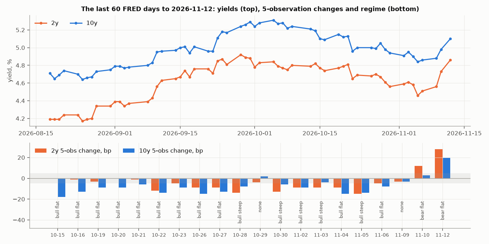
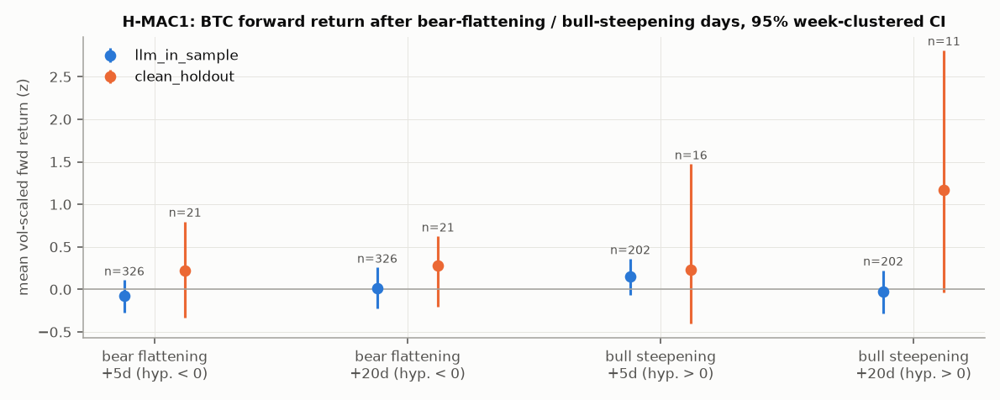
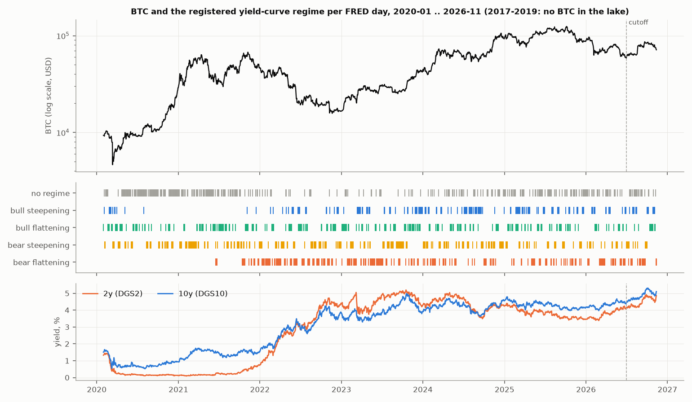
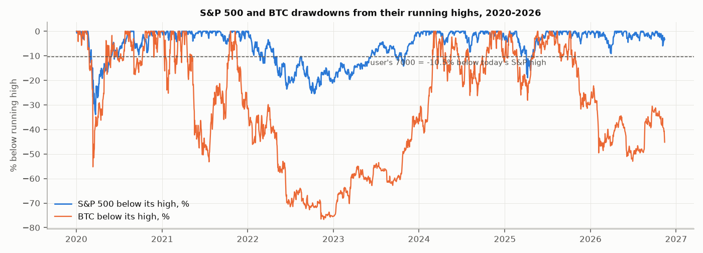
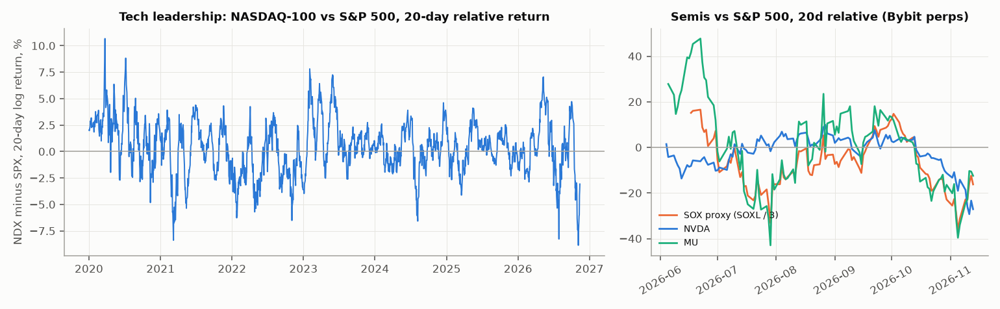
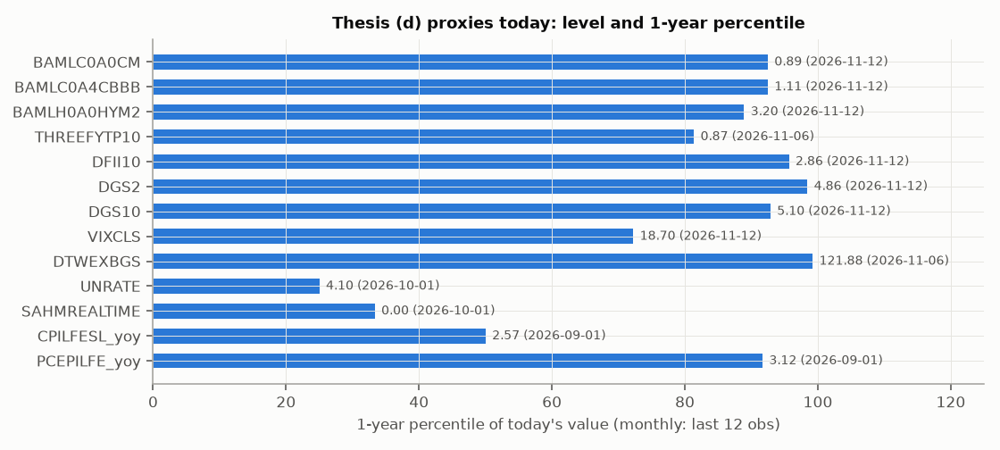

# Macro narrative layer: curve regimes, the user's thesis and the confluence log (2026-11-15)

Agent MACRO. Research only. The MAC block (curve-regime definition, H-MAC1, H-MAC2) was registered in `research/hypotheses.yaml` before any data; the operational reading of it (dominant-leg rule, entry, vol scaling, verdict rules) was frozen in the diary at 18:53 UTC before any result. Code: `src/ai_trader/narrative/{macro,curve,theses,confluence}.py`, `src/ai_trader/research/macro_study.py`, `macro_report.py`; scripts `scripts/thesis_check.py`, `scripts/confluence_fit.py`; tests `tests/test_narrative.py`. Log returns unless marked.

> **Read this first.** Neither registered test found the effect. H-MAC1 (BTC weak after bear flattening, strong after bull steepening) is **inconclusive** in both segments: the signs are mixed and no cell is significant after Holm. H-MAC2 (bull steepening is better when credit eases) points the hypothesised way in both segments but its interval includes zero: **inconclusive**. The user's curve thesis therefore enters the ledger as a narrative to be scored forward, not as a tested edge.

**Data and gaps.** FRED public CSV, no key (a custom User-Agent stalls FRED; the default works). The series are stored point in time under `data/research/macro/` (raw downloads, parquet with `rule_ts` / `effective_ts`, `manifest.json`); daily `known_ts` = obs_date + 1 day 00:00 UTC as registered. BTC is Deribit BTC-PERPETUAL 1h until 2020-03-25, then Bybit BTCUSDT, as UTC-day closes 2020-01-01 .. 2026-11-14. Gaps:
- BTC 2017-2019 missing (lake starts 2020-01-01; registration says 2017-2026; user leads data decisions);
- HY / IG / BBB OAS on FRED and ALFRED start 2023-11-14 (ICE licence): H-MAC2 uses 2023-11 .. 2026-11 only;
- no FRED semiconductor index; semis proxy = Bybit SOXLUSDT/3, NVDAUSDT, MUUSDT perps from 2026-05 only;
- ACM term premium is not on FRED; Kim-Wright THREEFYTP10 used;
- monthly series are latest vintage with a release-lag known_ts rule (ALFRED vintages fetched only for the live check);
- Bybit SPYUSDT is never used.

## 1. Today's curve regime: is it bear flattening now?

**Yes, but only on the last two FRED days.** The last observation known at 2026-11-15 19:04 UTC is **2026-11-12** (Nov 13 is not on FRED yet; Nov 11 was Veterans Day): 2y **4.86%**, 10y **5.10%**, 10y-2y **24 bp**. Over 5 observations the 2y rose **+28 bp** and the 10y **+20 bp**: the 2y leads upward, so the regime is **bear flattening**. Over 20 observations the picture is different: 2y +4 bp, 10y -9 bp. The 20 FRED days before were mostly bull flattening (long end falling), and the bear flattening began with the hot October CPI (Nov 10).

| regime in the last 20 FRED days | days |
|---|---|
| bull flattening | 11 |
| bull steepening | 5 |
| bear flattening | 2 |
| no regime | 2 |

| FRED day | 2y | 10y | 2y 5-obs, bp | 10y 5-obs, bp | regime |
|---|---|---|---|---|---|
| 2026-10-29 | 4.61 | 4.98 | -4 | +2 | no regime |
| 2026-10-30 | 4.56 | 4.94 | -13 | -6 | bull steepening |
| 2026-11-02 | 4.59 | 4.91 | -9 | -9 | bull steepening |
| 2026-11-03 | 4.61 | 4.95 | -9 | -4 | bull steepening |
| 2026-11-04 | 4.58 | 4.90 | -9 | -15 | bull flattening |
| 2026-11-05 | 4.46 | 4.84 | -15 | -14 | bull steepening |
| 2026-11-06 | 4.51 | 4.86 | -5 | -8 | bull flattening |
| 2026-11-09 | 4.56 | 4.88 | -3 | -3 | no regime |
| 2026-11-10 | 4.73 | 4.98 | +12 | +3 | bear flattening |
| 2026-11-12 | 4.86 | 5.10 | +28 | +20 | bear flattening |



_Today's regime and its 20-day history. Grey band: the +-5 bp no-regime band. Bear flattening appears only on the last two FRED days (Nov 10 and 12, after the hot October CPI); the 20 days before were mostly bull flattening._

So the user's read of the front end is right: the 2y is moving a lot (+40 bp from Nov 5 to Nov 12). The bear flattening is about two days old, and a 5-observation regime this young flips often (see the 20-day history).

## 2. H-MAC1: BTC forward returns by curve regime

Regime-days: bear_flattening 349, bear_steepening 385, bull_flattening 331, bull_steepening 218, no_regime 414 (full sample 2020-01-31 .. 2026-11-12). Mean of the vol-scaled forward return z = r / (sigma30 sqrt h); one-sided p from a week-clustered bootstrap with the null imposed; Holm over the 4 cells within a segment. NW t uses lags = h, because 20-day windows overlap across weeks (the week clusters do not fully cover that overlap).

| segment | regime | h | days | weeks | mean z | 95% CI | vs unconditional | one-sided p | Holm p | NW t | mean raw % | hyp. sign? |
|---|---|---|---|---|---|---|---|---|---|---|---|---|
| llm_in_sample | bear flattening | 5d | 326 | 144 | -0.075 | [-0.27, +0.11] | -0.137 | 0.210 | 0.630 | -0.76 | -0.60 | yes |
| llm_in_sample | bear flattening | 20d | 326 | 144 | +0.019 | [-0.22, +0.26] | -0.094 | 0.556 | 1.000 | +0.11 | -0.01 | no |
| llm_in_sample | bull steepening | 5d | 202 | 109 | +0.148 | [-0.06, +0.36] | +0.086 | 0.084 | 0.336 | +1.41 | +0.89 | yes |
| llm_in_sample | bull steepening | 20d | 202 | 109 | -0.024 | [-0.28, +0.22] | -0.137 | 0.572 | 1.000 | -0.16 | -0.17 | no |
| clean_holdout | bear flattening | 5d | 21 | 9 | +0.219 | [-0.33, +0.80] | +0.050 | 0.777 | 1.000 | +0.86 | +1.43 | no |
| clean_holdout | bear flattening | 20d | 21 | 9 | +0.283 | [-0.20, +0.62] | -0.212 | 0.940 | 1.000 | +1.82 | +3.36 | no |
| clean_holdout | bull steepening | 5d | 16 | 9 | +0.228 | [-0.40, +1.47] | +0.058 | 0.302 | 0.906 | +0.53 | +0.40 | yes |
| clean_holdout | bull steepening | 20d | 11 | 7 | +1.168 | [-0.03, +2.81] | +0.674 | 0.084 | 0.338 | +3.88 | +6.59 | yes |

**Verdict: llm_in_sample inconclusive, clean_holdout inconclusive, pooled inconclusive** (robustness with known_ts + 1 day: llm_in_sample inconclusive, clean_holdout inconclusive, pooled inconclusive). In-sample, two cells have the hypothesised sign (bear flattening +5d, bull steepening +5d) and two do not (both +20d); none survives Holm. In the holdout, bear flattening was followed by *higher* BTC (n = 21 days in 9 weeks), and the one large cell (bull steepening +20d, z +1.17, n = 11) rests on 7 weeks. Nothing here supports trading the regime.



_H-MAC1 cells: mean of r / (sigma30 sqrt h) with 95% week-clustered bootstrap intervals, by segment. The hypothesis needs bear flattening below 0 and bull steepening above 0 in all four cells._

## 3. H-MAC2: bull steepening with credit easing vs widening

HY OAS (BAMLH0A0HYM2) is on FRED only from 2023-11-14, so H-MAC2 covers 2023-11 .. 2026-11 (registered as 'full sample'; that sample is shorter than intended and is a data gap).

| segment | eased: days (weeks) | widened: days (weeks) | mean z eased | mean z widened | diff | 95% CI | raw mean % eased / widened |
|---|---|---|---|---|---|---|---|
| full | 70 (39) | 65 (41) | +0.356 | +0.033 | +0.323 | [-0.12, +0.77] | +3.24 / +1.04 |
| llm_in_sample | 66 (37) | 60 (37) | +0.303 | +0.033 | +0.270 | [-0.16, +0.74] | +2.96 / +1.14 |
| clean_holdout | 4 (2) | 5 (4) | +1.230 | +0.028 | +1.202 | [-0.88, +3.44] | +7.91 / -0.15 |

**Verdict: inconclusive** (full sample; segments: llm_in_sample inconclusive, clean_holdout inconclusive; known_ts + 1 day: inconclusive). The difference has the hypothesised sign in both segments (eased better by about 0.3 sigma over 20 days), but the full-sample CI includes zero (bootstrap P(diff <= 0) = 0.078), and the holdout has 9 days in 6 weeks. This is the most interesting lead for the user's component (c): the steepening's cause (credit easing vs widening) is the right thing to condition on, but it isn't established.

## 4. Descriptive: BTC realised vol by regime

Not a test. Median annualised realised vol of daily BTC returns over the same 5 days, the next 5 days, and the 30-day sigma at entry (full sample).

| regime | days | RV same 5d, % | RV next 5d, % | sigma30 at entry, % ann. |
|---|---|---|---|---|
| bear flattening | 349 | 41.7 | 41.2 | 48.9 |
| bear steepening | 385 | 45.1 | 42.5 | 51.2 |
| bull flattening | 331 | 47.3 | 43.0 | 55.6 |
| bull steepening | 218 | 44.4 | 40.0 | 45.9 |
| no regime | 414 | 44.3 | 44.0 | 54.3 |

The differences are a few vol points: bull flattening (long end falling, usually risk-off) carries the highest 30-day sigma, bull steepening the lowest next-5-day vol. No regime is a vol regime for BTC.



_Top: BTC (Deribit to 2020-03-25, then Bybit), log scale. Middle: the registered curve regime on each FRED day (one row per regime). Bottom: 2y and 10y yields. Dashed: knowledge cutoff._

## 5. Descriptive: S&P 500 drawdowns, AI leadership and BTC

S&P 500 (FRED) **7561.67** on 2026-11-13, **3.3%** below its high of 7818.93. The user's level, **7000**, is 7.7% (log) below the last close and 10.5% below the high, so it would be a standard correction (it is the user's number, not ours).

Episodes since 2020 with a drawdown of 5% or more from the running high (the 2023 correction sits inside the 2022 episode, because the S&P had not regained its January 2022 high). BTC columns: log % from the S&P peak to the S&P trough, and the 20 days after the trough.

| S&P peak | trough | S&P depth % | BTC peak to trough, log % | BTC +20d after trough, log % |
|---|---|---|---|---|
| 2020-02-19 | 2020-03-23 | -33.9 | -39.2 | +6.1 |
| 2020-09-02 | 2020-09-23 | -9.6 | -10.7 | +11.0 |
| 2021-09-02 | 2021-10-04 | -5.2 | -0.3 | +21.4 |
| 2022-01-03 | 2022-10-12 | -25.4 | -88.6 | +6.7 |
| 2024-03-28 | 2024-04-19 | -5.5 | -10.5 | -1.2 |
| 2024-07-16 | 2024-08-05 | -8.5 | -18.6 | +17.3 |
| 2025-02-19 | 2025-04-08 | -18.9 | -23.6 | +21.9 |
| 2025-10-28 | 2025-11-20 | -5.1 | -26.5 | +6.0 |
| 2026-01-27 | 2026-03-30 | -9.1 | -29.0 | +10.0 |
| 2026-10-06 | 2026-11-05 | -5.9 | -11.7 | n/a |

BTC fell from the S&P peak to the S&P trough in 10 of 10 episodes, by more than the S&P in 8, and it was higher 20 days after the trough in 8 of the 9 with data. That fits the user's 'no reason to buy crypto' while the S&P is still falling. It is also hindsight: the trough is known only afterwards.



_Drawdowns from the running high (simple %), S&P 500 (FRED) and BTC. Dashed: the user's 7000 level expressed as a drawdown from the current S&P high._

**AI concentration.** NDX/SPX ratio 3.695: 92nd percentile since 2016 (concentration is high), but 29th within the last year (it is coming off). NDX lagged SPX by 3.1% over 20 days (z -1.05 vs the past year). Semis vs SPX over 20 days to 2026-11-13: NVDA -27.1%, MU -12.4%, SOX proxy -16.2%. The AI leaders are already underperforming the index sharply, while the S&P is only 3.3% off its high: the 'index still very high' the user describes is the broad index holding up while semis fall.

| NDX vs SPX 20d (since 2020) | days | BTC same 20d, mean log % | BTC next 20d, mean log % |
|---|---|---|---|
| ndx_lags_spx_z<-1.5 | 138 | +0.16 | -1.53 |
| ndx_leads_spx_z>1.5 | 177 | +2.89 | +0.41 |
| normal | 1412 | +2.81 | +2.26 |

When NDX lags SPX by more than 1.5 sigma, BTC has been about flat over the same 20 days (+0.2% vs +2.8% in normal times) and lower over the next 20 (-1.5% vs +2.3%). Overlapping windows, few episodes: context, not a test.



_Left: NDX minus SPX 20-day log return since 2020 (FRED). Right: semis proxies vs SPX since May 2026 (Bybit TradFi perps; SOXL divided by 3 is a rough de-levered SOX)._

## 6. The user's addendum (component d): proxies today

| series | obs | value | 1y percentile | change (20 obs / 3 m) | 1y median |
|---|---|---|---|---|---|
| BAMLC0A0CM | 2026-11-12 | 0.890 | 92 | +0.050 | 0.795 |
| BAMLC0A4CBBB | 2026-11-12 | 1.110 | 92 | +0.070 | 1.000 |
| BAMLH0A0HYM2 | 2026-11-12 | 3.200 | 89 | -0.050 | 2.830 |
| THREEFYTP10 | 2026-11-06 | 0.874 | 81 | -0.196 | 0.708 |
| DFII10 | 2026-11-12 | 2.860 | 96 | +0.020 | 2.060 |
| DGS2 | 2026-11-12 | 4.860 | 98 | +0.040 | 3.980 |
| DGS10 | 2026-11-12 | 5.100 | 93 | -0.090 | 4.425 |
| VIXCLS | 2026-11-12 | 18.700 | 72 | +2.240 | 17.085 |
| DTWEXBGS | 2026-11-06 | 121.880 | 99 | +0.433 | 119.726 |
| UNRATE | 2026-10-01 | 4.100 | 25 | +0.000 | 4.300 |
| SAHMREALTIME | 2026-10-01 | 0.000 | 33 | +0.030 | 0.115 |
| CPILFESL_yoy | 2026-09-01 | 2.566 (last 4 y/y: [2.57, 2.47, 2.45, 2.57]; 3m ann. 3.75%) | 50 | n/a | n/a |
| PCEPILFE_yoy | 2026-09-01 | 3.121 (last 4 y/y: [3.04, 3.0, 3.03, 3.12]; 3m ann. 2.90%) | 92 | n/a | n/a |

Reading (descriptive): the front end is high (2y at its 98th 1-year percentile), real yields are high (DFII10 96th) and IG / BBB spreads are wide for the year (92nd) and widened over 20 days, but the HY spread narrowed over 20 days and the Kim-Wright term premium fell 20 bp over 20 observations (it is still at its 81st percentile). So the 'spreads widen, term premium anchors yields' part is half there: IG yes, HY and term premium not this month. The no-intervention conditions hold: Sahm 0.00 (< 0.5), unemployment 4.1%, core PCE 3.12% y/y (> 3%). Core CPI is 2.57% y/y (Sep; the October y/y can't be computed because FRED has no October 2025 value), which does not clear 3% on its own, though its 3-month annualised rate is 3.7%.



_Today's values of the thesis (d) proxies and their 1-year percentiles (daily: last 252 obs; monthly: last 12)._

**Descriptive check (not registered): spreads widening while the 2y stays high vs while it falls.** Days with HY and IG OAS both wider over 20 obs (2023-12-13 .. ; 239 of 725 days):

| case | days | weeks | BTC same 20d, mean log % | BTC next 20d, mean log % | next 20d up share |
|---|---|---|---|---|---|
| widening 2y up or flat | 89 | 29 | -1.02 | +0.41 | 0.46 |
| widening 2y down | 150 | 46 | -7.18 | +0.78 | 0.47 |
| widening 2y down 25bp | 42 | 16 | -7.78 | +0.95 | 0.45 |
| spreads tightening (any 2y) | 349 | | +6.87 | +1.36 | |

BTC did worst *during* spread widening when the 2y was falling (-7% over the same 20 days: a growth scare, risk-off) and only mildly negative when the 2y stayed high (-1%). The next 20 days were near flat in both cases. Since 2023-11 only (HY licence window), overlapping windows: suggestive at most.

## 7. The thesis ledger (Part 2)

`research/desk/theses.yaml` holds the definitions, `src/ai_trader/narrative/theses.py` loads, validates, evaluates and scores them, and `scripts/thesis_check.py` runs every desk cycle after `desk_snapshot.py`, writing `<snapshot>/theses.json` and a digest of 30 lines at most. Running state: `data/journal/theses/`. Status rules: invalidated and expired are sticky; otherwise net support of 0.5 or more = strengthening, below 0 = weakening, else active. Scoring is forward only: signed realised log return over the horizon, scored at the horizon even after an invalidation; Brier only with a probability (the user gave none).

Seeded with the user's view (author user, created 2026-11-15T19:00Z; component d at 19:15Z), split into components:

| id | component | direction | horizon | trigger | proxies (supporting sign) | invalidation | status at 19:30 UTC |
|---|---|---|---|---|---|---|---|
| T-USER-20261115-a | (a) Bear flattening = tighter liquidity = crypto headwind | short BTC/ETH | 20d | on creation | curve_regime; y2_up_5obs; curve_flatter_20obs; dollar_up_20obs; hy_wider_20obs | 2y down >= 30 bp in 20 obs, or 20-obs bull steepening (spread +25 bp with 2y down) | **strengthening** (4/5 support) |
| T-USER-20261115-b | (b) AI concentration fragility: index high on narrow AI leadership, risk of further S&P downside | short BTC/ETH | 30d | on creation | spx_down_20obs; spx_dd_gt_5pct; ndx_lags_spx_20obs; nvda_lags_spx_20obs; mu_lags_spx_20obs; vix_above_20 | S&P back at its high with NDX leading again, or VIX < 14 | **active** (4/6 support) |
| T-USER-20261115-c | (c) A bull steepening on central-bank intervention would be strongly crypto-positive | long BTC/ETH | 20d | bull steepening AND HY 5-obs change < 0 | curve_regime_bull_steep; y2_down_20obs; curve_steeper_20obs; hy_easing_5obs; ig_easing_20obs | HY +50 bp in 20 obs, or Sahm >= 0.5 (recession steepening) | **weakening** (1/5 support) |
| T-USER-20261115-d | (d) AI capex financing convergence keeps yields and spreads high; no intervention yet | short BTC/ETH | 30d | on creation | ig_oas_wider_20obs; bbb_oas_wider_20obs; hy_oas_wider_20obs; term_premium_up_20obs; real_yield_up_20obs; y2_high_1y; y2_rising_20obs; sahm_below_half; core_inflation_above_3 | Sahm >= 0.5; or core y/y falling 3 months with 2y -50 bp in a month; or IG OAS below its 1y median while the 10y falls | **strengthening** (7/9 support) |

User's numbers kept as theirs: S&P 7000 (b); project IRR 25-30% falling to about 15%, financing 6% rising to 9-10% (d). Watch items that can't be backtested (hyperscaler capex guidance, the AI bond issuance calendar) go to `research/narratives/events.yaml` through the news agent; the next test is Nvidia's results on Tue 2026-11-17 22:00 UTC.

## 8. The confluence log (Part 3)

`research/desk/CONFLUENCE.md` + `src/ai_trader/narrative/confluence.py`. Each cycle the trader writes `<snapshot>/reports/confluence.json`: for each candidate asset, one signed reading in [-1, 1] per layer, each with an evidence pointer that the validator checks against the snapshot. Layers: **levels / liquidity, flow, book, structure, momentum, vol / liquidity state, positioning, narrative, on-chain** (null, 'no source', until a source exists). Logged append-only to `data/journal/confluence/`. `scripts/confluence_fit.py --hyp <registered id>` refuses to fit before 300 cycles and before the hypothesis is registered; then it fits ridge (vol-scaled return), L2 logistic (P(up)) and ridge (move size on |readings|) walk-forward (5 expanding folds, purged by the horizon) and reports the weights with their fold spread, OOS IC, hit rate and Brier vs the base rate. The CONTRACT paragraph for the orchestrator is `research/desk/CONTRACT_addendum_confluence.md`. Suggested registration before the first fit (not registered here): 'H-CONF1: a walk-forward linear combination of the nine layer readings has OOS IC > 0 for the 24h vol-scaled return, and beats the base-rate Brier for P(up), in both segments'.

This is the practical route from the user's discretionary process to model execution: log the read of each layer as a number, with its evidence, *before* the outcome. After a few hundred cycles the fit shows which layers carry information once the others are known, and which only feel informative because they agree with the rest.

## 9. On-chain sources memo (Part 4)

What can legally give 'suspicious transaction / whale movement' signals. No collector needing a key was built; the user would have to supply the keys or subscriptions marked below. Latency is from the on-chain event to availability.

| source | what it gives | access | cost | latency | what the user must supply |
|---|---|---|---|---|---|
| blockchain.com charts / API | BTC network aggregates (tx count, volume, mempool size, hash rate, exchange-trade volume) | public, no key (already used: src/ai_trader/news/onchain.py) | free | daily aggregates, about 1 day | nothing |
| mempool.space REST + websocket | BTC mempool, fee rates, every unconfirmed / confirmed tx and block; large-tx detection is our own filter (value threshold, address reuse) | public, no key (fair-use rate limits; self-hostable) | free | seconds (mempool), about 10 min (block) | nothing for the public API; optional self-hosted node |
| Etherscan API | ETH / ERC-20 transfers, token holders, contract events, gas; large-transfer scans by address or token | free API key | free tier (about 5 calls/s, 100k/day); paid tiers above | about 12 s (one block) | an Etherscan API key in .env |
| Whale Alert | labelled large transfers (exchange in / out, mint / burn) across BTC, ETH, stablecoins | free tier = public X/Telegram feed; REST / websocket API needs a key | free (social feed); API subscription paid (from about $30/month unverified, from memory; check before buying) | seconds to about 1 min | an API key for programmatic use (scraping the social feed is not an option) |
| Arkham Intelligence | entity-labelled flows (funds, exchanges, governments), alerts on addresses / entities | account; API by application / key | platform free with limits; API access paid / by agreement | seconds to minutes | an account and API approval |
| CryptoQuant | exchange in / outflows, reserves, miner flows, fund flows, stablecoin flows (entity-labelled) | account; API key on paid plans | paid (roughly $30-$800/month by tier unverified, from memory; check before buying) | 10 min to 1 h on lower tiers, faster on higher | a subscription and API key |
| Glassnode | on-chain metrics (exchange balances, SOPR, MVRV, whale cohorts, supply by age) | account; API on Professional tier | paid (API only on the top tiers, hundreds of $/month and up; unverified, check) | 1 h to 1 day by metric and tier | a Professional subscription and API key |

Caveats: exchange and entity labels (Whale Alert, Arkham, CryptoQuant, Glassnode) are heuristics and get revised, and a vendor's history may have been relabelled after the fact, so a backtest on today's labels has look-ahead. Treat it like the desk's `liq_map`: an estimate. Free mempool / Etherscan data is raw, and labelling it is our own deterministic code. R-NEWS-7 already says on-chain activity counts were not a BTC direction signal in our tests, so any new on-chain feature needs its own registered hypothesis before it enters the confluence layer.

## 10. What this changes

- The curve regime is context, not direction (R-MAC-1). The user's bear-flattening read of today is correct on the 5-day definition, but the history (2020-2026) doesn't say BTC does badly after it.
- The credit leg is where the signal lead is (H-MAC2 points the right way in both segments, not significant). Component (c)'s trigger already requires credit easing.
- The ledger makes the user's narrative falsifiable and scored. The confluence log turns the rest of their process into data.

## Rule candidates

All grade C (no hypothesis supported), so status provisional, not active. Validated with `ai_trader.research.rules.validate` (no errors).

```yaml
rules:
  - id: R-MAC-1
    kind: avoid
    rule: "WHEN the yield-curve regime is bear flattening or bull steepening THEN do not read it as a BTC direction signal over 5 or 20 days"
    when: "curve regime (narrative.curve, 5-obs DGS2 / DGS10 changes) = bear_flattening or bull_steepening"
    then: "treat the regime as macro context only; any directional idea needs its own evidence"
    scope: {assets: crypto, horizon: "5d-20d", sides: both}
    effect: "in-sample bear flattening +5d z -0.075 (Holm p 0.63), +20d +0.019; bull steepening +5d +0.148 (Holm p 0.34), +20d -0.024; holdout signs mixed; H-MAC1 inconclusive in both segments"
    confidence: C
    evidence: [H-MAC1, research/reports/macro_narrative_2026-11-15.md]
    review: "re-run H-MAC1 when the clean holdout has >= 40 bear-flattening and >= 40 bull-steepening days, or with pre-2020 BTC if the user adds it"
    status: provisional
  - id: R-MAC-2
    kind: expect
    rule: "WHEN a bull steepening comes with the HY spread easing THEN expect a better 20-day BTC outcome than when it comes with HY widening, as an unconfirmed tendency only"
    when: "curve regime = bull_steepening and the 5-obs change in BAMLH0A0HYM2 < 0 (vs > 0)"
    then: "weight the user's thesis (c) trigger (bull steepening with credit easing) as the better branch; do not trade the split by itself"
    scope: {assets: crypto, horizon: "20d", sides: both}
    effect: "eased minus widened 20d z +0.32, 95% CI [-0.12, +0.77] (n 70 / 65 days, 2023-11..2026-11); same sign in both segments; H-MAC2 inconclusive"
    confidence: C
    evidence: [H-MAC2, research/reports/macro_narrative_2026-11-15.md]
    review: "HY OAS on FRED starts 2023-11-14; re-test with a longer credit series or after more holdout bull-steepening days"
    status: provisional
  - id: R-MAC-3
    kind: avoid
    rule: "WHEN a ledger thesis is active or strengthening THEN cite it as narrative context and never as the reason a trade beats the driftless base rate"
    when: "research/desk/<snapshot>/theses.json status in (active, strengthening) for an asset's thesis"
    then: "put the thesis in the narrative layer of the confluence log and in honesty.conflicts when it cuts against an idea; direction claims still need R-BUDGET-1's justification"
    scope: {assets: crypto, horizon: "1h-30d", sides: both}
    effect: "no tested edge: H-MAC1 and H-MAC2 inconclusive; the ledger is scored forward only"
    confidence: C
    evidence: [H-MAC1, H-MAC2, research/desk/theses.yaml]
    review: "after 20 scored theses, compare their signed horizon returns with zero and with the paired desk baselines"
    status: provisional
```
