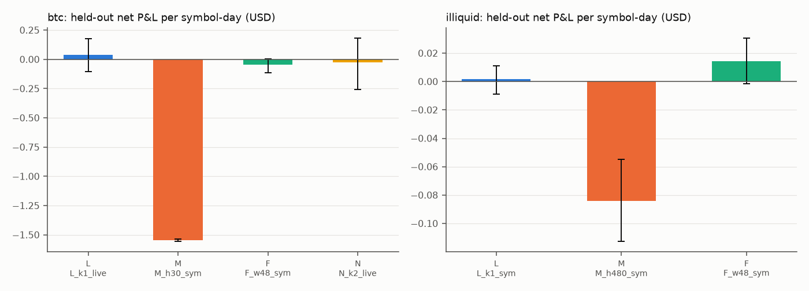
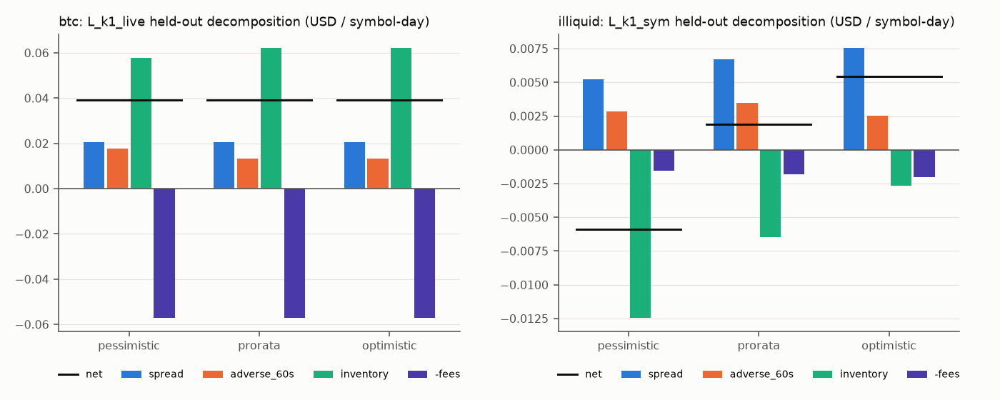
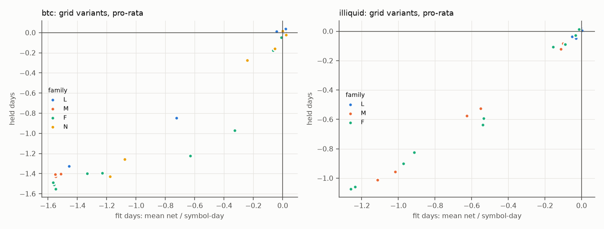

# Market making on replayed real Bybit order books (H-MMR0, H-MMR1, H-MMR2), 2026-11-14

Agent M. Research only: no live orders, no Bybit trading calls. The quoting code is the live `atx mm` code; the market is the real ob200 book and the real trade tape of each symbol-day, replayed by `atx mm-replay` (crates/atx/src/mm_replay.rs) through at-match. All days are after the knowledge cutoff (2026-07-01), so every result is `clean_holdout`.

## Verdicts

- **H-MMR0 (replay reproduces live fills): supports.**
- **H-MMR1 (held-out net P&L > 0): inconclusive.**
- **H-MMR2 (forecast widths beat the best fixed width): inconclusive.**

## In plain words

- **Quoting tight loses money, fast.** On these 20 days, every variant that quoted within about 25 bp of the mid lost money on held-out days, for BTC and for the illiquid contracts alike. The spread it captured (+0.2 to +0.4 USD per symbol-day) was smaller than what the market took back **within one second** of each fill (adverse selection -0.5 to -0.8 USD), before fees (-0.6 to -1.1 USD). On BTC these variants hit the 1.5 USD per-symbol loss stop on most days.
- **Quoting wide earns almost nothing.** The variants chosen on the fit days are the live width (`L_k1_live` for BTC: the live mm_multi rule itself; `L_k1_sym` for the illiquid group). They sit 40-50 bp from the mid, fill 2-4 times a day and make a few cents: BTC +0.039 USD per symbol-day (95% CI -0.105 to +0.178), illiquid +0.002 (-0.009 to +0.011). Positive means, CIs straddling zero: **H-MMR1 inconclusive.**
- **Volatility forecasts did not help.** Widths from the 15 s micro sigma (the mm_nvda_micro settings) quote much closer and lost clearly against the best fixed width (illiquid -0.099 USD per symbol-day, CI -0.126 to -0.074; BTC -1.50, CI -1.55 to -1.44). The BTC 1h forecast band (the field's sigma, the live network band only for 2026-11-13 20-24 UTC) was level with the best fixed width (+0.024, CI -0.21 to +0.22). **H-MMR2 inconclusive** by its pre-registered rule (one forecast has a positive point estimate), but the micro-sigma half is a clear negative.
- **The replay matches the live bot's few fills.** On the six live symbol-days (2026-11-09 and 11-10) the replay with the journaled live config made 12 fills where the bot made 7, with the same P&L sign on all six (pro-rata). The median error is 0.25 only because two quiet days had zero fills in both; on the four days with live fills the error is 0.75. **H-MMR0 supports** by its pre-registered rule, on very little data (7 live fills).
- **Queue model choice matters little for the wide quoters** (their fills come mostly from trades through the quote); it matters for the tight ones (for the illiquid choice: pessimistic -0.006, pro-rata +0.002, optimistic +0.005 USD per symbol-day).

## Caveats and what went wrong

- **BTC grid amendment.** The first BTC day placed no orders: mm_multi's 60 USD portfolio net cap is below one BTC order (~80 USD) and has no from-flat exemption, so the live code can never quote BTC under that config (a finding about the live config). The BTC grid sets `max_net_usd = 0` (logged in the diary and split.json `amendments`; BTCUSDT 2026-10-25 was downloaded a second time to re-run it, recorded in the manifest).
- **Sub-tick prints.** TRXUSDT 2026-10-29 and 10-31 have ~900 prints off the 0.0001 tick grid during a trading burst while every ob200 level stays on the grid; they are treated like RPI prints (hidden liquidity, no effect on our queue). Both days first failed and were re-run from the kept raw files; TRXUSDT 10-30 and 11-01 (fit days) therefore ran without the previous day's bars (their first ~30 minutes quoted at the floor sigma).
- **Build interference.** Two BTC days failed because another agent rebuilt `target/debug/atx.exe` mid-run; both were re-run in order, and the study now runs a private copy of the binary.
- **BTC book resolution.** The BTC ob200 archive is a 100 ms feed: 59% of BTC prints (median day) fall outside the pre-trade touch (ETC 28%, TRX 8%, XLM 7%). The best alignment is at the matching-engine time `cts` (checked by shifting the tape), so the ordering is right, but BTC queue positions are coarse; most BTC fills come from trades through our price.
- **Overfitting diagnostics.** PBO is 0.00 in both groups, but it is not reassuring here: most grid variants are dominated (they stop out daily), so the fit winner always beats the OOS median. The purged-CV estimate of the whole selection procedure is negative (BTC -0.015, illiquid -0.025 USD per symbol-day). Deflated Sharpe (null trial variance; the cross-trial variance is dominated by the stop-out variants and gives 0.0): BTC 0.05, illiquid 0.89.
- **Not modelled:** portfolio caps across symbols, structural zones (levels_file), the live link's stale tops, funding, Bybit internals (hidden priority, internal latency), our own market impact (minimum orders). Each day starts flat and is marked to the mid at 24:00 UTC. The H-MMR0 runs start flat at the window start (the live bot carried inventory into 2026-11-09).
- **Small money.** All P&L is at the venue minimum order (BTC ~80 USD, illiquid ~5 USD per fill): cents per day. The result is about the sign and the mechanism, not the amount.

## Data

- Symbols and days: BTCUSDT, TRXUSDT, ETCUSDT, XLMUSDT; 2026-10-25 .. 2026-11-13 (20 days each, 80 symbol-days, all verified: 0 engine rejects, replayer book equal to the engine at every check, ledger identity exact). Fit 10-25 .. 11-03, held 11-04 .. 11-13 (chronological, written before any P&L). Live days 11-09 and 11-10 included.
- Sources: quote-saver.bycsi.com ob200 + public.bybit.com trades, one day at a time, processed and deleted (manifest data/research/mm_replay/manifest.json; 0 raw files left). Warm-up bars of 10-23 / 10-24 from trades only.
- Storage: 6.30 GB before (lake 1.61, research 4.26, raw 0.44), 6.41 GB after (lake 1.66, research 4.35, raw 0.40; the study's own outputs are 90 MB). Peak transient raw below 1 GB.
- Runtime: 3.8 h of single-threaded replay (debug build), 22-28 variants x 3 queue models per symbol-day.


## What was run

- **engine**: atx mm-replay (crates/atx/src/mm_replay.rs): ob200 snapshot + deltas -> at_match::Ob200Replayer -> at_match::OrderBook; public trade tape merged by time (trade ts <= message cts first); the live atx mm decision code (mm::symbol_inputs, mm::target_quotes, mm::needs_replace, sigma / flow / micro / toxicity / shock / trend-guard steps); our orders virtual (minimum lots, no impact)
- **queue**: join the back at activation (ahead = level size); trades at our price consume from the front; trade through our price or a real resting order crossing our price fills us; unexplained level decreases are cancels split FIFO-pessimistic (behind first), pro-rata (primary), LIFO-optimistic (ahead first); levels outside the 200-level window count fully ahead when they appear; RPI prints do not fill
- **latency_ms**: 150
- **fees**: config/fees.yaml by symbol class (crypto: maker 2.0 bp, taker 5.5 bp)
- **risk**: inventory caps, per-symbol and global loss stops from the config (a stop cancels and closes at market, taker); one-lot-from-flat rule
- **day**: each symbol-day starts flat at 00:00 UTC and is marked to the mid at 24:00 UTC; warm-up 1m bars of the two previous days
- **pnl**: net = spread captured + adverse selection (60 s) + inventory P&L - fees; spread = sum s q (mid_fill - price); adverse_h = sum s q (mid_t+h - mid_fill) (1 / 10 / 60 s); inventory = sum s q (mid_end - mid_t+60s)
- **selection**: per group, on FIT days only, pro-rata queue: combinatorial purged CV over days (10 fit days, 2 test days per split = 45 splits, training days within 1 calendar day of a test day purged); a variant's CV score = median over splits of its test-day mean net P&L per symbol-day; choice = the highest CV score (H-MMR1); best fixed width = the F variant chosen the same way among F only, best micro among M, best forecast among N (H-MMR2)
- **overfitting**: PBO by CSCV over the fit days (S = 10 one-day blocks, C(10,5) = 252 splits, metric = mean net P&L per symbol-day); deflated Sharpe of the chosen variant's daily net P&L on fit days with N = grid size trials
- **tests**: H-MMR1: mean net P&L per symbol-day on HELD days, day-clustered bootstrap (B = 10000) 95% CI, per group, pro-rata primary; H-MMR2: paired per symbol-day difference (forecast - best fixed) on HELD days, day-clustered bootstrap; H-MMR0: live days with the journaled live config over the live window, |replay - live| / max(live, 1) fill-count error and P&L sign agreement
- **segment**: every day is after research.knowledge_cutoff (2026-07-01): clean_holdout
- **forecast**: N family: the BTC live network's 1h band (data/journal/live_nn net.1h.sigma_pct) where it exists (2026-11-13 20:00-24:00 UTC); every other hour the field's hour-of-week x log-vol sigma sqrt(vf_t * f_next) (ai_trader.field.state; hour-of-week profile known at the day's 00:00 UTC; row valid from its known_ts)

Coverage (symbol-days with a verified replay):

- btc BTCUSDT: 20 days (2026-10-25 .. 2026-11-13)
- illiquid TRXUSDT: 20 days (2026-10-25 .. 2026-11-13)
- illiquid ETCUSDT: 20 days (2026-10-25 .. 2026-11-13)
- illiquid XLMUSDT: 20 days (2026-10-25 .. 2026-11-13)

## H-MMR0: replay vs the live bot's own fills

| day | symbol | live window (UTC) | live fills | replay fills (pess / pro-rata / opt) | live P&L | replay P&L pro-rata |
|---|---|---|---|---|---|---|
| 2026-11-09 | TRXUSDT | 00:00-08:13 | 2 | 3 / 3 / 7 | +0.0063 | +0.0161 |
| 2026-11-09 | ETCUSDT | 00:00-08:13 | 1 | 2 / 2 / 2 | +0.0057 | +0.0291 |
| 2026-11-09 | XLMUSDT | 00:00-08:13 | 2 | 5 / 5 / 5 | +0.0349 | +0.0475 |
| 2026-11-10 | TRXUSDT | 19:49-22:20 | 2 | 2 / 2 / 2 | +0.0063 | +0.0080 |
| 2026-11-10 | ETCUSDT | 19:49-22:20 | 0 | 0 / 0 / 0 | +0.0000 | +0.0000 |
| 2026-11-10 | XLMUSDT | 19:49-22:20 | 0 | 0 / 0 / 0 | +0.0000 | +0.0000 |

| queue model | median abs fill-count error | P&L sign agreement | replay fills | live fills |
|---|---|---|---|---|
| pessimistic | 0.25 | 1.00 | 12 | 7 |
| prorata | 0.25 | 1.00 | 12 | 7 |
| optimistic | 0.50 | 1.00 | 16 | 7 |

Error = |replay - live| / max(live, 1) per symbol-day. Success needed <= 0.30 and >= 0.70 under pro-rata.

## Selection on fit days (pro-rata) and overfitting

| group | chosen | CV score (median test-day net) | procedure OOS mean | PBO | deflated Sharpe | fit-days daily Sharpe |
|---|---|---|---|---|---|---|
| btc | L_k1_live | +0.0183 | -0.0151 | 0.00 | +0.050 | +0.142 |
| illiquid | L_k1_sym | +0.0097 | -0.0252 | 0.00 | +0.890 | +0.984 |

Best variant per family (chosen on fit days the same way):

| group | family | variant | held net pro-rata [95% CI] | pessimistic | optimistic | family PBO |
|---|---|---|---|---|---|---|
| btc | L | L_k1_live | +0.0391 [-0.1034, +0.1759] | +0.0391 | +0.0391 | 0.20 |
| btc | M | M_h30_sym | -1.5480 [-1.5569, -1.5371] | -1.5510 | -1.5439 | 0.67 |
| btc | F | F_w48_sym | -0.0475 [-0.1139, +0.0035] | -0.0475 | -0.0475 | 0.00 |
| btc | N | N_k2_live | -0.0241 [-0.2593, +0.1832] | -0.0241 | -0.0241 | 0.00 |
| illiquid | L | L_k1_sym | +0.0019 [-0.0088, +0.0111] | -0.0059 | +0.0054 | 0.03 |
| illiquid | M | M_h480_sym | -0.0843 [-0.1127, -0.0547] | -0.0994 | -0.0626 | 0.00 |
| illiquid | F | F_w48_sym | +0.0145 [-0.0017, +0.0307] | +0.0041 | +0.0147 | 0.00 |

## H-MMR1: held-out P&L and its decomposition (USD per symbol-day)

| group | variant | queue | net | spread | adverse 1 s | adverse 10 s | adverse 60 s | inventory | fees | fills / symbol-day | 95% CI of net |
|---|---|---|---|---|---|---|---|---|---|---|---|
| btc | L_k1_live | pessimistic | +0.0391 | +0.0205 | -0.0514 | -0.0381 | +0.0178 | +0.0578 | -0.0571 | 3.8 | [-0.1081, +0.1779] |
| btc | L_k1_live | prorata | +0.0391 | +0.0205 | -0.0513 | -0.0317 | +0.0134 | +0.0623 | -0.0571 | 3.8 | [-0.1054, +0.1783] |
| btc | L_k1_live | optimistic | +0.0391 | +0.0205 | -0.0513 | -0.0306 | +0.0134 | +0.0623 | -0.0571 | 3.8 | [-0.1052, +0.1743] |
| illiquid | L_k1_sym | pessimistic | -0.0059 | +0.0053 | -0.0049 | +0.0026 | +0.0029 | -0.0124 | -0.0016 | 1.7 | [-0.0246, +0.0076] |
| illiquid | L_k1_sym | prorata | +0.0019 | +0.0067 | -0.0059 | +0.0033 | +0.0035 | -0.0065 | -0.0018 | 1.8 | [-0.0092, +0.0111] |
| illiquid | L_k1_sym | optimistic | +0.0054 | +0.0076 | -0.0063 | +0.0012 | +0.0025 | -0.0026 | -0.0020 | 2.4 | [-0.0017, +0.0124] |

net = spread + adverse 60 s + inventory - fees; adverse 1 s and 10 s are the earlier parts of adverse 60 s.

## H-MMR2: forecast-informed widths minus the best fixed width (held days, paired per symbol-day)

| group | forecast | variant | fixed | difference pro-rata [95% CI] | pessimistic | optimistic |
|---|---|---|---|---|---|---|
| btc | micro sigma | M_h30_sym | F_w48_sym | -1.5004 [-1.5515, -1.4389] | -1.5035 | -1.4964 |
| btc | 1h network / field band | N_k2_live | F_w48_sym | +0.0235 [-0.2100, +0.2157] | +0.0235 | +0.0235 |
| illiquid | micro sigma | M_h480_sym | F_w48_sym | -0.0988 [-0.1259, -0.0739] | -0.1035 | -0.0773 |

## Figures





## Rule candidates

```yaml
- id: R-MMR-1
  kind: avoid
  rule: "WHEN quoting passively on a Bybit USDT perp at crypto maker fees (2 bp) with quotes within about 25 bp of the mid THEN expect a net loss: adverse selection inside one second already exceeds the spread captured"
  when: "quote distance from mid < ~25 bp (BTCUSDT) or < ~20 bp (TRXUSDT, ETCUSDT, XLMUSDT); fees from config/fees.yaml crypto class"
  then: "expect negative net P&L per symbol-day (replayed on real ob200 books with the live atx mm quoting code); prefer not quoting that tight"
  scope: {assets: [BTCUSDT, TRXUSDT, ETCUSDT, XLMUSDT], horizon: intraday, sides: both}
  effect: "held days, pro-rata queue: every variant quoting closer than ~25 bp lost; e.g. fixed 3 bp quote sigma -1.55 USD/day BTC (stopped by the 1.5 USD symbol stop 10/10 days), -1.07 USD/day illiquid; spread +0.24/+0.33 vs adverse(1 s) -0.60/-0.76 and fees -1.07/-0.70 USD/day"
  confidence: B
  evidence: [H-MMR1, H-MMR2, research/reports/mm_replay_2026-11-14.md]
  review: "a held-out month where a sub-25 bp variant has net > 0 with a day-clustered CI above 0, or a maker rebate / VIP fee tier"
  status: active
- id: R-MMR-2
  kind: expect
  rule: "WHEN the live 1h-sigma quoter runs at its live width (offsets 0.45 / 0.90 sigma, or 0.675 symmetric) THEN expect a few fills a day and net P&L indistinguishable from zero"
  when: "atx mm quote rule with config/mm_illiq20.yaml or mm_multi.yaml widths (k = 1), quotes ~40-50 bp from mid"
  then: "expect about 2-5 fills per symbol-day and net within a few cents of zero; no evidence of an edge after fees"
  scope: {assets: [BTCUSDT, TRXUSDT, ETCUSDT, XLMUSDT], horizon: "1 day", sides: both}
  effect: "held days, pro-rata: BTCUSDT +0.039 USD/symbol-day [95% CI -0.105, +0.178]; illiquid +0.002 [-0.009, +0.011]; fit-chosen by purged CV (PBO 0.00, deflated Sharpe 0.05 BTC / 0.89 illiquid)"
  confidence: C
  evidence: [H-MMR1, research/reports/mm_replay_2026-11-14.md]
  review: "more held-out days (the CI is ~10x the mean), or a lower fee tier"
  status: active
- id: R-MMR-3
  kind: avoid
  rule: "WHEN setting crypto quote widths from the 15 s micro sigma (mm_nvda_micro settings) at 2 bp maker fees THEN avoid it: it quotes too close and loses to the best fixed width"
  when: "micro_interval_s = 15, micro_lookback = 40, micro_horizon_s 30-480, requote_sigma 0.5, min_rest_s 10; crypto fee class"
  then: "expect lower net P&L than a wide fixed width chosen on the same days"
  scope: {assets: [BTCUSDT, TRXUSDT, ETCUSDT, XLMUSDT], horizon: intraday, sides: both}
  effect: "held days, pro-rata, paired per symbol-day micro minus best fixed: illiquid -0.099 USD [-0.126, -0.074]; BTC -1.50 [-1.55, -1.44]; the 1h field / network band vs fixed on BTC +0.024 [-0.21, +0.22] (no difference shown)"
  confidence: B
  evidence: [H-MMR2, research/reports/mm_replay_2026-11-14.md]
  review: "a micro-sigma variant with wider horizon or a zero-fee (TradFi) contract tested on held-out replay days"
  status: active
- id: R-MMR-4
  kind: expect
  rule: "WHEN using the ob200 replay (atx mm-replay) to judge a quoting change on quiet contracts THEN expect it to roughly match the live bot's fills, with somewhat more fills than live"
  when: "replay of the journaled live config over the live window, pro-rata queue, 150 ms latency"
  then: "expect fill counts within about a factor of two of live and the same P&L sign; treat replay P&L as an upper-side estimate"
  scope: {assets: [TRXUSDT, ETCUSDT, XLMUSDT], horizon: "hours", sides: both}
  effect: "6 live symbol-days (2026-11-09, 11-10): replay 12 fills vs live 7; median |error| 0.25 (0.75 on the 4 days with live fills), P&L sign agreement 6/6"
  confidence: C
  evidence: [H-MMR0, research/reports/mm_replay_2026-11-14.md]
  review: "a live run with >= 30 fills per symbol-day replayed the same way"
  status: active
```
