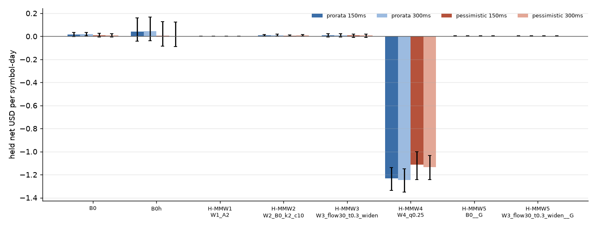
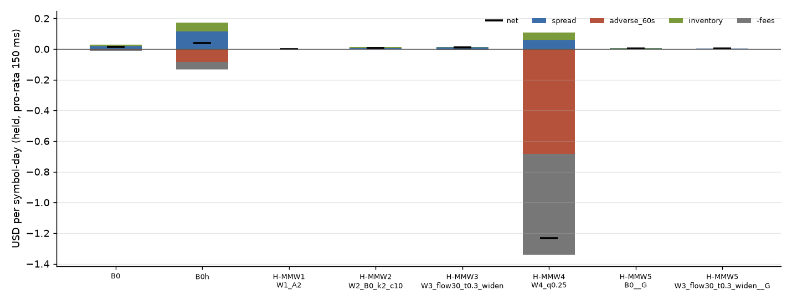

# Weekend alt market making on replayed Bybit books (H-MMW1 .. H-MMW6), 2026-11-21

Agent MMW. Research only: no live orders, no Bybit trading or private calls. The quoting code is the live `atx mm` code plus the weekend rules added to crates/atx/src/mm.rs; the market is the real ob200 book and public trade tape of each symbol-day (plus BTCUSDT's tape for the BTC pull), replayed by `atx mm-replay`. Every day is after the knowledge cutoff (2026-07-01): every result is `clean_holdout`.

## Verdicts

- **H-MMW1: inconclusive** (chosen on FIT: `W1_A2`).
- **H-MMW2: supports** (chosen on FIT: `W2_B0_k2_c10`).
- **H-MMW3: inconclusive** (chosen on FIT: `W3_flow30_t0.3_widen`).
- **H-MMW4: contradicts** (chosen on FIT: `W4_q0.25`).
- **H-MMW5: inconclusive** (pairs B0 and `W3_flow30_t0.3_widen`).
- **H-MMW6: inconclusive** (evaluated for W2_B0_k2_c10).

Held mean net USD per symbol-day [day-clustered 95% CI], in each cell:

| hypothesis | variant | pro-rata 150 ms | pro-rata 300 ms | FIFO-pess. 150 ms | FIFO-pess. 300 ms | passes |
|---|---|---|---|---|---|---|
| H-MMW1 | W1_A2 | +0.0000 [+0.0000, +0.0000] | +0.0000 [+0.0000, +0.0000] | +0.0000 [+0.0000, +0.0000] | +0.0000 [+0.0000, +0.0000] | no |
| H-MMW2 | W2_B0_k2_c10 | +0.0079 [+0.0015, +0.0167] | +0.0085 [+0.0019, +0.0180] | +0.0066 [+0.0008, +0.0137] | +0.0072 [+0.0011, +0.0150] | yes |
| H-MMW3 | W3_flow30_t0.3_widen | +0.0089 [-0.0074, +0.0218] | +0.0089 [-0.0074, +0.0218] | +0.0072 [-0.0078, +0.0192] | +0.0072 [-0.0078, +0.0192] | no |
| H-MMW4 | W4_q0.25 | -1.2331 [-1.3354, -1.1394] | -1.2464 [-1.3500, -1.1478] | -1.1144 [-1.2423, -0.9997] | -1.1348 [-1.2426, -1.0331] | no |
| H-MMW5 gated | B0__G | +0.0031 [+0.0014, +0.0052] | +0.0031 [+0.0014, +0.0052] | +0.0030 [+0.0010, +0.0053] | +0.0030 [+0.0010, +0.0053] | yes |
| H-MMW5 gated | W3_flow30_t0.3_widen__G | +0.0031 [+0.0006, +0.0058] | +0.0031 [+0.0006, +0.0058] | +0.0028 [+0.0006, +0.0052] | +0.0028 [+0.0006, +0.0052] | yes |
| baseline | B0 | +0.0158 [-0.0013, +0.0330] | +0.0196 [+0.0047, +0.0352] | +0.0093 [-0.0066, +0.0257] | +0.0091 [-0.0064, +0.0246] | no |
| baseline | B0h | +0.0393 [-0.0410, +0.1611] | +0.0434 [-0.0391, +0.1689] | +0.0047 [-0.0868, +0.1266] | +0.0031 [-0.0877, +0.1224] | no |

## In plain words

- **Nothing here earns real money.** At the venue minimum lot every variant makes or loses cents per symbol-day; the best held result is about +0.8 cent. The question was the sign and the mechanism.
- **H-MMW2 (pull alt quotes when BTC jumps) passes the frozen rule, but not for the registered reason.** The FIT-chosen `W2_B0_k2_c10` (B0 width; pull when |BTC 1 s or 5 s return| > 2 x the BTC 1h sigma scaled to the horizon; 10 s cooldown) has held means of +0.0066 to +0.0085 USD per symbol-day with day-clustered 95% CIs above 0 in all four cells. But (a) it is **worse than B0 without the pull** (paired -0.002 to -0.011): the pull mostly removes fills; (b) spread minus adverse selection minus fees is about zero (+0.0001 USD per symbol-day excluding inventory, FIFO-pessimistic 300 ms), so the net is the **inventory mark** of small positions held to 24:00; (c) only 19 of 56 held symbol-days have a fill, 3 are negative, and one weekend (11-07/08) has 43 of its 73 fills. The CI is above zero because most days are exactly zero and a few are positive. Read it as "the pull makes a nearly idle quoter more idle without losing", not as an edge from avoiding toxic fills.
- **The BTC trigger is much busier than intended:** z > 2 on 45% of BTC prints (z > 4 on 26%). 1 s returns are far from Gaussian and prints cluster in moving seconds.
- **H-MMW4 (join only short queues at the touch) loses clearly: contradicts.** About 520-600 fills per symbol-day, -1.11 to -1.25 USD per symbol-day. Adverse selection inside **1 s** (-0.50 to -0.72) is ten times the spread captured (+0.06 pro-rata, negative under FIFO-pessimistic); fees (-0.60 to -0.66) come on top. This repeats R-MMR-1 on these alts.
- **H-MMW1 (level ladders) never really traded: inconclusive.** The zones of scripts/levels.py (top 8 by score, recency weighted) almost never sit 1.5-3.5 x the 1h sigma from the mid: A1 placed 9233 resting level orders over 112 symbol-days and filled **one** lot (zero on held days). A2's liquidation pull is on nearly all day (caveats), so A2 - A1 is exactly zero and says nothing about R-FLOW-2.
- **H-MMW3 (pull or widen the threatened side) is level with B0: inconclusive.** `W3_flow30_t0.3_widen` +0.007 to +0.009 USD per symbol-day, CIs straddle zero; paired vs B0 -0.002 to -0.011 (CIs straddle zero).
- **H-MMW5 (jump gate) makes the quoter smaller, not better: inconclusive.** The gate is on about 30% of the time. Gated B0 has a held mean above 0 with the CI above 0 in every cell (+0.003), but gated minus ungated is negative (-0.006 to -0.017; one CI below 0), so the registered condition fails; the same for gated W3. As on weekdays (R-MMR-5), the gate mostly stops trading.
- **B0 (the live mm_illiq20 width) is slightly positive but not significant** in three of four cells (+0.009 to +0.020 USD per symbol-day, about 4 fills), consistent with R-MMR-2.
- **H-MMW6 (portfolio caps) was evaluated because H-MMW2 passed: inconclusive.** With net 40 / gross 80 USD caps on one clock, `W2_B0_k2_c10` makes +0.034 to +0.047 USD per portfolio day; the CI is above 0 under pro-rata but not under FIFO-pessimistic (lower bounds -0.003 and -0.002).

## Caveats and what went wrong

- **The liquidation-cluster proxy does not discriminate.** It was declared before results, because the lake's liquidation stream starts 2026-11-08, after the FIT days: >= 5 same-side prints in 30 s over >= 3 levels, with summed notional >= 10 x the previous day's median print. Median prints are 10-30 USD with heavy tails, so it fired a median of about 1700 times per symbol-day. Against the lake's liquidation prints on 2026-11-14/15 (7 symbols) it catches 94-99% of them, but only 9-27% of its triggers fall within 30 s of a real one. The smoke run showed this before any P&L was computed (split.json `amendments`, diary). The frozen proxy was kept, so **A2 and the R-FLOW-2 check are uninformative**, not negative.
- **The ladder is limited by the levels logic.** Only the top 8 zones by score are kept, and they sit far from the price: on 09-26 all 8 XLM zones were at least 5% below it, while 3.5 sigma is about 2%. A ladder built on all clusters or on 1h pivots would quote, but it was not registered and was not run.
- **The H-MMW2 pass rests on 8 day-clusters and on inventory P&L.** The W2 selection has PBO 0.41, the purged-CV estimate of the selection procedure is -0.033 USD per symbol-day (worst cell), and the deflated Sharpe is 0.05. The training-best pick changes across splits (k2_c10, k2_c30, k3_c10, B0h_k3_c60).
- **Reading of "field P(jump)":** the field is BTC-only, so for H-MMW5 its P(jump) serves as the market-wide jump state for every alt. Its FIT tercile and median are almost equal (0.01583 vs 0.01597), so the hysteresis barely matters.
- **Clarifications made before results** (split.json): ladder quotes sit at the zone edge nearest the mid; the take-profit is never less than one tick beyond the entry; sigma_risk is the quoter's unshrunk 1h sigma; selection uses the worst of the four cells.
- **Not modelled:** Bybit internals (hidden priority, internal latency), our own impact, funding, the live link's stale tops, and structural zones in the B0 quoter. Each day starts flat and is marked to the mid at 24:00 UTC. About 21% of prints (median symbol-day) fall outside the pre-trade touch, so queue positions are approximate.
- **One re-download:** BTCUSDT 2026-09-26 trades were downloaded twice (about 25 MB; the smoke run had deleted them; logged in the manifest `redownloads`).
- **Small money, small sample:** 4 held weekends, minimum order about 5 USD.


## Selection on FIT days and overfitting

| hypothesis | choice | CV score (median split, worst cell) | procedure OOS (worst cell) | FIT mean (pro-rata 150) | PBO | deflated Sharpe | candidates |
|---|---|---|---|---|---|---|---|
| H-MMW1 | W1_A2 | +0.0000 | -0.0004 | +0.0000 | +1.00 | n/a | 2 |
| H-MMW2 | W2_B0_k2_c10 | +0.0064 | -0.0333 | +0.0064 | +0.41 | +0.051 | 18 |
| H-MMW3 | W3_flow30_t0.3_widen | +0.0128 | -0.0109 | +0.0129 | +0.73 | +0.247 | 12 |
| H-MMW4 | W4_q0.25 | -1.4719 | -1.4652 | -1.4450 | +0.00 | +0.000 | 3 |

## Paired tests (held, per symbol-day)

| test | a - b | pro-rata 150 ms | pro-rata 300 ms | FIFO-pess. 150 ms | FIFO-pess. 300 ms |
|---|---|---|---|---|---|
| H-MMW1 | W1_A2 - W1_A1 | +0.0000 [+0.0000, +0.0000] | +0.0000 [+0.0000, +0.0000] | +0.0000 [+0.0000, +0.0000] | +0.0000 [+0.0000, +0.0000] |
| H-MMW2 | W2_B0_k2_c10 - B0 | -0.0080 [-0.0224, +0.0061] | -0.0111 [-0.0228, -0.0002] | -0.0027 [-0.0152, +0.0098] | -0.0019 [-0.0139, +0.0099] |
| H-MMW3 | W3_flow30_t0.3_widen - B0 | -0.0070 [-0.0244, +0.0141] | -0.0107 [-0.0256, +0.0071] | -0.0020 [-0.0140, +0.0126] | -0.0019 [-0.0137, +0.0125] |
| H-MMW5 | B0__G - B0 | -0.0127 [-0.0300, +0.0050] | -0.0165 [-0.0318, -0.0018] | -0.0063 [-0.0224, +0.0095] | -0.0061 [-0.0213, +0.0092] |
| H-MMW5 | W3_flow30_t0.3_widen__G - W3_flow30_t0.3_widen | -0.0058 [-0.0175, +0.0092] | -0.0058 [-0.0175, +0.0092] | -0.0044 [-0.0154, +0.0099] | -0.0044 [-0.0154, +0.0099] |

## P&L decomposition (held, USD per symbol-day)

| hypothesis | variant | cell | net [95% CI] | spread | adverse 1 s | adverse 10 s | adverse 60 s | inventory | fees | fills / symbol-day | through share |
|---|---|---|---|---|---|---|---|---|---|---|---|
| H-MMW1 | W1_A2 | prorata 150 ms | +0.0000 [+0.0000, +0.0000] | +0.0000 | +0.0000 | +0.0000 | +0.0000 | +0.0000 | -0.0000 | 0.0 | 0.00 |
| H-MMW1 | W1_A2 | prorata 300 ms | +0.0000 [+0.0000, +0.0000] | +0.0000 | +0.0000 | +0.0000 | +0.0000 | +0.0000 | -0.0000 | 0.0 | 0.00 |
| H-MMW1 | W1_A2 | pessimistic 150 ms | +0.0000 [+0.0000, +0.0000] | +0.0000 | +0.0000 | +0.0000 | +0.0000 | +0.0000 | -0.0000 | 0.0 | 0.00 |
| H-MMW1 | W1_A2 | pessimistic 300 ms | +0.0000 [+0.0000, +0.0000] | +0.0000 | +0.0000 | +0.0000 | +0.0000 | +0.0000 | -0.0000 | 0.0 | 0.00 |
| H-MMW2 | W2_B0_k2_c10 | prorata 150 ms | +0.0079 [+0.0015, +0.0167] | +0.0057 | -0.0046 | -0.0049 | -0.0043 | +0.0076 | -0.0011 | 1.3 | 0.34 |
| H-MMW2 | W2_B0_k2_c10 | prorata 300 ms | +0.0085 [+0.0019, +0.0180] | +0.0057 | -0.0046 | -0.0049 | -0.0042 | +0.0083 | -0.0012 | 1.4 | 0.32 |
| H-MMW2 | W2_B0_k2_c10 | pessimistic 150 ms | +0.0066 [+0.0008, +0.0137] | +0.0048 | -0.0042 | -0.0047 | -0.0037 | +0.0064 | -0.0010 | 1.2 | 0.46 |
| H-MMW2 | W2_B0_k2_c10 | pessimistic 300 ms | +0.0072 [+0.0011, +0.0150] | +0.0048 | -0.0043 | -0.0048 | -0.0036 | +0.0071 | -0.0011 | 1.3 | 0.45 |
| H-MMW3 | W3_flow30_t0.3_widen | prorata 150 ms | +0.0089 [-0.0074, +0.0218] | +0.0109 | -0.0077 | -0.0054 | -0.0047 | +0.0042 | -0.0015 | 1.9 | 0.34 |
| H-MMW3 | W3_flow30_t0.3_widen | prorata 300 ms | +0.0089 [-0.0074, +0.0218] | +0.0109 | -0.0077 | -0.0054 | -0.0047 | +0.0042 | -0.0015 | 1.9 | 0.34 |
| H-MMW3 | W3_flow30_t0.3_widen | pessimistic 150 ms | +0.0072 [-0.0078, +0.0192] | +0.0101 | -0.0071 | -0.0050 | -0.0044 | +0.0030 | -0.0014 | 1.9 | 0.52 |
| H-MMW3 | W3_flow30_t0.3_widen | pessimistic 300 ms | +0.0072 [-0.0078, +0.0192] | +0.0101 | -0.0071 | -0.0050 | -0.0044 | +0.0030 | -0.0014 | 1.9 | 0.52 |
| H-MMW4 | W4_q0.25 | prorata 150 ms | -1.2331 [-1.3354, -1.1394] | +0.0590 | -0.7041 | -0.6961 | -0.6814 | +0.0474 | -0.6580 | 593.7 | 0.08 |
| H-MMW4 | W4_q0.25 | prorata 300 ms | -1.2464 [-1.3500, -1.1478] | +0.0763 | -0.7195 | -0.7073 | -0.6905 | +0.0271 | -0.6594 | 597.9 | 0.08 |
| H-MMW4 | W4_q0.25 | pessimistic 150 ms | -1.1144 [-1.2423, -0.9997] | -0.1238 | -0.5020 | -0.4819 | -0.4613 | +0.0652 | -0.5945 | 519.6 | 0.10 |
| H-MMW4 | W4_q0.25 | pessimistic 300 ms | -1.1348 [-1.2426, -1.0331] | -0.1207 | -0.5071 | -0.4801 | -0.4581 | +0.0393 | -0.5954 | 522.1 | 0.10 |
| H-MMW5 | B0__G | prorata 150 ms | +0.0031 [+0.0014, +0.0052] | +0.0036 | -0.0032 | -0.0024 | -0.0011 | +0.0017 | -0.0011 | 1.3 | 0.13 |
| H-MMW5 | B0__G | prorata 300 ms | +0.0031 [+0.0014, +0.0052] | +0.0036 | -0.0032 | -0.0024 | -0.0011 | +0.0017 | -0.0011 | 1.4 | 0.14 |
| H-MMW5 | B0__G | pessimistic 150 ms | +0.0030 [+0.0010, +0.0053] | +0.0025 | -0.0025 | -0.0015 | -0.0003 | +0.0018 | -0.0010 | 1.1 | 0.32 |
| H-MMW5 | B0__G | pessimistic 300 ms | +0.0030 [+0.0010, +0.0053] | +0.0025 | -0.0025 | -0.0015 | -0.0003 | +0.0018 | -0.0010 | 1.1 | 0.33 |
| H-MMW5 | W3_flow30_t0.3_widen__G | prorata 150 ms | +0.0031 [+0.0006, +0.0058] | +0.0019 | -0.0015 | -0.0011 | -0.0003 | +0.0019 | -0.0004 | 0.5 | 0.20 |
| H-MMW5 | W3_flow30_t0.3_widen__G | prorata 300 ms | +0.0031 [+0.0006, +0.0058] | +0.0019 | -0.0015 | -0.0011 | -0.0003 | +0.0019 | -0.0004 | 0.5 | 0.20 |
| H-MMW5 | W3_flow30_t0.3_widen__G | pessimistic 150 ms | +0.0028 [+0.0006, +0.0052] | +0.0017 | -0.0014 | -0.0009 | -0.0003 | +0.0018 | -0.0004 | 0.5 | 0.34 |
| H-MMW5 | W3_flow30_t0.3_widen__G | pessimistic 300 ms | +0.0028 [+0.0006, +0.0052] | +0.0017 | -0.0014 | -0.0009 | -0.0003 | +0.0018 | -0.0004 | 0.5 | 0.34 |
| baseline | B0 | prorata 150 ms | +0.0158 [-0.0013, +0.0330] | +0.0167 | -0.0148 | -0.0120 | -0.0082 | +0.0111 | -0.0039 | 4.4 | 0.17 |
| baseline | B0 | prorata 300 ms | +0.0196 [+0.0047, +0.0352] | +0.0169 | -0.0148 | -0.0115 | -0.0076 | +0.0143 | -0.0040 | 4.6 | 0.16 |
| baseline | B0 | pessimistic 150 ms | +0.0093 [-0.0066, +0.0257] | +0.0114 | -0.0108 | -0.0090 | -0.0063 | +0.0069 | -0.0028 | 3.9 | 0.51 |
| baseline | B0 | pessimistic 300 ms | +0.0091 [-0.0064, +0.0246] | +0.0115 | -0.0108 | -0.0090 | -0.0060 | +0.0064 | -0.0028 | 3.9 | 0.51 |

net = spread + adverse 60 s + inventory - fees; adverse 1 s and 10 s are the earlier parts of adverse 60 s; through share = fills from trades through our price.

## Figures




## Data

- 7 symbols (research/mm_weekend/universe.json) x the Sat + Sun of 8 weekends 2026-09-26 .. 11-15 = 112 symbol-days, all verified: 0 engine rejects, replayer book equal to the engine at every check, ledger identity < 1e-6 for all 296 quoters, BTC tape present. FIT 09-26 .. 10-18, HELD 10-24 .. 11-15. split.json was written 2026-11-21 01:16 UTC, before any P&L.
- Sources: quote-saver.bycsi.com ob200 and public.bybit.com trades (each alt plus BTCUSDT), processed one day at a time and deleted (manifest data/research/mm_weekend/manifest.json; 0 raw files left). Zones come from Bybit public 4h klines (cached). The first ob200 file (XLMUSDT 2026-11-15) was 20 MB; the largest was about 40 MB.
- Storage: 9.70 GB before (lake 2.82, research 6.48, raw 0.40), 9.90 GB after (lake 2.84, research 6.66, raw 0.40). The study's outputs are about 190 MB; peak transient raw stayed below 0.2 GB.
- Runtime: 61 min for 112 symbol-days (release build, single-threaded, 296 quoters per symbol-day), plus 12 min for the release build.

## Method

- **Engine:** `atx mm-replay` (private release copy data/research/mm_weekend/bin/atx-mmw.exe, built from commit 7254e26). It runs the live `atx mm` decision code with config/mm_illiq20.yaml for every variant, plus the weekend rules as pure, unit-tested functions in crates/atx/src/mm.rs: `ladder_levels`, `level_stop`, `ladder_tp`, `BtcTape` / `btc_move_z`, `top_imbalance`, `threatened_side`, `side_pull`, `short_queue`, `behind_thinned`, `LiqProxy`. Orders are virtual minimum lots.
- **Cells:** pro-rata and FIFO-pessimistic queue models x 150 and 300 ms latency. Orders, cancels, stops and pulls take effect one latency after they are sent. Fees: maker 2.0 bp, taker 5.5 bp.
- **Grid:** 37 variants, each also gated, so 74. B0 (ask 0.45 / bid 0.90 x the 1h sigma) and B0h (0.5 x B0); W1 ladder A1 / A2; W2 width {B0, B0h} x k {2, 3, 4} x cooldown {10, 30, 60} s; W3 {imb5, flow30} x {0.3, 0.5, 0.7} x {pull, widen 1 sigma}; W4 q {0.25, 0.5, 1}. Full definitions are in split.json `design`.
- **Selection:** FIT days only. Purged CV over the 4 FIT weekends (2 test weekends per split, 6 splits). A variant's split statistic is the worst of the four cells' test mean; its score is the median over splits. Best H-MMW1-4 = the family choice with the highest score (W3). PBO by CSCV over the 8 FIT days; deflated Sharpe with N = 74.
- **Tests:** held mean net USD per symbol-day with a day-clustered bootstrap 95% CI (B = 10000, seed 20261121). Pass = mean > 0 and CI above 0 in all four cells. Contradicts = mean <= 0 with the CI below 0 in the pro-rata 150 ms cell. H-MMW6: the passing variant's held fills on all 7 symbols merged on one clock with net 40 / gross 80 USD caps (one resting minimum-lot adding order per quoting symbol and side counted as filled; a blocked adding fill is dropped together with that symbol's later fills until it is flat again).
- **Segment:** every day is after research.knowledge_cutoff (2026-07-01): clean_holdout.

## Rule candidates (suggestions only; research/rules.yaml not edited)

```yaml
- id: R-MMW-1 (candidate)
  kind: avoid
  rule: "WHEN quoting minimum lots at the touch on thin Bybit alt perps (spread 4-12 bp) at crypto maker fees THEN avoid it, even when joining only short queues and leaving when the queue behind thins"
  effect: "held weekends 10-24..11-15, 7 alts: W4_q0.25 -1.11 to -1.25 USD per symbol-day in every cell, CI far below 0; adverse 1 s -0.50 to -0.72 vs spread +0.06 / -0.12, fees -0.60 to -0.66"
  confidence: B
  evidence: [H-MMW4, H-MMR1]
- id: R-MMW-2 (candidate)
  kind: expect
  rule: "WHEN the live-width alt quoter adds a BTC-move pull or a jump gate THEN expect it to trade less, not better: net within a cent of zero and below the unpulled quoter"
  effect: "held: W2_B0_k2_c10 +0.007 to +0.009 USD per symbol-day (CI above 0, mostly inventory marks, 19 of 56 symbol-days with a fill), paired vs B0 -0.002 to -0.011; gated B0 vs B0 -0.006 to -0.017"
  confidence: C
  evidence: [H-MMW2, H-MMW5, R-MMR-5]
  review: "more weekends; measure the markouts of the fills the pull removes"
- id: R-MMW-3 (candidate)
  kind: expect
  rule: "WHEN detecting liquidation clusters from Bybit's public tape with a count / levels / 10 x median-print rule THEN expect near-continuous triggers on thin alts; use the allLiquidation stream instead"
  effect: "median ~1700 triggers per symbol-day; vs lake liquidations 11-14/15: recall 94-99%, precision 9-27%"
  confidence: B
  evidence: [H-MMW1]
```
