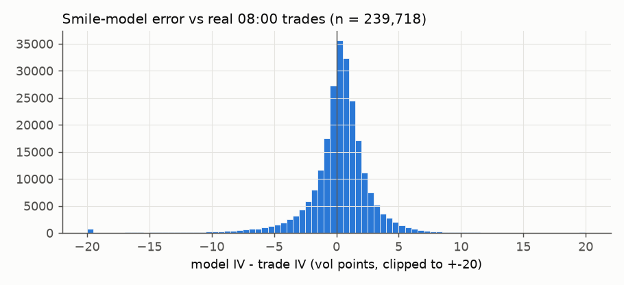
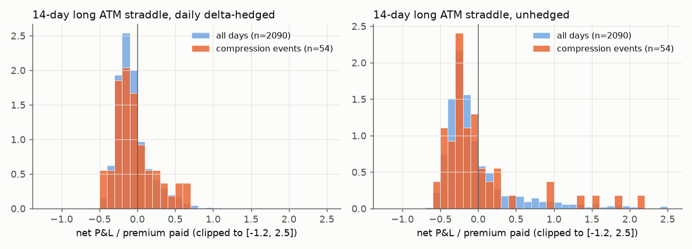
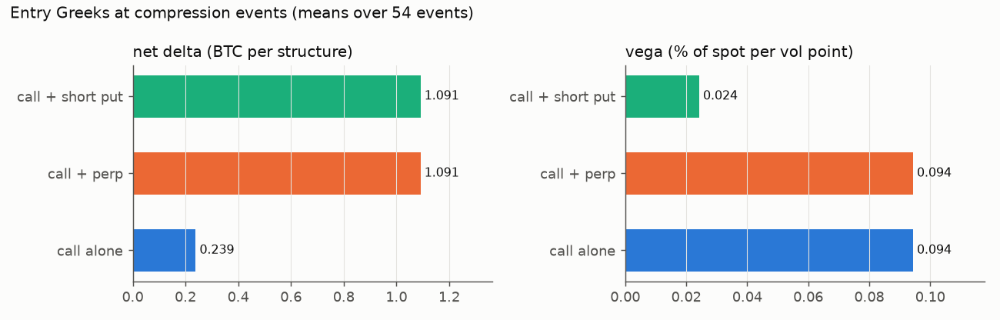
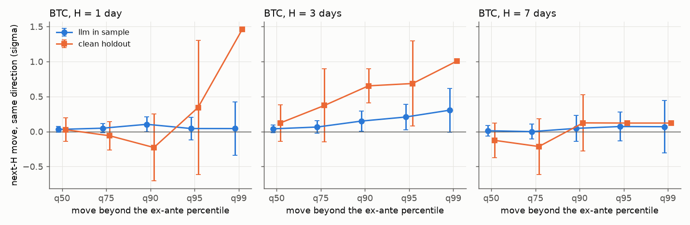
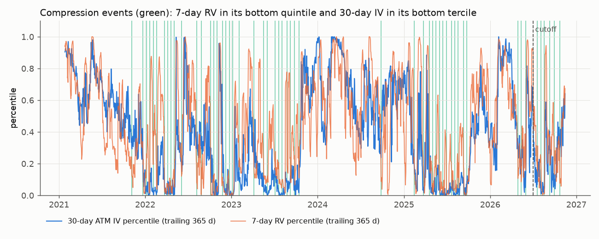

# Options after a volatility compression, the user's call + short deep-ITM put, and extreme-profit continuation

_Agent OPX, 2026-11-14. Hypotheses H-OPX1..4 (registered before any data). Research only: no orders anywhere. Code: `src/ai_trader/research/options_compression.py`, `options_download.py`, `scripts/options_compression_study.py`; tests `tests/test_options_compression.py`; design frozen in the diary (2026-11-14 16:57 UTC) before any result._

## In short


- **Long volatility after a compression (H-OPX1): not shown.** A 14-day long ATM straddle loses on average after compressions (-3.9% of premium delta-hedged) about as it does on any day (-6.4%). The difference, +2.5% of premium, has a 95% CI of [-3.8%, +9.4%]: **inconclusive** in-sample, and the holdout has only 6 events (**inconclusive**). Implied vol is lower at compressions (48% vs 58%), but realised vol is lower too (realised/implied 0.85 vs 0.82), so options are cheap, not mispriced.
- **The short deep-ITM put does cut volatility exposure, but only by making the position mostly a future (Greeks).** The -0.85-delta put has about 74% of the 25-delta call's vega, so the user's structure has **about a quarter of the call's vega** (0.024% vs 0.094% of spot per vol point) at **4.5x the delta** (1.09 vs 0.24). This corrects the earlier summary that the put "barely" lowers vega: it lowers it a lot. But only **5.6% of the put's premium is time value** (about 1.1% of spot out of 19.7%); the rest is intrinsic value you hand back when BTC falls.
- **Short put vs a perp with the same delta (H-OPX2): contradicted at compression events.** In-sample the put leg did worse than the perp by 0.33% of spot per 14 days (CI [-1.07, +0.25], n 48). Its median was positive (+0.38%, 69% of events), but it lost big in crashes (it is short convexity). Over all days it did beat the perp in-sample (+0.29%, CI [+0.07, +0.48]), helped by the perp's funding, but not in the holdout (-0.40%). Holdout events: 6, **inconclusive**.
- **Extreme unexpected moves (H-OPX3): no reversal, mild continuation at 3 days, inconclusive overall.** After BTC moves beyond the 90th/95th/99th percentile of its ex-ante 3-day distribution, the next 3 days go on in the same direction by +0.15 / +0.21 / +0.31 sigma (t 2.05 / 2.24 / 1.91), mostly after up moves. That misses the registered bar (t > 2 at every q >= 90 on 2 of 3 horizons), so **inconclusive** in both segments, but nothing anywhere points to the reversal that would justify taking an extreme profit off.
- **Scaling out in thirds with limit orders after an extreme profit (H-OPX4): contradicted in both segments.** On 68,641 in-sample trend trades it cut net R by 0.0036 per trade (holdout -0.0081 on 6,933 trades). The scaled trades win most of the time (74%) but give up the big continuation days. On the option trades it cost 0.24-0.39% of spot per trade over all days, with CIs below zero.
- **The downside plan (descriptive only, 27 bearish-compression events):** small puts + a short perp cut the worst loss of the structure from -37.2% to -29.0% of spot. Held to day 14, the protection added +0.63% of spot on average. With the spot hedge and the scale-out it added only +0.07%: the scale-out gave back most of the crash gains, as H-OPX4 predicts. In 11 of the 12 events where BTC ended the 14 days higher, the protection cost 0.7-3.6% of spot.
- **Data:** 24.2 million Deribit BTC option trades (2020-01 to 2026-11-13), 209 MB. The smile model's IV error against 239,718 real quotes is a median 1.09 vol points (bias +0.14), or 3.2% of the option price.


## Data

- Deribit BTC option trades from the public history API, 2020-01..2026-10 (82 complete months, partial 2026-11): **24,247,567 trades**, aggregated per instrument-hour into 5,341,944 rows, **208.6 MB** on disk (`data/research/options/`, manifest + one parquet per month; raw responses never written). Block trades excluded.
- Lake: Bybit BTCUSDT / ETHUSDT 1h bars and funding, the deribit_svi daily smile summary (ATM / RR25 / BF25 at 7/30/90 days, to 2026-10-09) and DVOL, read point-in-time.
- Compression events: 54 after declustering (462 trigger days). Entry days with a full trade: llm_in_sample 1967, clean_holdout 123, straddles_cutoff 14.

## Pricing and the fallback model

Each option leg at a 08:00 fixing is priced from a real trade when the instrument traded between 05:00 and 11:00 (its trade IV, moved to the 08:00 forward with Black-76), otherwise by Black-76 on a 3-point smile rebuilt from ATM / RR25 / BF25 (quadratic in log-moneyness through the 25-delta put, ATM and 25-delta call, straight lines outside, ATM variance interpolated linearly in time).

Model error against every real 08:00 quote (7-120 days to expiry, |delta| 0.05-0.95):

| subset | n | bias (vol pts) | median abs (vol pts) | RMSE (vol pts) | median abs price error | median abs (BTC) |
|---|---|---|---|---|---|---|
| all | 239718 | 0.14 | 1.09 | 3.82 | 3.2% | 0.0008 |
| strikes like the short put | 40860 | 0.49 | 1.07 | 4.35 | 4.8% | 0.0007 |
| 0.35-0.65 | 76612 | 0.63 | 0.90 | 2.31 | 1.8% | 0.0010 |
| abs delta <0.35 | 142563 | -0.00 | 1.17 | 3.24 | 5.6% | 0.0008 |
| abs delta >0.65 | 20543 | -0.74 | 1.40 | 8.79 | 0.8% | 0.0010 |
| 21-45d | 56413 | 0.14 | 0.99 | 3.03 | 2.9% | 0.0008 |
| 46-120d | 81857 | -0.02 | 0.85 | 2.26 | 2.5% | 0.0011 |
| 7-20d | 101448 | 0.27 | 1.40 | 5.02 | 4.1% | 0.0007 |
| 2020 | 20605 | 0.23 | 2.56 | 8.97 | 6.0% | 0.0018 |
| 2021 | 29334 | -0.09 | 1.85 | 5.43 | 3.3% | 0.0014 |
| 2022 | 26458 | 0.02 | 1.19 | 3.47 | 2.9% | 0.0009 |
| 2023 | 33354 | 0.07 | 1.09 | 2.43 | 3.8% | 0.0008 |
| 2024 | 50046 | 0.32 | 1.15 | 2.29 | 3.1% | 0.0009 |
| 2025 | 46750 | 0.16 | 0.76 | 1.47 | 2.5% | 0.0006 |
| 2026 | 33171 | 0.14 | 0.67 | 1.69 | 2.6% | 0.0005 |



## H-OPX1: does long volatility pay after a compression?

The registered test compares the mean net P&L (as a share of the premium paid) of trades entered at the 54 compression events with the same trade entered on every day. 48 events and 1,967 days are in-sample; 6 events and 123 days are in the holdout, and 14 days straddle the cutoff and are dropped. The primary (delta-hedged) difference is positive but small and its CI includes zero. The unhedged variant is noisier and says the same thing. The long straddle loses on average in both samples because implied vol is above the realised vol that follows. Compressions make options cheaper, but realised vol stays just as low relative to them over the next 14 days. The volatility does not "pay" more after a compression than on any other day.

Inverse settlement: in BTC-settled terms the unhedged event straddle looks better (+3.8% of the BTC premium vs +0.9% in USD). This is because the BTC premium itself is long BTC, and BTC rose on average over these windows; it is not volatility income.

| segment | variant | events | all days | mean (events) | mean (all) | difference | 95% CI |
|---|---|---|---|---|---|---|---|
| llm_in_sample | hedged | 48 | 1967 | -0.039 | -0.064 | 0.025 | [-0.038, 0.094] |
| llm_in_sample | unhedged | 48 | 1967 | 0.005 | -0.022 | 0.027 | [-0.112, 0.185] |
| llm_in_sample | BTC-settled, hedged | 48 | 1967 | -0.002 | -0.060 | 0.059 | [-0.020, 0.149] |
| llm_in_sample | BTC-settled, unhedged | 48 | 1967 | 0.046 | -0.026 | 0.071 | [-0.082, 0.251] |
| clean_holdout | hedged | 6 | 123 | -0.014 | -0.053 | 0.039 | [-0.228, 0.331] |
| clean_holdout | unhedged | 6 | 123 | 0.040 | 0.014 | 0.025 | [-0.446, 0.589] |
| clean_holdout | BTC-settled, hedged | 6 | 123 | -0.059 | -0.082 | 0.023 | [-0.185, 0.233] |
| clean_holdout | BTC-settled, unhedged | 6 | 123 | -0.028 | -0.036 | 0.008 | [-0.366, 0.434] |

Units: net P&L / premium paid (1.0 = doubled the premium). llm_in_sample: verdict **inconclusive**; median realised/implied vol ratio events 0.85 vs all 0.82; entry legs priced from real trades 0.90. clean_holdout: verdict **inconclusive**; median realised/implied vol ratio events 0.93 vs all 0.78; entry legs priced from real trades 0.76.



## What the short deep-ITM put actually does (Greeks at entry)

What the user's structure is, at entry, averaged over the 54 compression events (the same holds on all 2,090 days). The perp leg in "call + perp" is sized to match the structure's net delta. **The short deep-ITM put does reduce volatility dependence: net vega falls by about 74%, because the put is short vega.** A -0.85-delta put has the same strike as a +0.15-delta call, so its vega is about three quarters of a 25-delta call's. The cost is that the position becomes mostly a long future: delta 1.09, vega per unit of delta 18x smaller than the call alone and 4x smaller than call + perp. Most of the put premium (94%) is intrinsic value, i.e. the synthetic future. Only its time value (about 1.1% of spot over the expiry) is income, and it comes with short gamma: you are short the convexity on the way down.

**events** (n = 54; mean call delta 0.24, mean put delta -0.85):

| structure | net delta | vega (% of spot per vol pt) | theta (% of spot per day) | net premium (% of spot) | vega per unit delta |
|---|---|---|---|---|---|
| call alone | 0.239 | 0.0944 | -0.0676 | 1.88 | 0.3956 |
| call plus perp | 1.091 | 0.0944 | -0.0676 | 1.88 | 0.0865 |
| user structure | 1.091 | 0.0243 | -0.0153 | -17.83 | 0.0221 |
| short put alone | 0.852 | -0.0701 | 0.0523 | -19.71 | -0.0824 |

Short put: premium 19.71% of spot, of which time value 1.06% (time-value share mean 0.056, median 0.055); the rest is intrinsic value you pay back. Put vega / call vega (median) 0.74.

**all days** (n = 2090; mean call delta 0.25, mean put delta -0.85):

| structure | net delta | vega (% of spot per vol pt) | theta (% of spot per day) | net premium (% of spot) | vega per unit delta |
|---|---|---|---|---|---|
| call alone | 0.246 | 0.0955 | -0.0834 | 2.32 | 0.3901 |
| call plus perp | 1.097 | 0.0955 | -0.0834 | 2.32 | 0.0871 |
| user structure | 1.097 | 0.0253 | -0.0195 | -22.55 | 0.0229 |
| short put alone | 0.851 | -0.0703 | 0.0639 | -24.87 | -0.0827 |

Short put: premium 24.87% of spot, of which time value 1.28% (time-value share mean 0.054, median 0.054); the rest is intrinsic value you pay back. Put vega / call vega (median) 0.74.



## H-OPX2: short deep-ITM put vs a perp with the same delta

The registered comparison isolates exactly what the user asked about: same call, same starting delta, with the extra delta coming either from the short put or from a perp (funding and costs included). The difference is P&L(short put) minus P&L(perp). At compression events the put lost to the perp on average. It wins small most of the time and loses large in crashes, and the to-expiry variant, which holds through more of those crashes, is worse (-0.86%). The real-trade coverage for the deep put is thin (it was priced from a real trade at entry in only 12.5% of events, otherwise from the smile model). The model's median error at strikes like it is about 0.0007 BTC (0.07% of spot), small compared with these effects. Note that compressions are the worst time to sell the put: its time value is proportional to implied vol, which is in its bottom tercile by construction.

| segment | sample | n | mean diff (% of spot) | 95% CI | median | share > 0 |
|---|---|---|---|---|---|---|
| llm_in_sample | events 14d | 48 | -0.328 | [-1.069, 0.250] | 0.382 | 0.69 |
| llm_in_sample | all days 14d | 1967 | 0.287 | [0.073, 0.485] | 0.587 | 0.71 |
| llm_in_sample | events to expiry | 48 | -0.862 | [-2.121, 0.210] | 0.197 | 0.54 |
| llm_in_sample | all days to expiry | 1967 | 0.567 | [0.141, 0.974] | 0.772 | 0.63 |
| clean_holdout | events 14d | 6 | -0.673 | [-2.686, 0.472] | 0.281 | 0.67 |
| clean_holdout | all days 14d | 123 | -0.399 | [-1.436, 0.317] | 0.329 | 0.69 |
| clean_holdout | events to expiry | 5 | -5.773 | [-10.646, -0.900] | -5.967 | 0.20 |
| clean_holdout | all days to expiry | 103 | -2.791 | [-5.130, -0.647] | -0.429 | 0.43 |

llm_in_sample: verdict **contradicts**. clean_holdout: verdict **inconclusive**.

Leg means at events, llm_in_sample (% of spot, 14-day hold): structure -2.46, call + perp -2.13, call -0.24, short put -2.22, perp -1.89 (of which funding paid 0.17, costs 0.08), put costs 0.09; put priced from real trades at entry 0.12, at exit 0.15.

Leg means at events, clean_holdout (% of spot, 14-day hold): structure 3.55, call + perp 4.22, call 1.45, short put 2.10, perp 2.78 (of which funding paid 0.17, costs 0.09), put costs 0.09; put priced from real trades at entry 0.00, at exit 0.17.

### BTC-settled vs USD P&L (Deribit options are inverse: premium and P&L are in BTC)

| sample | straddle unhedged USD | straddle unhedged BTC | straddle hedged USD | straddle hedged BTC | user structure USD (% spot) | user structure BTC-settled, in USD (% spot) |
|---|---|---|---|---|---|---|
| events | 0.9% | 3.8% | -3.6% | -0.8% | -1.79 | -2.19 |
| all_days | -2.0% | -2.6% | -6.3% | -6.2% | 0.73 | 1.00 |

Straddle columns are % of premium (USD premium for USD, BTC premium for BTC). The BTC-settled number keeps the premium and the P&L in BTC: USD P&L - BTC-settled P&L x S_exit = (net BTC premium) x (S_exit - S_entry), i.e. paying a premium in BTC adds a long-BTC exposure equal to it, and receiving the short put's large premium in BTC adds a short-BTC exposure of the same size.

## H-OPX3: are extreme unexpected moves followed by more of the same?

For every daily 08:00 UTC origin, the move over the next H days is compared with the percentiles of the ex-ante predictive distribution. That distribution is the project's log-HAR-t (field_study.LogHarT) plus origin-weekday dummies, refitted monthly on an expanding window, and it is well calibrated: 9.2% of 1-day moves fall beyond the two-sided q95 (ideal 10%), 1.4% beyond q99 (ideal 2%). For moves beyond each percentile, the table gives the next H-day move in the same direction, in units of the next predictive sd. The registered rule is met at no horizon in-sample. The 3-day horizon comes closest (q90 and q95 pass, q99 has t = 1.91 < 2, and the slope across q is positive). In the holdout only the 3-day horizon qualifies (q90 +0.65 sigma, n 12; higher q have fewer than 10 events). So the verdict is inconclusive in both segments. The direction is consistent, though: continuation, not reversal, and stronger after up moves (3 days, q95: +0.36 sigma after up moves vs +0.09 after down moves). ETH (robustness only) shows the same 3-day pattern (q90 +0.17, t 2.32; q95 +0.24, t 2.37; q99 +0.27, t 2.00).

**BTCUSDT** (verdict llm_in_sample **inconclusive**, clean_holdout **inconclusive**):

| H (days) | segment | beyond | n | mean next-H z (same dir.) | cluster t | NW t | mean next-H move (%) | share > 0 | z after up moves | z after down moves |
|---|---|---|---|---|---|---|---|---|---|---|
| 1 | llm_in_sample | q50 | 1885 | 0.030 | 1.38 | 1.38 | 0.03 | 0.47 | 0.044 | 0.017 |
| 1 | llm_in_sample | q75 | 906 | 0.047 | 1.44 | 1.51 | 0.03 | 0.47 | 0.100 | -0.001 |
| 1 | llm_in_sample | q90 | 379 | 0.103 | 1.88 | 2.11 | 0.19 | 0.50 | 0.150 | 0.062 |
| 1 | llm_in_sample | q95 | 178 | 0.043 | 0.51 | 0.55 | 0.03 | 0.52 | 0.067 | 0.020 |
| 1 | llm_in_sample | q99 | 26 | 0.042 | 0.22 | 0.21 | 0.21 | 0.46 | 0.176 | -0.056 |
| 1 | llm_in_sample | slope |  | 0.0020 | [-0.0632, 0.0692] |  |  |  |  | call: neither |
| 1 | clean_holdout | q50 | 135 | 0.026 | 0.30 | 0.30 | 0.11 | 0.45 | 0.085 | -0.029 |
| 1 | clean_holdout | q75 | 73 | -0.061 | -0.59 | -0.65 | -0.03 | 0.42 | 0.082 | -0.216 |
| 1 | clean_holdout | q90 | 20 | -0.229 | -0.94 | -0.94 | -0.36 | 0.25 | -0.146 | -0.311 |
| 1 | clean_holdout | q95 | 8 | 0.344 | 0.70 | n/a | 1.13 | 0.50 | 0.521 | 0.049 |
| 1 | clean_holdout | q99 | 3 | 1.459 | n/a | n/a | 4.08 | 1.00 | 1.773 | 0.832 |
| 1 | clean_holdout | slope |  | 0.3272 | [-0.1340, 0.4497] |  |  |  |  | call: neither |
| 3 | llm_in_sample | q50 | 1881 | 0.038 | 1.34 | 1.41 | 0.13 | 0.49 | 0.050 | 0.028 |
| 3 | llm_in_sample | q75 | 884 | 0.064 | 1.39 | 1.40 | 0.21 | 0.50 | 0.117 | 0.022 |
| 3 | llm_in_sample | q90 | 348 | 0.149 | 2.05 | 2.03 | 0.65 | 0.52 | 0.259 | 0.068 |
| 3 | llm_in_sample | q95 | 155 | 0.207 | 2.24 | 2.27 | 1.05 | 0.59 | 0.363 | 0.094 |
| 3 | llm_in_sample | q99 | 40 | 0.305 | 1.91 | 1.99 | 1.89 | 0.57 | 0.463 | 0.220 |
| 3 | llm_in_sample | slope |  | 0.0676 | [0.0137, 0.1239] |  |  |  |  | call: neither |
| 3 | clean_holdout | q50 | 131 | 0.122 | 0.91 | 0.98 | 0.41 | 0.50 | 0.218 | 0.041 |
| 3 | clean_holdout | q75 | 53 | 0.372 | 1.39 | 1.57 | 1.32 | 0.60 | 0.650 | 0.142 |
| 3 | clean_holdout | q90 | 12 | 0.653 | 5.20 | 2.85 | 2.67 | 0.83 | 0.686 | 0.488 |
| 3 | clean_holdout | q95 | 6 | 0.686 | 2.21 | n/a | 2.78 | 0.83 | 0.666 | 0.786 |
| 3 | clean_holdout | q99 | 3 | 1.006 | n/a | n/a | 4.28 | 1.00 | 1.006 | n/a |
| 3 | clean_holdout | slope |  | 0.2084 | [0.0014, 0.2824] |  |  |  |  | call: continuation |
| 7 | llm_in_sample | q50 | 1842 | 0.011 | 0.29 | 0.32 | 0.00 | 0.49 | 0.032 | -0.006 |
| 7 | llm_in_sample | q75 | 826 | -0.001 | -0.02 | -0.03 | -0.16 | 0.49 | 0.036 | -0.029 |
| 7 | llm_in_sample | q90 | 306 | 0.045 | 0.48 | 0.54 | 0.14 | 0.53 | 0.246 | -0.094 |
| 7 | llm_in_sample | q95 | 153 | 0.071 | 0.68 | 0.80 | 0.39 | 0.57 | 0.417 | -0.112 |
| 7 | llm_in_sample | q99 | 27 | 0.069 | 0.36 | 0.41 | 0.28 | 0.63 | 0.757 | -0.275 |
| 7 | llm_in_sample | slope |  | 0.0187 | [-0.0492, 0.0882] |  |  |  |  | call: neither |
| 7 | clean_holdout | q50 | 123 | -0.127 | -1.00 | -1.02 | -0.78 | 0.49 | -0.005 | -0.229 |
| 7 | clean_holdout | q75 | 38 | -0.214 | -1.05 | -0.88 | -1.06 | 0.50 | 0.079 | -0.508 |
| 7 | clean_holdout | q90 | 12 | 0.123 | 0.60 | 0.64 | 1.00 | 0.50 | 0.123 | n/a |
| 7 | clean_holdout | q95 | 6 | 0.121 | n/a | n/a | 0.88 | 0.67 | 0.121 | n/a |
| 7 | clean_holdout | q99 | 6 | 0.121 | n/a | n/a | 0.88 | 0.67 | 0.121 | n/a |
| 7 | clean_holdout | slope |  | 0.0830 | [-0.1059, 0.1699] |  |  |  |  | call: neither |

Calibration of the ex-ante distribution (share of origins beyond each two-sided percentile; ideal = 2 x (1 - q)): H=1: q50 1.000, q75 0.484, q90 0.197, q95 0.092, q99 0.014; H=3: q50 1.000, q75 0.466, q90 0.179, q95 0.081, q99 0.021; H=7: q50 1.000, q75 0.444, q90 0.162, q95 0.081, q99 0.017

**ETHUSDT** (verdict llm_in_sample **inconclusive**, clean_holdout **inconclusive**; ETH is robustness only, not recorded separately):

| H (days) | segment | beyond | n | mean next-H z (same dir.) | cluster t | NW t | mean next-H move (%) | share > 0 | z after up moves | z after down moves |
|---|---|---|---|---|---|---|---|---|---|---|
| 1 | llm_in_sample | q50 | 1520 | 0.046 | 1.77 | 1.82 | 0.09 | 0.48 | 0.045 | 0.048 |
| 1 | llm_in_sample | q75 | 696 | 0.085 | 2.23 | 2.33 | 0.17 | 0.47 | 0.054 | 0.117 |
| 1 | llm_in_sample | q90 | 279 | 0.143 | 2.09 | 2.27 | 0.39 | 0.48 | 0.070 | 0.212 |
| 1 | llm_in_sample | q95 | 154 | 0.101 | 1.06 | 1.15 | 0.31 | 0.45 | 0.029 | 0.172 |
| 1 | llm_in_sample | q99 | 35 | -0.061 | -0.42 | -0.45 | -0.26 | 0.43 | -0.023 | -0.111 |
| 1 | llm_in_sample | slope |  | -0.0199 | [-0.0700, 0.0337] |  |  |  |  | call: neither |
| 1 | clean_holdout | q50 | 135 | 0.044 | 0.50 | 0.48 | 0.06 | 0.44 | 0.108 | -0.022 |
| 1 | clean_holdout | q75 | 67 | -0.098 | -0.95 | -1.10 | -0.16 | 0.39 | -0.034 | -0.168 |
| 1 | clean_holdout | q90 | 22 | -0.246 | -1.45 | -1.39 | -0.65 | 0.32 | -0.184 | -0.298 |
| 1 | clean_holdout | q95 | 10 | -0.363 | -1.09 | -1.45 | -0.82 | 0.40 | -0.685 | -0.041 |
| 1 | clean_holdout | q99 | 1 | 1.041 | n/a | n/a | 5.18 | 1.00 | 1.041 | n/a |
| 1 | clean_holdout | slope |  | 0.1729 | [-0.2780, 0.2324] |  |  |  |  | call: neither |
| 3 | llm_in_sample | q50 | 1516 | 0.044 | 1.28 | 1.33 | 0.14 | 0.49 | 0.032 | 0.055 |
| 3 | llm_in_sample | q75 | 698 | 0.061 | 1.16 | 1.15 | 0.23 | 0.48 | 0.048 | 0.074 |
| 3 | llm_in_sample | q90 | 275 | 0.172 | 2.32 | 2.28 | 0.99 | 0.54 | 0.202 | 0.139 |
| 3 | llm_in_sample | q95 | 147 | 0.242 | 2.37 | 2.54 | 1.45 | 0.59 | 0.228 | 0.262 |
| 3 | llm_in_sample | q99 | 45 | 0.265 | 2.00 | 2.39 | 1.99 | 0.62 | 0.340 | 0.172 |
| 3 | llm_in_sample | slope |  | 0.0625 | [0.0108, 0.1110] |  |  |  |  | call: neither |
| 3 | clean_holdout | q50 | 131 | 0.061 | 0.42 | 0.47 | 0.25 | 0.44 | 0.116 | 0.001 |
| 3 | clean_holdout | q75 | 43 | 0.247 | 1.15 | 1.36 | 1.13 | 0.56 | 0.356 | 0.153 |
| 3 | clean_holdout | q90 | 15 | 0.398 | 1.29 | 1.69 | 2.07 | 0.67 | 0.124 | 0.809 |
| 3 | clean_holdout | q95 | 8 | 0.585 | 1.96 | n/a | 3.54 | 0.88 | 0.433 | 0.838 |
| 3 | clean_holdout | q99 | 3 | 0.611 | n/a | n/a | 3.71 | 1.00 | 0.611 | n/a |
| 3 | clean_holdout | slope |  | 0.1439 | [0.0557, 0.2403] |  |  |  |  | call: neither |
| 7 | llm_in_sample | q50 | 1508 | 0.042 | 0.94 | 0.98 | 0.33 | 0.49 | 0.034 | 0.049 |
| 7 | llm_in_sample | q75 | 645 | 0.057 | 0.82 | 0.86 | 0.37 | 0.49 | 0.068 | 0.046 |
| 7 | llm_in_sample | q90 | 277 | 0.086 | 0.95 | 0.91 | 0.69 | 0.49 | 0.126 | 0.047 |
| 7 | llm_in_sample | q95 | 149 | 0.149 | 1.57 | 1.36 | 1.28 | 0.54 | 0.222 | 0.039 |
| 7 | llm_in_sample | q99 | 42 | -0.049 | -0.28 | -0.34 | -1.03 | 0.38 | -0.060 | -0.037 |
| 7 | llm_in_sample | slope |  | -0.0090 | [-0.0729, 0.0500] |  |  |  |  | call: neither |
| 7 | clean_holdout | q50 | 123 | 0.054 | 0.55 | 0.47 | 0.56 | 0.57 | 0.147 | -0.051 |
| 7 | clean_holdout | q75 | 34 | 0.056 | 0.42 | 0.51 | 0.52 | 0.56 | 0.007 | 0.127 |
| 7 | clean_holdout | q90 | 11 | 0.134 | 0.70 | 0.65 | 1.33 | 0.45 | 0.134 | n/a |
| 7 | clean_holdout | q95 | 7 | 0.253 | n/a | n/a | 2.22 | 0.57 | 0.253 | n/a |
| 7 | clean_holdout | q99 | 6 | 0.108 | n/a | n/a | 0.88 | 0.50 | 0.108 | n/a |
| 7 | clean_holdout | slope |  | 0.0305 | [-0.1244, 0.0810] |  |  |  |  | call: neither |

Calibration of the ex-ante distribution (share of origins beyond each two-sided percentile; ideal = 2 x (1 - q)): H=1: q50 1.000, q75 0.461, q90 0.182, q95 0.099, q99 0.022; H=3: q50 1.000, q75 0.450, q90 0.177, q95 0.094, q99 0.029; H=7: q50 1.000, q75 0.423, q90 0.178, q95 0.096, q99 0.029



## H-OPX4: scaling out in thirds with limit orders after an extreme profit

The user's exit plan was tested literally. At the first three closes where the open profit is beyond the ex-ante q95 for the time elapsed, a limit order for a third of the position rests at that close. It fills only if the next bar trades through it (for options: only if a real trade prints through the mark within 24 h). In both segments the scaled version earned less than holding to the strategy's own exit. This is the same short-convexity pattern as the tight trailing exits of H-PD6 / R-EXIT-1: most triggered trades end slightly better, but the few that keep running are cut. By strategy, only compression_breakout (+0.59 R, 649 trades) and geo_flag_bo (+0.04 R) gain in-sample; the other six lose. On option positions the extra transactions (spread on each third) and the missed continuation cost 0.24-0.39% of spot per trade over all days.

Trend book (23 crypto perps x 8 trend strategies, own exits, net R per trade in daily risk units):

| segment | trades | own exit R | scaled R | diff | 95% CI | share triggered | fills per triggered trade | diff when triggered | verdict |
|---|---|---|---|---|---|---|---|---|---|
| llm_in_sample | 68641 | -0.0037 | -0.0073 | -0.0036 | [-0.0261, 0.0142] | 0.198 | 2.43 | -0.0184 | contradicts |
| clean_holdout | 6933 | -0.0511 | -0.0592 | -0.0081 | [-0.0886, 0.0417] | 0.180 | 2.34 | -0.0451 | contradicts |

Option trades (net P&L in % of spot, 14-day hold vs thirds at the first three daily marks beyond the ex-ante q95 P&L; each leg's third fills only if a real trade prints through the mark within 24 h):

| segment | book | n | hold | scaled | diff | 95% CI | share triggered | leg fills when triggered |
|---|---|---|---|---|---|---|---|---|
| llm_in_sample | straddle events | 48 | 0.016 | -0.959 | -0.975 | [-2.503, 0.283] | 0.46 | 3.64 |
| llm_in_sample | straddle all | 1873 | -0.668 | -0.910 | -0.242 | [-0.451, -0.049] | 0.31 | 3.17 |
| llm_in_sample | user events | 48 | -2.460 | -3.138 | -0.677 | [-2.408, 0.507] | 0.38 | 2.22 |
| llm_in_sample | user all | 1873 | 0.296 | -0.097 | -0.393 | [-0.703, -0.115] | 0.20 | 2.99 |
| clean_holdout | straddle events | 6 | 0.568 | 0.069 | -0.499 | [-1.622, 0.125] | 0.50 | 3.33 |
| clean_holdout | straddle all | 123 | 0.167 | -0.165 | -0.332 | [-0.884, 0.057] | 0.23 | 2.64 |
| clean_holdout | user events | 6 | 3.551 | 2.481 | -1.069 | [-2.898, 0.000] | 0.33 | 4.50 |
| clean_holdout | user all | 123 | 2.326 | 1.620 | -0.706 | [-1.781, 0.022] | 0.22 | 3.48 |

Trend book by strategy (llm_in_sample): compression_breakout n=649, diff 0.5903, trig 0.30; donchian_breakout n=4465, diff -0.0551, trig 0.38; ema_stack n=11691, diff -0.0166, trig 0.25; geo_flag_bo n=932, diff 0.0371, trig 0.41; geo_pivot_bo n=1071, diff -0.0690, trig 0.40; geo_struct n=1541, diff -0.0273, trig 0.28; tsmom n=43045, diff -0.0004, trig 0.15; zoo_ensemble n=5247, diff -0.0180, trig 0.21

## The downside plan (DESCRIPTIVE ONLY, not a registered hypothesis)

**This is not a registered hypothesis and nothing here is a verdict.** Bearish-compression event (written in the diary before looking): a compression event whose BTC move from entry to the next day's 08:00 fixing is negative (27 of the 54 events: 25 in-sample, 2 holdout). On that day the plan buys 0.5 x 25-delta puts (same expiry) and shorts 0.25 BTC perp. At the first later mark where the protection's open profit is beyond its ex-ante q95, it buys spot to flatten the protection's delta, then exits a third of the protection and the spot hedge at each of the next three marks with limit orders (filled only if traded through). What it shows: the protection works as insurance in the five large drops (2021-12, 2022-05, 2022-06, 2025-02, 2026-06), where it turned up to +18.5% of spot. The plan's own spot hedge and scale-out then gave back 12-72% of that gain (for example 2022-06: +18.5% held vs +8.1% with the plan). In 11 of the 12 events where BTC ended the 14 days higher, it cost 0.7-3.6% of spot. The underlying structure is the bigger problem: at bearish events it loses 3.7% of spot on average, because it is mostly a long future.

| entry | segment | day-1 move % | 14-day move % | structure | protection held | protection with plan | structure + plan | spot hedge day | fills |
|---|---|---|---|---|---|---|---|---|---|
| 2021-12-24 | llm_in_sample | -0.12 | -18.30 | -20.50 | 7.79 | 2.17 | -18.33 | 4 | 9 |
| 2022-01-21 | llm_in_sample | -9.49 | -3.19 | -3.94 | -2.92 | -2.92 | -6.87 | - | 0 |
| 2022-02-19 | llm_in_sample | -3.69 | -3.14 | -3.85 | -0.53 | 2.06 | -1.79 | 2 | 9 |
| 2022-04-21 | llm_in_sample | -2.80 | -5.50 | -6.50 | 0.28 | 0.28 | -6.21 | - | 0 |
| 2022-05-05 | llm_in_sample | -8.11 | -26.33 | -27.38 | 9.43 | 6.74 | -20.64 | 4 | 8 |
| 2022-06-04 | llm_in_sample | -0.18 | -35.22 | -37.19 | 18.51 | 8.14 | -29.05 | 8 | 9 |
| 2022-08-27 | llm_in_sample | -1.09 | 5.04 | 5.17 | -2.85 | -2.85 | 2.32 | - | 0 |
| 2022-10-06 | llm_in_sample | -1.46 | -5.36 | -6.20 | 0.22 | 0.22 | -5.98 | - | 0 |
| 2022-10-20 | llm_in_sample | -0.59 | 6.05 | 5.94 | -2.79 | -2.79 | 3.15 | - | 0 |
| 2022-11-26 | llm_in_sample | -0.11 | 3.50 | 3.31 | -2.16 | -2.16 | 1.15 | - | 0 |
| 2022-12-24 | llm_in_sample | -0.12 | 0.57 | 0.52 | -1.05 | -1.05 | -0.52 | - | 0 |
| 2023-02-03 | llm_in_sample | -0.52 | 0.79 | -0.30 | -0.82 | 1.64 | 1.34 | 6 | 9 |
| 2023-04-08 | llm_in_sample | -0.62 | -2.99 | -4.16 | 0.24 | 0.24 | -3.92 | - | 0 |
| 2023-05-19 | llm_in_sample | -0.12 | 0.60 | 0.00 | -0.76 | -0.76 | -0.76 | - | 0 |
| 2023-07-06 | llm_in_sample | -2.61 | -1.97 | -2.88 | -0.71 | -0.71 | -3.59 | - | 0 |
| 2023-07-22 | llm_in_sample | -0.12 | -3.13 | -4.04 | 0.48 | 0.48 | -3.57 | - | 0 |
| 2023-08-26 | llm_in_sample | -0.03 | -0.63 | -1.22 | -0.11 | -0.11 | -1.34 | - | 0 |
| 2023-09-09 | llm_in_sample | -0.10 | 2.72 | 2.20 | -1.37 | -1.37 | 0.83 | - | 0 |
| 2025-02-15 | llm_in_sample | -0.12 | -13.01 | -14.45 | 5.13 | 4.51 | -9.94 | 11 | 3 |
| 2025-05-04 | llm_in_sample | -1.19 | 8.39 | 8.88 | -3.17 | -3.17 | 5.71 | - | 0 |
| 2025-05-18 | llm_in_sample | -0.66 | 0.36 | -0.34 | -0.67 | -0.67 | -1.01 | - | 0 |
| 2025-07-01 | llm_in_sample | -0.07 | 8.91 | 10.18 | -3.00 | -3.00 | 7.17 | - | 0 |
| 2025-08-19 | llm_in_sample | -1.33 | -4.16 | -4.81 | 0.75 | 0.75 | -4.06 | - | 0 |
| 2025-09-25 | llm_in_sample | -2.15 | 9.08 | 9.95 | -3.56 | -3.56 | 6.39 | - | 0 |
| 2026-06-01 | llm_in_sample | -3.70 | -9.78 | -10.43 | 1.88 | 1.11 | -9.31 | 1 | 8 |
| 2026-09-12 | clean_holdout | -0.21 | 8.86 | 9.61 | -3.11 | -3.11 | 6.50 | - | 0 |
| 2026-10-24 | clean_holdout | -0.06 | -5.72 | -6.46 | 1.79 | 1.79 | -4.67 | - | 0 |

All in % of spot at entry. Mean structure -3.66 -> with plan -3.59; worst -37.19 -> -29.05; best 10.18 -> 7.17; the spot hedge triggered on 7 of 27 events.



## Caveats

- Option prices are hourly aggregates. A leg's entry and exit quote is the trade nearest 08:00 within 05:00-10:59, with its IV moved to the 08:00 forward, so the price can come from a trade up to 3 h away. When no trade exists, the smile model prices it: 90% of call and straddle legs had a real trade, but only about 12% of the deep puts did.
- Costs are the registered floor (0.000425 BTC per option per transaction) or the observed half-spread, whichever is larger. Exits pay the same again, and each scale-out third pays its own. Perp and spot cost 5 bps per side, and Bybit funding is included.
- Settlement and the hedge use the Bybit BTCUSDT 08:00 open and the Deribit index from option trades; Deribit's 30-minute settlement TWAP is not modelled.
- All-days samples overlap (a 14-day trade starts every day), and the ISO-week block bootstrap only partly absorbs that overlap, so the all-days CIs are somewhat too narrow.
- The holdout is 4.5 months: 6 compression events and 123 entry days. Every holdout verdict except H-OPX4 is inconclusive by construction (fewer than 8 events).
- The log-HAR-t's jump weight sits at its 0.3 bound on daily data, so it acts as a second, wider scale component. A numerical guard was added for two alt fits (diary). The predictive quantiles are still well calibrated.
- Multiple testing: 4 hypotheses x 2 segments, plus the variants shown. Treat |t| around 2 as interesting, not proven.

## Rule candidates

```yaml
- id: R-OPX-1
  kind: expect
  rule: WHEN a long 25-delta BTC call is paired with a short put of delta about -0.85 on the same expiry (>= 21 days) THEN expect the put leg to remove about three quarters of the call's vega, add about 0.85 of delta, and carry only about 5% of its premium as time value
  when: building or reviewing a call + short deep-ITM put structure on Deribit BTC options
  then: read the structure as a long future (net delta about 1.1) with a small volatility exposure, not as a premium harvest; the vega cut comes from selling the put's vega, and almost all of the put premium is intrinsic value that is paid back
  scope:
    assets: BTC (Deribit inverse options)
    horizon: 21-60 day expiries, 14-day holds
    sides: long
  effect: 'at 54 compression events: net vega 0.024% of spot per vol point vs 0.094% for the call alone and for call + perp (-74%); put vega / call vega median 0.74; net delta 1.09; time value 5.6% of the put premium (1.06% of spot out of 19.7%); theta -0.015% of spot per day vs -0.068% for the call; all 2,090 entry days alike'
  confidence: B
  evidence:
  - H-OPX2
  - research/reports/options_compression_2026-11-14.md
  review: re-run on a different put delta (-0.70 / -0.95) or when ETH options are added; a change of the smile regime (put skew far richer) could change the vega ratio
  status: active
- id: R-OPX-2
  kind: avoid
  rule: WHEN a BTC volatility compression has just fired THEN do not prefer a short deep-ITM put over a perp of the same delta for the long-delta leg; the put lost to the perp on average and its losses are concentrated in crashes
  when: compression event (7-day RV bottom quintile and 30-day IV bottom tercile of their trailing 365 days), structure entered at the next 08:00 fixing
  then: get the extra delta from the perp (funding included) or accept that the short put is a short-convexity bet; a small typical gain (median +0.38% of spot) comes with a fat left tail
  scope:
    assets: BTC (Deribit options, Bybit BTCUSDT perp)
    horizon: 14 days or to expiry
    sides: long
  effect: 'paired diff (short put - perp) at events, llm_in_sample -0.33% of spot per 14 days, 95% CI [-1.07, +0.25], n 48 (to expiry -0.86); clean_holdout -0.67%, n 6 (inconclusive); on all days the put did win in-sample (+0.29%, CI [+0.07, +0.48]) but not in the holdout (-0.40%, CI [-1.44, +0.32])'
  confidence: C
  evidence:
  - H-OPX2
  - research/reports/options_compression_2026-11-14.md
  review: holdout reaches 8 compression events; or a put chosen by time value per unit of gamma rather than by delta, registered separately
  status: active
- id: R-OPX-3
  kind: expect
  rule: WHEN a BTC volatility compression has just fired THEN do not expect long volatility to pay; the 14-day long ATM straddle loses on average after compressions as on other days, and implied vol still exceeds realised vol
  when: compression event as in R-OPX-2; ATM straddle with the first expiry >= 21 days, 14-day hold
  then: treat a compression as a reason to expect cheaper options, not mispriced ones; a compression is not, by itself, a long-volatility entry
  scope:
    assets: BTC (Deribit options)
    horizon: 14 days
    sides: both
  effect: 'net P&L / premium, llm_in_sample: delta-hedged events -3.9% vs all days -6.4% (diff +2.5%, 95% CI [-3.8, +9.4], n 48 vs 1967); unhedged +0.5% vs -2.2% (diff +2.7%, CI [-11.2, +18.5]); median RV/IV 0.85 at events vs 0.82 on all days; clean_holdout 6 events (inconclusive)'
  confidence: C
  evidence:
  - H-OPX1
  - research/reports/options_compression_2026-11-14.md
  review: holdout reaches 8 events; or a registered variant with a longer hold (30 days) or a calendar spread
  status: active
- id: R-OPX-4
  kind: avoid
  rule: WHEN an open trend trade or long option position shows a profit beyond the 95th percentile of its ex-ante distribution THEN do not scale out in thirds with limit orders at the next closes; it lowered net R in both segments and gives up the continuation
  when: trend-family trade (the H-PD6 trend book on 23 crypto perps) or an H-OPX1/2 option position, open profit above the log-HAR-t x weekday q95 at the elapsed horizon
  then: keep the strategy's own exit; read an extreme open profit as a sign the move may continue (R-OPX-5), not as a target hit
  scope:
    assets: 23 crypto perps (trend book); BTC options
    horizon: 1h-4h bars, trades of hours to weeks; 14-day option holds
    sides: both
  effect: 'trend book diff per trade (scaled - own exit), llm_in_sample -0.0036 R, 95% CI [-0.026, +0.014], 68,641 trades; clean_holdout -0.0081 R, CI [-0.089, +0.042], 6,933 trades; triggered trades win 74% of the time (median +0.20 R) but lose on average (-0.018 R); option trades all days -0.24% of spot (straddles, CI [-0.45, -0.05]) and -0.39% (call + short put, CI [-0.70, -0.12]) in-sample'
  confidence: B
  evidence:
  - H-OPX4
  - H-OPX3
  - H-PD6
  - research/reports/options_compression_2026-11-14.md
  review: holdout passes 180 days; a scale-out that only trims after a reversal signal (not a level) needs its own registration
  status: active
- id: R-OPX-5
  kind: expect
  rule: WHEN BTC has moved beyond the 90th-99th percentile of its ex-ante 3-day distribution THEN expect no reversal over the next 3 days; if anything the move continues by a fraction of a sigma
  when: move since a daily 08:00 UTC origin beyond the q90 / q95 / q99 of the log-HAR-t x weekday predictive distribution (either direction)
  then: do not treat an extreme unexpected move as an exit or fade signal by itself; the evidence leans to mild continuation at 3 days (stronger after up moves), none at 1 and 7 days
  scope:
    assets: BTC, ETH (robustness)
    horizon: 1-7 days
    sides: both
  effect: 'BTC next-3-day move in the same direction, llm_in_sample: q90 +0.15 sigma (cluster t 2.05, n 348), q95 +0.21 (t 2.24, n 155), q99 +0.31 (t 1.91, n 40), slope across q +0.068 (90% CI [+0.014, +0.124]); 1 day q90 +0.10 (t 1.88), 7 days q90 +0.05 (t 0.48); no horizon shows reversal; clean_holdout 3 days q90 +0.65 sigma (n 12); ETH 3 days q90 +0.17 (t 2.32), q95 +0.24 (t 2.37)'
  confidence: C
  evidence:
  - H-OPX3
  - research/reports/options_compression_2026-11-14.md
  review: holdout gives >= 10 events above q95 at 3 days; verdict was inconclusive (the 3-day q99 t of 1.91 missed the registered t > 2)
  status: active
```
