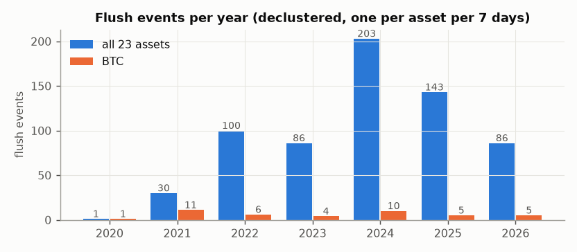
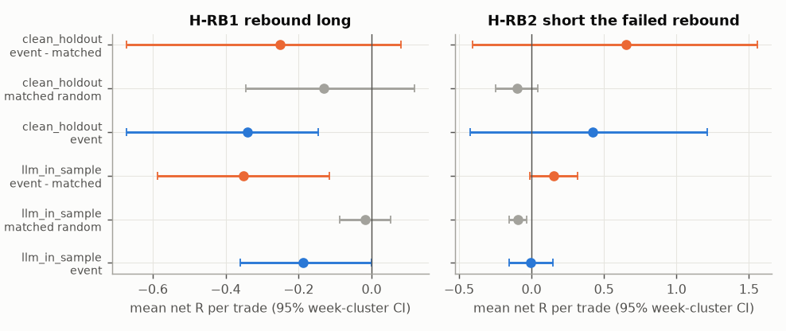
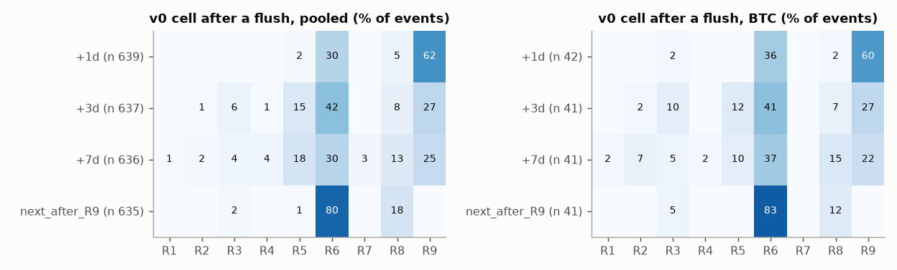
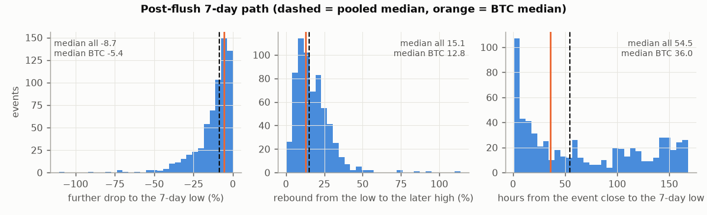
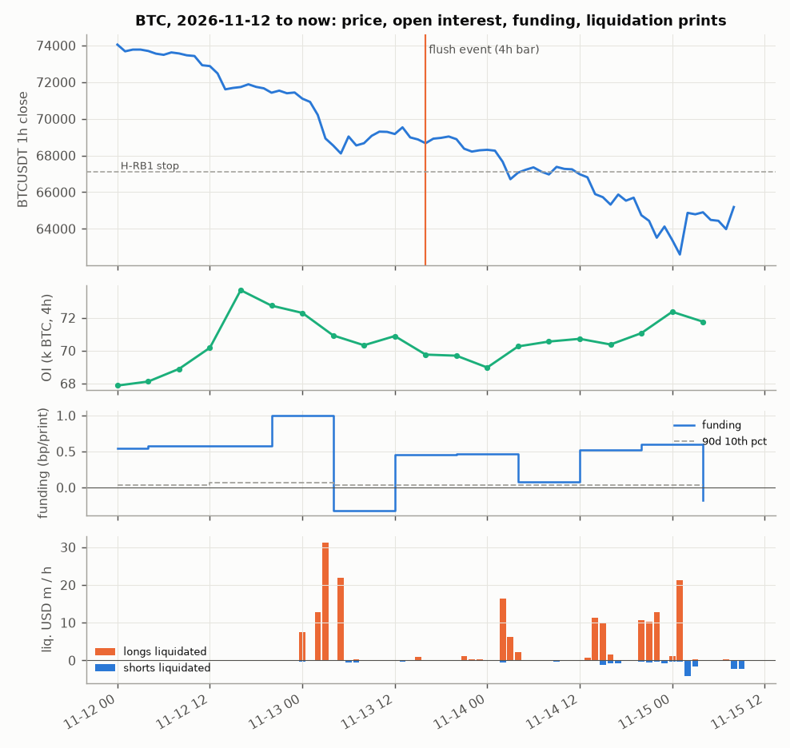

# Post-cascade plays: rebound longs vs continuation shorts after a liquidation flush (H-RB1, H-RB2, H-RB3), 2026-11-15

Agent RB. Research only. The three hypotheses were registered before any test (research/hypotheses.yaml, block RB) and the design was frozen in the diary (2026-11-15, kind decision) and in `data/research/post_cascade/design.json` before any outcome was computed. Code: `src/ai_trader/research/post_cascade_study.py`, `post_cascade_report.py`. Universe L (23 Bybit USDT perps), 4h bars 2020-03 to 2026-11-15 04:00 UTC, funding and 4h open interest read point in time on known_ts, v0 regime cell from `regimes.label` on 4h bars. Liquidation prints (only from 2026-11-08) are used only to describe the current episode. Percent moves are log returns unless marked simple.

## Verdicts

- **H-RB1 (rebound long after a flush pays): contradicts**, in both segments. llm_in_sample: contradicts; clean_holdout: contradicts. Mean net R -0.19 [-0.36, -0.00] before the cutoff and -0.34 [-0.67, -0.15] after it. Both CIs are below zero, and the trade is also worse than a random long in the same R9 cell.
- **H-RB2 (short the failed rebound pays): inconclusive.** llm_in_sample: inconclusive; clean_holdout: inconclusive. About breakeven in-sample (-0.00 [-0.15, +0.15]), positive but very noisy in the holdout (+0.42 [-0.42, +1.21], 19 trades in 7 weeks). It does beat random shorts in the same cell (which lose).
- **H-RB3 (negative funding + rebuilding OI after a flush precedes a squeeze): inconclusive**, leaning the other way. llm_in_sample: inconclusive; clean_holdout: inconclusive. In-sample the next 24h is weaker after the pattern (-0.14 [-0.32, +0.02] sigma), not stronger; at 72h there is no difference (+0.02 [-0.13, +0.17]).
- Trials: 3 hypotheses x 2 segments x 2 cost variants, plus BTC-only and descriptive extras. Treat |t| ~ 2 as interesting, not proven.

## In plain words

**What a flush is.** A 4h close where the 48h return is below the asset's own 1-year 5th percentile, open interest is at least 5% below its 72h high (positions were closed, not just repriced) and the v0 cell is R9 (liquidation). One event per asset per 7 days. That gives **649 events** (614 before the cutoff, 35 after), 42 of them on BTC.

**Buying the flush loses (H-RB1).** Going long at the next 4h close with the stop under the flush low (median stop 3.0 sigma, 37% capped at 4 sigma), a 2R target and a 5-day time stop:
- llm_in_sample: -0.19 [-0.36, -0.00] R per trade, 614 trades in 116 weeks; 35% winners; exits: {'time': 203, 'target': 74, 'stop': 337}.
- clean_holdout: -0.34 [-0.67, -0.15] R, 22 trades in 8 weeks.
- A random long on a non-event R9 day of the same asset earns +0.16 R in-sample, so the flush long is -0.35 [-0.59, -0.12] R worse (holdout -0.25 [-0.67, +0.08]). The flush is a worse moment to buy than an ordinary R9 bar.
- Pegged-limit entries (maker 2.0 + 1.3 bp instead of 7.5 bp) change almost nothing: -0.18 [-0.36, +0.01] in-sample, -0.33 [-0.67, -0.14] holdout. Costs are not the problem; timing is.
- BTC alone: -0.13 [-0.46, +0.21] R over 41 in-sample events (CI includes 0; no resolved holdout event yet).

**Why: the low is usually still ahead.** Over the 7 days after the event close (1h bars):
- price makes a further low a median **-8.7%** below the event close (IQR -15.8% to -4.2%); 70% of events go at least 5% lower. BTC: median -5.4%, IQR -11.1% to -2.5%.
- the low comes a median **54 h** after the event (BTC 36 h); only 35% bottom within 24 h.
- from that low the rebound is large: median **+15.1%** (BTC +12.8%); 70% rebound at least 10%.
- the time to the low is bimodal: either the event close is already near the bottom (a quarter of events bottom within 14 h) or the decline grinds on and the low comes late in the week (a quarter after 121 h).
- the 7-day return from the event close is a coin flip: median +0.3%, 51% up (BTC +1.5%, 61% up).
- clean_holdout (22 events): further low -6.8%, low after 127 h, rebound +8.0%: the low came even later in 2026-H2.
So a rebound does usually come, but a stop under the flush low is usually hit first. That is the R-FLOW-2 pattern (don't fade liquidation clusters) on a multi-day scale.

**Shorting the failed rebound is roughly breakeven (H-RB2).** After a rebound of at least 1.5 sigma off the post-flush low, short the first 4h close back below the EMA20, stop above the rebound high:
- 579 setups out of 649 events (no setup within 7 days: 56). Most entries are in R6 (whipsaw): {'R1': 1, 'R2': 5, 'R3': 21, 'R4': 10, 'R5': 92, 'R6': 351, 'R7': 1, 'R8': 21, 'R9': 58}.
- llm_in_sample -0.00 [-0.15, +0.15] R; clean_holdout +0.42 [-0.42, +1.21] R.
- versus random shorts in the same asset and cell: +0.15 [-0.01, +0.32] in-sample, +0.65 [-0.41, +1.56] holdout. Random shorts lose (-0.16 R), so 'better than random' mostly means 'less bad'.
- pegged entries: +0.00 [-0.14, +0.15] / +0.44 [-0.44, +1.20]. BTC alone: -0.20 [-0.53, +0.16] (34 trades).

**New shorts piling in after a flush is not a squeeze signal (H-RB3).** The pattern (funding below its 90-day 10th percentile while OI rebuilds >= 3% within 72h) is common: 234 of 614 in-sample events, usually within the first 20 hours.
- 24h vol-scaled return after the pattern minus no-pattern events at the same lag: llm_in_sample -0.14 [-0.32, +0.02] sigma, clean_holdout -0.39 [-1.13, +0.66] (3 resolved pattern events).
- 72h: +0.02 [-0.13, +0.17] / +0.02 [-0.61, +0.74].
- BTC alone (in-sample, 15 pattern events): 24h +0.13 [-0.37, +0.60], 72h +0.21 [-0.35, +0.75]: positive point estimates, CIs wide.
- This agrees with R-AVOID-1 and R-MAP-5: funding positioning is not a usable contrarian signal, including after a flush.

## Regime after a flush (check of R-PX-8)

Share of events (%) by v0 cell (4h labels) at +1, +3 and +7 days after the event bar, and the first cell after the R9 episode ends. 'Unconditional R9' is every R9 4h close, for comparison.

| scope | horizon | n | R1 quiet trend up | R2 trend up | R3 momentum burst | R4 compression | R5 balanced range | R6 whipsaw | R7 grind down | R8 trend down | R9 liquidation |
|---|---|---|---|---|---|---|---|---|---|---|---|
| pooled | +1d | 639 | . | . | 0 | . | 2 | 30 | . | 5 | 62 |
| pooled | +3d | 637 | . | 1 | 6 | 1 | 15 | 42 | . | 8 | 27 |
| pooled | +7d | 636 | 1 | 2 | 4 | 4 | 18 | 30 | 3 | 13 | 25 |
| pooled | next_after_R9 | 635 | . | . | 2 | . | 1 | 80 | . | 18 | . |
| pooled, unconditional R9 | +1d | 18765 | . | 0 | 2 | . | 7 | 35 | . | 9 | 46 |
| pooled, unconditional R9 | +3d | 18694 | 0 | 2 | 6 | 2 | 18 | 37 | 1 | 10 | 23 |
| pooled, unconditional R9 | +7d | 18532 | 1 | 5 | 7 | 7 | 21 | 25 | 5 | 12 | 17 |
| BTC | +1d | 42 | . | . | 2 | . | . | 36 | . | 2 | 60 |
| BTC | +3d | 41 | . | 2 | 10 | . | 12 | 41 | . | 7 | 27 |
| BTC | +7d | 41 | 2 | 7 | 5 | 2 | 10 | 37 | . | 15 | 22 |
| BTC | next_after_R9 | 41 | . | . | 5 | . | . | 83 | . | 12 | . |
| BTC, unconditional R9 | +1d | 1290 | . | 0 | 3 | . | 7 | 34 | . | 6 | 50 |
| BTC, unconditional R9 | +3d | 1284 | . | 2 | 9 | 2 | 14 | 36 | 0 | 6 | 30 |
| BTC, unconditional R9 | +7d | 1269 | 1 | 5 | 7 | 5 | 19 | 31 | 3 | 7 | 23 |
| clean_holdout | +1d | 25 | . | . | . | . | 4 | 48 | . | . | 48 |
| clean_holdout | +3d | 23 | . | 4 | 13 | . | 26 | 43 | . | 4 | 9 |
| clean_holdout | +7d | 22 | . | . | 5 | 9 | 14 | 50 | . | . | 23 |
| clean_holdout | next_after_R9 | 21 | . | . | . | . | . | 81 | . | 19 | . |

- When the flush's R9 episode ends, the next cell is **R6 whipsaw 80%** of the time and R8 trend down 18% (BTC: R6 83%; clean_holdout R6 81% of 21). That confirms R-PX-8's direction (whipsaw, not a clean trend) with a higher share than its 62% for R9 in general. A switch straight to an uptrend (R1-R3) is rare: under 2%.
- R9 itself lasts a median **36 h** more after the flush event (IQR 20-60 h). A week later the asset is in R6 30%, still R9 25%, R5 18%, R8 13%.
- Flush-led R9 is a bit more persistent than R9 in general (62% vs 46% still R9 a day later).

## Events per asset and year

| asset | 2020 | 2021 | 2022 | 2023 | 2024 | 2025 | 2026 | total |
|---|---|---|---|---|---|---|---|---|
| AAVEUSDT | 0 | 1 | 6 | 7 | 10 | 7 | 3 | 34 |
| ADAUSDT | 0 | 1 | 6 | 1 | 9 | 8 | 3 | 28 |
| ATOMUSDT | 0 | 0 | 3 | 3 | 11 | 3 | 5 | 25 |
| AVAXUSDT | 0 | 0 | 4 | 4 | 10 | 5 | 3 | 26 |
| BCHUSDT | 0 | 2 | 5 | 4 | 7 | 4 | 4 | 26 |
| BNBUSDT | 0 | 0 | 7 | 3 | 11 | 8 | 3 | 32 |
| BTCUSDT | 1 | 11 | 6 | 4 | 10 | 5 | 5 | 42 |
| DOGEUSDT | 0 | 0 | 7 | 7 | 12 | 8 | 4 | 38 |
| DOTUSDT | 0 | 1 | 4 | 2 | 7 | 7 | 4 | 25 |
| ENAUSDT | 0 | 0 | 0 | 0 | 1 | 3 | 1 | 5 |
| ETCUSDT | 0 | 0 | 8 | 2 | 12 | 5 | 4 | 31 |
| ETHUSDT | 0 | 1 | 6 | 3 | 13 | 9 | 5 | 37 |
| FILUSDT | 0 | 0 | 9 | 7 | 10 | 8 | 4 | 38 |
| HYPEUSDT | 0 | 0 | 0 | 0 | 0 | 2 | 1 | 3 |
| LINKUSDT | 0 | 6 | 5 | 6 | 10 | 8 | 5 | 40 |
| LTCUSDT | 0 | 6 | 5 | 6 | 7 | 9 | 2 | 35 |
| NEARUSDT | 0 | 0 | 5 | 2 | 11 | 6 | 3 | 27 |
| SOLUSDT | 0 | 0 | 4 | 4 | 9 | 9 | 4 | 30 |
| SUIUSDT | 0 | 0 | 0 | 0 | 6 | 5 | 4 | 15 |
| TRXUSDT | 0 | 0 | 2 | 4 | 9 | 5 | 4 | 24 |
| UNIUSDT | 0 | 0 | 1 | 4 | 8 | 8 | 5 | 26 |
| XLMUSDT | 0 | 0 | 1 | 7 | 12 | 4 | 4 | 28 |
| XRPUSDT | 0 | 1 | 6 | 6 | 8 | 7 | 6 | 34 |
| all | 1 | 30 | 100 | 86 | 203 | 143 | 86 | 649 |

Trade status: H-RB1 {'traded': 636, 'blocked': 0, 'unresolved': 13, 'no_setup': 0}; H-RB2 {'traded': 579, 'blocked': 0, 'unresolved': 14, 'no_setup': 56} (unresolved = the 5-day path runs past the data, i.e. the current episode).

## The current episode (2026-11-13 to 15), descriptive only

**Did it meet the flush definition?** Times are the 4h bar's open (the bar closes 4h later).
- **BTC: yes, at the 11-13 16:00 UTC bar** (48h return -7.5% vs a 5th-pct threshold of -5.5%; OI -5.3% from its 72h high; R9). All three conditions also held at 11-13 16:00, 11-13 20:00, 11-14 00:00. Previous event: 2026-06-04.
- **ETH: the conditions held (bars 11-14 00:00, 11-14 04:00, 11-15 04:00), but no new event was counted** because the 7-day decluster still covered ETH's previous event on 11-10 16:00 (the 11-10 sell-off). By the definition this is the same episode, continued.
- **SOL: yes, at the 11-14 00:00 UTC bar** (48h return -10.5% vs a 5th-pct threshold of -7.7%; OI -8.2% from its 72h high; R9). All three conditions also held at 11-14 00:00, 11-14 20:00, 11-15 04:00. Previous event: 2026-06-06.

**What players did (BTC).**
- **Longs were forced out in waves.** Bybit BTC long liquidations since 11-13: 183 M USD vs 20 M of shorts. The biggest 4h buckets: 11-13 00:00 52 M, 11-14 20:00 34 M, 11-15 00:00 23 M, 11-14 00:00 23 M, 11-13 04:00 22 M.
- **Open interest fell, then rebuilt while price kept falling.** OI peaked at 73.7k BTC (11-12 16:00 bar), fell to 69.0k at 11-14 00:00 (-6.4%), then 72.4k at 11-15 00:00 (+4.9%) while the close went from 66,703 to 64,789. New positions were opened into the fall; with funding turning negative, mostly shorts.
- **Funding** was positive through the flush (rank 0.46 in its 90-day range at the event) and turned negative in the latest print (-0.179 bp, rank 0.03, below the 10th-pct threshold +0.028 bp).
- **Short liquidations** were small: the largest 4h buckets were 11-15 00:00 6.5 M, 11-15 08:00 4.5 M, 11-14 20:00 1.9 M, the squeeze hours of the bounce.
- **The H-RB3 pattern fired for BTC** (lag 9 bars after the event, i.e. the 11-13 16:00 event + 36 h). Its outcome is not known yet; the test says not to read it as a squeeze signal.
- **The H-RB1 long would already be stopped:** entry 68,281 at the close of the bar opened 11-13 20:00, stop 67,115 (1.6 sigma), low since 61,899 (-9.8% from entry), last 1h close 65,186.
- ETH and SOL show the same picture: long liquidations 79 M / 17 M vs shorts 5 M / 1.3 M; latest funding ranks 0.11 / 0.21; all three are still in R9.
- SOL's H-RB1 long (entry 75.21) is stopped too: low since 67.32 (-11.1%).
- **Where BTC is on the typical path:** from the event close (69,034) the low so far is 61,899 (-10.9%, 30 h later) and the last close is +5.2% above that low. Historically BTC's further drop had a median of -5.4% (q25 -11.1%), so this one is already a deep case; the median rebound off the 7-day low was +12.8%. Whether 61,899 is the 7-day low is unknown; in 29% of past BTC events (pooled 26%) the low came more than 5 days after the event.

**Nearest historical analogues** (chosen after the fact, so this is a description, not evidence). Features at the event bar, z-scored over the historical events before 2026-11-08: vol-scaled 48h return, OI drop from its 72h high, funding rank in its 90 days, vol-scaled 30-day return. Euclidean distance, 5 nearest across all assets.

*BTC* (reference: 11-13 16:00, flush event; z48 -2.06, OI -5.3%, funding rank 0.46, z30d -1.21)

| analogue | dist | further low | hours to low | rebound off low | 1d | 3d | 7d | H-RB1 R | H-RB2 R | cell +7d | next after R9 |
|---|---|---|---|---|---|---|---|---|---|---|---|
| BCHUSDT 2022-06-13 00 | 0.58 | -28.1% | 103 | +16.1% | -7.8% | -11.7% | -16.8% | -1.00 | +0.22 | R6 | R6 |
| BTCUSDT 2025-11-22 00 | 0.63 | -1.1% | 7 | +10.9% | +2.2% | +3.9% | +7.1% | +1.44 | -1.00 | R6 | R6 |
| AAVEUSDT 2026-06-05 16 | 0.64 | -4.3% | 10 | +12.8% | -0.6% | +6.1% | +7.3% | -1.00 | +1.78 | R6 | R6 |
| ETCUSDT 2025-04-07 00 | 0.65 | -7.6% | 3 | +21.9% | +6.7% | +9.0% | +12.9% | +1.74 | -1.00 | R5 | R6 |
| BTCUSDT 2021-05-13 20 | 0.68 | -54.6% | 134 | +38.7% | +0.3% | -6.9% | -20.5% | -1.00 | n/a | R9 | R6 |

*ETH* (reference: 11-14 00:00, first bar meeting all flush conditions (suppressed by the 7-day decluster); z48 -1.60, OI -6.0%, funding rank 0.48, z30d -1.07)

| analogue | dist | further low | hours to low | rebound off low | 1d | 3d | 7d | H-RB1 R | H-RB2 R | cell +7d | next after R9 |
|---|---|---|---|---|---|---|---|---|---|---|---|
| ADAUSDT 2025-11-15 08 | 0.19 | -25.9% | 145 | +7.5% | -0.9% | -6.8% | -22.2% | -1.00 | n/a | R9 | R8 |
| XRPUSDT 2025-11-04 08 | 0.31 | -9.9% | 10 | +22.2% | -2.0% | -4.2% | +7.6% | -1.00 | -1.00 | R3 | R6 |
| ETHUSDT 2024-04-13 04 | 0.36 | -15.4% | 13 | +16.1% | -5.5% | -4.8% | -6.3% | -1.00 | +0.17 | R6 | R6 |
| ETHUSDT 2025-04-08 04 | 0.44 | -12.6% | 18 | +20.1% | -5.7% | -1.1% | +4.6% | -1.00 | -0.56 | R6 | R6 |
| TRXUSDT 2026-02-06 16 | 0.52 | -0.1% | 1 | +3.3% | +1.8% | +2.2% | +3.0% | +0.48 | -1.00 | R4 | R8 |

*SOL* (reference: 11-14 00:00, flush event; z48 -1.68, OI -8.2%, funding rank 0.47, z30d -1.29)

| analogue | dist | further low | hours to low | rebound off low | 1d | 3d | 7d | H-RB1 R | H-RB2 R | cell +7d | next after R9 |
|---|---|---|---|---|---|---|---|---|---|---|---|
| ADAUSDT 2025-11-04 04 | 0.34 | -8.8% | 14 | +21.6% | +0.1% | +2.6% | +7.5% | -1.00 | -1.00 | R6 | R3 |
| XRPUSDT 2025-11-04 08 | 0.36 | -9.9% | 10 | +22.2% | -2.0% | -4.2% | +7.6% | -1.00 | -1.00 | R3 | R6 |
| ADAUSDT 2025-11-15 08 | 0.53 | -25.9% | 145 | +7.5% | -0.9% | -6.8% | -22.2% | -1.00 | n/a | R9 | R8 |
| BTCUSDT 2021-05-13 20 | 0.55 | -54.6% | 134 | +38.7% | +0.3% | -6.9% | -20.5% | -1.00 | n/a | R9 | R6 |
| BTCUSDT 2025-11-22 00 | 0.58 | -1.1% | 7 | +10.9% | +2.2% | +3.9% | +7.1% | +1.44 | -1.00 | R6 | R6 |

- BTC's closest analogues split two ways: two V-shaped recoveries (BTC 2025-11-22, ETC 2025-04-07: the low came within hours and the long made +1.4 / +1.7 R) and two deep continuations (BCH 2022-06-13 and BTC 2021-05-13: a further 25-42% down over the week in simple terms, the long stopped); AAVE 2026-06-05 ended the week up but stopped the long first. Median 7-day return of the five: +7.1%. That spread is the point: on these features the flush does not tell you which branch you are on.
- After R9, all five of BTC's analogues went to R6; a week later they were in R6, R6, R6, R5, R9, in line with the transition table.

## What this means for long and short plays now

- **Long:** the tested rebound entry (buy the next close after a flush, stop under the flush low) loses in both segments. It was stopped in this episode too. The rebound usually comes after the low, which is a median 1.5-2.5 days after the flush (later in the 2026 holdout) and 5-9% lower, and these tests do not show how to time it. A later entry is untested (it would need a new registered hypothesis).
- **Short:** shorting the first failed rebound (back below the 4h EMA20) has been roughly breakeven. That is better than random shorts, which lose in the whipsaw that follows, but it is not an edge.
- **Regime:** expect R9 to persist for about another day or two, then R6 whipsaw (about 80%), not a clean uptrend. R-PX-8 holds and is sharper for flush-led episodes.
- **Players:** longs have been forced out (about 9:1 long vs short liquidations on BTC), and new shorts have opened into the fall (OI rebuilt, funding below its 10th percentile). Historically that pattern has not predicted a squeeze. R-OPX-5 (mild continuation after tail moves) and R-FLOW-2 point the same way.

## Method details

- Entries and exits: H-RB1 long at the close of the 4h bar after the event; stops at the structural extreme with a 0.5 sigma buffer (4h sigma_risk_next), pulled in to 4 sigma; 2R target; 120 h time stop; 1h bars walked from the entry close, stop checked before the target in each hour, stops fill at the worse of the stop and the hour's open. Costs: 7.5 bp per side; variant: 3.3 bp pegged-limit entry (R-EXE-1, risk.yaml paper_entry).
- Baselines: one random 4h close per asset per UTC date on non-event days (no flush within +-7 days), same geometry (stop beyond the 13-bar extreme). Matched on asset + R9 (RB1) or asset + entry cell (RB2) + segment; 29901 in-sample long baselines.
- Inference: cluster bootstrap by ISO week (all assets in a week share a cluster: crypto moves together), 5000 draws, events and baselines resampled independently.
- Verdict rule (frozen): supports = mean > 0 with the CI above 0 and above the matched baseline in that segment; contradicts = mean or paired difference <= 0 with its CI below 0; else inconclusive.
- Survivorship: the universe is today's survivors. Limits: the 4h close-to-close flush timing is coarse; 1h paths cannot resolve stop and target inside one hour (worst case assumed).

## Figures



_Flush events per year, pooled and BTC._



_Mean net R per trade with 95% CIs, events vs regime-matched random entries, by segment._



_v0 cell at +1/+3/+7 days after flush events and the first cell after the R9 episode ends._



_Distribution of the post-flush path: further drawdown, rebound size, time to the low._



_BTC current episode: 1h price with the flush event, OI, funding vs its 90d 10th percentile, hourly liquidation prints._

## Rule candidates

Validated with `ai_trader.research.rules.validate` (no problems, alone and together with research/rules.yaml). Not yet merged into rules.yaml.

```yaml
- id: R-RB-1
  kind: avoid
  rule: 'WHEN a crypto perp has just printed a flush (48h return below its 1y 5th pct, OI down >= 5% from its 72h high, v0 R9) THEN do not buy the next 4h close expecting a rebound: the low usually comes later'
  when: 'flush event: 4h close with 48h log return below its trailing-1y 5th pct, 4h OI >= 5% below its 72h high, v0 cell R9 (post_cascade_study.flush_events); candidate is a long entered within the first 4h after the event'
  then: expect a negative net R for a rebound long at the next 4h close with a stop under the flush low (2R target, 5-day time stop), and worse than a random long in the same R9 cell
  scope:
    assets: crypto
    horizon: 5 days
    sides: long
  effect: 'net R per trade, 7.5 bp/side: llm_in_sample -0.19 [-0.36, -0.00] (n 614, 116 weeks), clean_holdout -0.34 [-0.67, -0.15] (n 22, 8 weeks); minus matched R9 random longs -0.35 [-0.59, -0.12] / -0.25 [-0.67, +0.08]; pegged-limit entry changes it by < 0.01 R'
  confidence: B
  evidence:
  - H-RB1
  - research/reports/post_cascade_2026-11-15.md
  review: a registered later-entry variant (e.g. after the R9 episode ends or after a confirmed higher low) tested the same way; 20+ more holdout events
  status: active
- id: R-RB-2
  kind: expect
  rule: WHEN a flush has just printed THEN expect the 7-day low still ahead (median a further 5-9% down, usually one to three days later and later still in the 2026 holdout) followed by a rebound of about 8-15% off that low, with no net drift over the week
  when: 'flush event: 4h close with 48h log return below its trailing-1y 5th pct, 4h OI >= 5% below its 72h high, v0 cell R9 (post_cascade_study.flush_events)'
  then: describes the path from the event close over 7 days (1h bars); use it to set expectations for timing, not as a direction signal
  scope:
    assets: crypto
    horizon: 7 days
    sides: both
  effect: 'pooled n 636: further drop to the 7-day low median -8.7% (IQR -15.8% to -4.2%), low after median 54 h (only 35% within 24 h), rebound from the low median +15.1%, 7-day return median +0.3%; BTC n 41: -5.4%, 36 h, +12.8%; clean_holdout n 22: -6.8%, 127 h, +8.0%'
  confidence: C
  evidence:
  - H-RB1
  - research/reports/post_cascade_2026-11-15.md
  review: descriptive, mostly in-sample; re-check the holdout path quantiles at 50+ holdout events
  status: provisional
- id: R-RB-3
  kind: expect
  rule: WHEN the R9 episode that contains a flush ends THEN expect R6 whipsaw next (about 80%), otherwise R8 trend down; R9 itself usually lasts another 1-2.5 days after the flush
  when: 'flush event: 4h close with 48h log return below its trailing-1y 5th pct, 4h OI >= 5% below its 72h high, v0 cell R9 (post_cascade_study.flush_events); v0 cell on 4h bars (regimes.label, bar_hours 4)'
  then: describes the state path; refines R-PX-8 (62% whipsaw after R9 in general) for flush-led R9 episodes
  scope:
    assets: crypto
    horizon: 1-7 days
    sides: both
  effect: 'first cell after R9: R6 80%, R8 18% (n 635; BTC R6 83%, clean_holdout R6 81% of 21); R9 hours left after the event median 36 (IQR 20-60); cell at +7d: R6 30%, R9 25%, R5 18%, R8 13%'
  confidence: B
  evidence:
  - H-RB1
  - H-RB2
  - H-RL3
  - research/reports/post_cascade_2026-11-15.md
  review: the same matrix on daily cells, or a holdout share of R6 below 60% at 40+ holdout events
  status: active
- id: R-RB-4
  kind: avoid
  rule: 'WHEN funding drops below its 90-day 10th percentile while open interest rebuilds >= 3% within 72h of a flush THEN don''t expect a short squeeze from it: the next 24h is if anything weaker than after flushes without that pattern'
  when: 'flush event: 4h close with 48h log return below its trailing-1y 5th pct, 4h OI >= 5% below its 72h high, v0 cell R9 (post_cascade_study.flush_events); then at a 4h close within 72h: latest funding print < trailing-90d 10th pct of prints and OI >= 3% above its post-flush low'
  then: treat new shorts piling in after a flush as no evidence for a rebound (in line with R-AVOID-1 / R-MAP-5 on funding-contrarian signals)
  scope:
    assets: crypto
    horizon: 24-72h
    sides: both
  effect: pattern minus no-pattern vol-scaled return, llm_in_sample 24h -0.14 [-0.32, +0.02] sigma, 72h +0.02 [-0.13, +0.17] (pattern 234 of 614 events); clean_holdout 24h -0.39 [-1.13, +0.66], 72h +0.02 [-0.61, +0.74] (pattern 4 of 35)
  confidence: C
  evidence:
  - H-RB3
  - research/reports/post_cascade_2026-11-15.md
  review: 15+ holdout pattern events
  status: provisional
- id: R-RB-5
  kind: expect
  rule: 'WHEN shorting the first 4h close back below the EMA20 after a >= 1.5 sigma post-flush rebound THEN expect about breakeven net R: better than a random short in the same cell, but no edge yet'
  when: 'flush event: 4h close with 48h log return below its trailing-1y 5th pct, 4h OI >= 5% below its 72h high, v0 cell R9 (post_cascade_study.flush_events); then within 7 days a close >= 1.5 sigma above the post-flush low, then a 4h close crossing below the 4h EMA20'
  then: a short here is not worse than other shorts in the whipsaw that follows, but there is no tested positive expectation
  scope:
    assets: crypto
    horizon: 5 days
    sides: short
  effect: 'net R per trade: llm_in_sample -0.00 [-0.15, +0.15] (n 560), clean_holdout +0.42 [-0.42, +1.21] (n 19, 7 weeks); minus matched random shorts +0.15 [-0.01, +0.32] / +0.65 [-0.41, +1.56]; entries mostly in R6 (351 of 560)'
  confidence: C
  evidence:
  - H-RB2
  - research/reports/post_cascade_2026-11-15.md
  review: holdout CI clearing zero at 40+ trades, or a registered variant
  status: provisional
```
