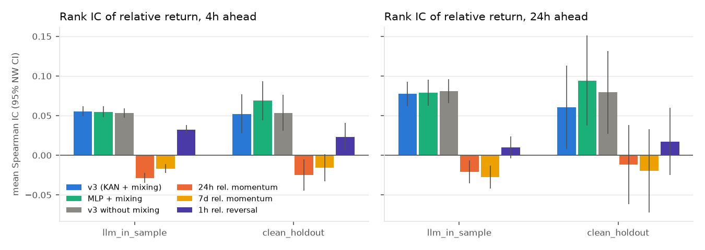
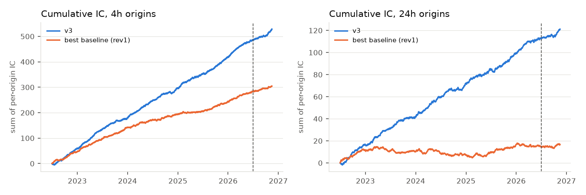
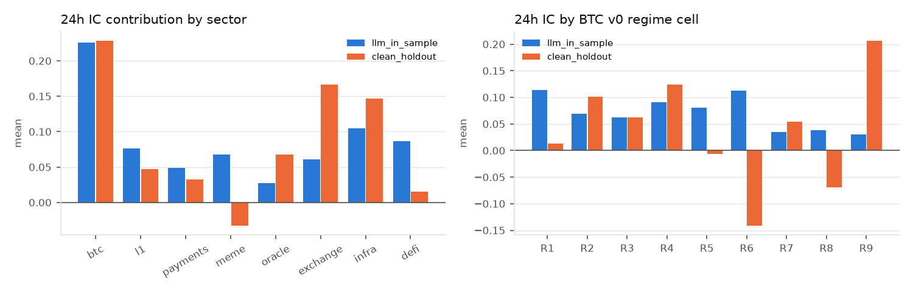
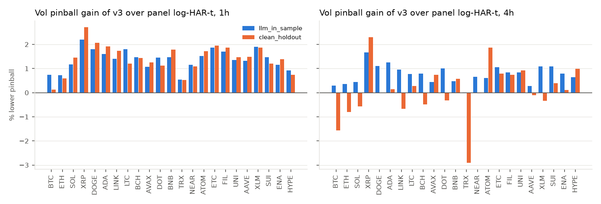
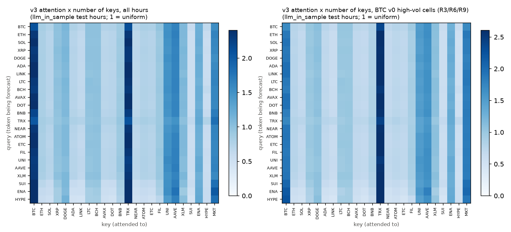
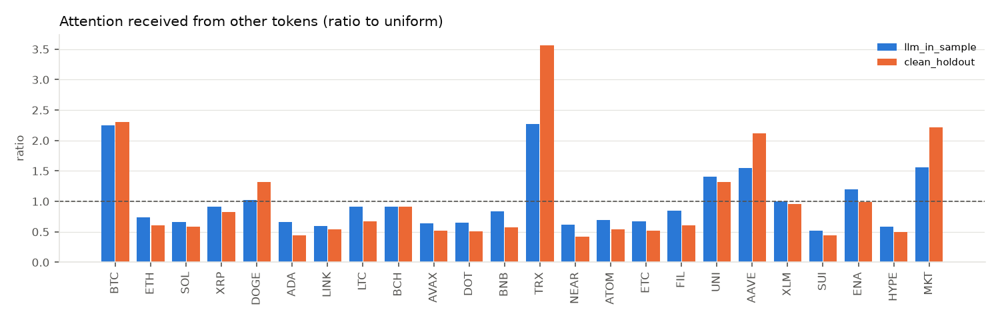
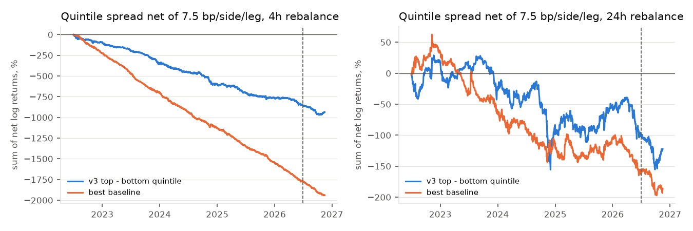
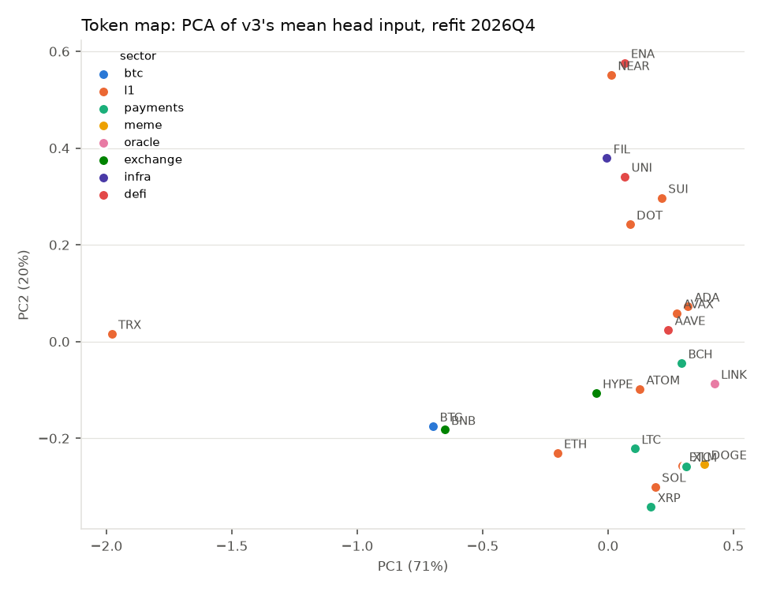

# Cross-sectional network v3: relative strength, volatility and spillovers across universe L (H-XS1 to H-XS3)

_Block XS, agent X3, 2026-11-15. Data: Bybit 1h bars, funding and 4h OI for the 23 universe-L perps, 2021-05-25 to 2026-11-14, as of 2026-11-15 10:00 UTC; knowledge cutoff 2026-07-01. Code: `src/ai_trader/ml/xs_net.py` (panel maths, network), `src/ai_trader/research/xs_network_study.py` (design in its docstring); tests `tests/test_xs_net.py`; artifacts `data/models/xs_v3/`. Design frozen in the diary before any fit ('XS v3 design frozen'). Research only: deterministic tools, nothing live, no sizing._

## Verdicts

| hypothesis | llm_in_sample | clean_holdout | pooled | Holm p (in / hold) |
|---|---|---|---|---|
| H-XS1 | supports | supports | **supports** | 0.000 / 0.009 |
| H-XS2 | supports | supports | **supports** | 0.000 / 0.001 |
| H-XS3 | supports | contradicts | **contradicts** | 0.002 / 0.940 |

**Sizes.** v3 (kan_mix) 4147 parameters, MLP arm 4127, ablation 4147 (cap 5,000). Config search (in-sample, first test quarter 2022Q3): kan_mix {'lr': 0.001, 'wd': 0.0001}, mlp_mix {'lr': 0.003, 'wd': 0.0001}.
**Walk-forward.** 18 quarterly refits (2022Q3 to 2026Q4), 3 seeds per arm, warm-started; mean best epoch kan_mix 3.2, mlp_mix 1.9, kan_nomix 4.1; 117 CPU-minutes (2 threads).

<!-- FINDINGS -->
## Findings in plain language

- **The network ranks tokens better than momentum and reversal, but mostly by ranking low volatility first (H-XS1 supports, with a large caveat).**
  - Rank IC of v3's predicted relative return:
    - in-sample: 0.055 at 4h (t 17) and 0.077 at 24h (t 10);
    - holdout: 0.052 at 4h (t 4.1) and 0.061 at 24h (t 2.3).
  - The best baseline in both segments is 1h relative reversal: in-sample 0.033 / 0.010, holdout 0.023 / 0.017.
  - Relative momentum has a negative IC in both segments: over hours to a day, crypto tokens that outran the basket tend to give some of it back.
  - However, a free ranking by low current volatility (minus lsig2) has IC 0.040 / 0.073 in-sample and 0.039 / 0.060 in the holdout.
    - At 24h, v3 adds nothing over it: v3 - low-vol +0.001, t 0.08 in the holdout.
    - At 4h it adds about +0.013 (t 2.4 in the holdout).
  - The IC is flat across years (0.053-0.060 at 4h). It is concentrated in BTC, TRX, BNB and ENA, which the network places high, and in-sample its gap over rev1 at 24h is largest in BTC cells R1, R4 and R6 (+0.09 to +0.10).
- **The ranking does not make money (descriptive).** The quintile spread is gross ~0 to negative in simple returns:
  - in-sample: +0.1 bp / 4h and -7.0 bp / 24h;
  - holdout: -2.2 bp and -17.2 bp;
  - after 7.5 bp per side per leg: -12 bp / 4h and -29 bp / 24h in the holdout, with 66-83% of the book replaced per rebalance.

  High-vol alts land below the cross-sectional median more often than not, but they carry the right tail. So a median-rank skill (IC, pairwise accuracy 52-53%) does not turn into a positive mean spread. The rank IC is genuine forecasting of medians; it is not an alpha.
- **Volatility: the shared network beats panel log-HAR-t at 1h only (H-XS2 supports).**
  - 1h pinball is 1.4% lower in both segments (t -14.1 in-sample, -3.4 holdout) and lower for every one of the 23 tokens in both segments (BTC +0.1%, alts +1-2.7%).
  - At 4h the gain shrinks to 0.8% in-sample and 0.1% in the holdout (t -0.2).
  - At 24h (descriptive) the network is slightly worse than log-HAR-t.
  - The 1h quantiles are calibrated to within about 2 pp. This matches the BTC result (R-PNN-1 / R-PNN-2): small networks help intraday and lose their edge at the daily horizon.
- **The mixing layer does not add information (H-XS3: in-sample supports, holdout contradicts, pooled contradicts).**
  - Removing attention across tokens raised non-BTC 1h pinball in-sample (+0.00018, t 2.9). In the holdout it *lowered* it at 1h, 4h and 24h (t -1.95, -1.55, -1.38).
  - The IC effect is nil to negative: mix - no-mix 24h -0.019 (t -1.7) in the holdout.
  - Each token's own features plus the relative-return and beta inputs already carry what the cross-section can tell it. This repeats, intraday, the daily finding that HAR spillover terms do not help.
- **KAN vs MLP.** As in H-PNN1, polynomial edges buy nothing. In the holdout the equal-size MLP arm is better:
  - IC 0.069 / 0.094 vs 0.052 / 0.061 (KAN - MLP t -2.8 / -2.0);
  - 1h pinball KAN - MLP +0.00066 (t 2.8).

  In-sample they tie on IC, and the KAN is slightly better on 4h pinball (-0.00072, t -2.8).
- **Attention: BTC and TRX are the hubs, not ETH and SOL.**
  - Every token's query puts the most weight on BTC (2.3x uniform), TRX (2.3x in-sample, 3.6x holdout) and the market token (1.6x / 2.2x), then AAVE and UNI.
  - ETH and SOL receive *less* than average (hub t -13.5 / -24.0 in-sample, -8.5 / -11.8 holdout), also in BTC high-vol cells. In high-vol hours the market token's share rises (MLP arm 0.12 -> 0.20).
  - The R-SPILL result (ETH/SOL transmit realised vol) does not reappear as attention. Since H-XS3 says the attention adds nothing to the forecasts, read the map as "what the network found cheapest to look at": BTC and TRX are the lowest-vol anchors, i.e. a market and a low-beta reference.
- **Token map.** PC1 (71%) separates the low-vol anchors (TRX far out, then BTC, BNB, ETH) from the alts. PC2 splits newer / higher-beta alts (ENA, NEAR, FIL, UNI, SUI, DOT) from the old large caps (XRP, SOL, LTC, DOGE). Sectors are not what organises the representation; volatility and beta are.
- **Conformal rel bands.** ACI holds the 80% band at 4h: holdout coverage 0.803, all 23 tokens within 3 pp. At 24h coverage is 0.749 and only 6 of 23 tokens are within 3 pp: with 137 daily origins, gamma 0.005 adapts too slowly. A 24h band needs a larger gamma or pooled-token scores.
- **Caveats.**
  - Universe L is today's survivors, which flatters any rule that favours established low-vol names.
  - The holdout is 138 days (137 daily origins).
  - MLP seeds sometimes stopped at their warm start (best epoch 0), as the frozen protocol allows.
  - The low-vol and simple-return checks were added after the in-sample look and are descriptive only (diary 2026-11-15).
<!-- /FINDINGS -->





## H-XS1: rank IC of the relative-return median vs momentum and reversal

Mean per-origin Spearman IC between the predicted median relative return and the realised one (token minus the equal-weight universe), non-overlapping origins (4h: every 4 hours; 24h: 00 UTC), NW t over days in brackets. Best baseline chosen in-sample per horizon.

| segment | horizon | origins | v3 | MLP arm | v3 no mixing | mom24 | mom7d | rev1 | best | v3 - best |
|---|---|---|---|---|---|---|---|---|---|---|
| llm_in_sample | 4h | 8766 | 0.0554 (17.15) | 0.0549 (15.49) | 0.0532 (17.29) | -0.0287 (-9.12) | -0.0167 (-5.67) | 0.0325 (11.10) | rev1 | 0.0229 (5.53) |
| llm_in_sample | 24h | 1461 | 0.0773 (9.85) | 0.0791 (9.50) | 0.0807 (10.49) | -0.0209 (-2.81) | -0.0277 (-3.72) | 0.0099 (1.39) | rev1 | 0.0674 (6.61) |
| clean_holdout | 4h | 824 | 0.0522 (4.14) | 0.0689 (5.47) | 0.0536 (4.69) | -0.0248 (-2.49) | -0.0156 (-1.77) | 0.0232 (2.57) | rev1 | 0.0291 (2.61) |
| clean_holdout | 24h | 137 | 0.0605 (2.26) | 0.0941 (3.25) | 0.0794 (2.98) | -0.0117 (-0.46) | -0.0197 (-0.73) | 0.0174 (0.81) | rev1 | 0.0431 (1.39) |

**Descriptive robustness (added after the in-sample look; not part of any verdict).** A pure low-volatility ranking (minus lsig2) earns a large rank IC on its own. Rank IC is identical on log and simple relative returns (ranks are invariant to exp and to subtracting the cross-sectional mean), so this is not a log-return artefact in the ranks; it says high-vol tokens land below the median more often. Whether that is worth anything shows in the simple-return spread below, where it is not.

| segment | horizon | v3 IC | low-vol IC | v3 - low-vol (t) |
|---|---|---|---|---|
| llm_in_sample | 4h | 0.0554 (17.15) | 0.0399 (11.83) | 0.0155 (7.37) |
| llm_in_sample | 24h | 0.0773 (9.85) | 0.0727 (8.59) | 0.0046 (1.23) |
| clean_holdout | 4h | 0.0522 (4.14) | 0.0391 (3.42) | 0.0131 (2.37) |
| clean_holdout | 24h | 0.0605 (2.26) | 0.0599 (2.11) | 0.0007 (0.08) |

Pairwise view (from the rel heads, P(i beats j) = Phi((m_i - m_j) / sqrt(s_i^2 + s_j^2)), all token pairs at the same origins):

| segment | horizon | pairs | accuracy v3 (t vs 0) | accuracy best baseline | v3 - baseline (t) | Brier skill vs 1/2 |
|---|---|---|---|---|---|---|
| llm_in_sample | 4h | 1949876 | 0.5207 | 0.5118 | 0.0089 (5.75) | 0.00234 |
| llm_in_sample | 24h | 324972 | 0.5288 | 0.5038 | 0.0250 (6.67) | 0.00394 |
| clean_holdout | 4h | 208472 | 0.5198 | 0.5084 | 0.0114 (2.69) | 0.00201 |
| clean_holdout | 24h | 34661 | 0.5246 | 0.5062 | 0.0183 (1.66) | 0.00379 |

### Where the IC comes from

IC contribution = mean of z(rank predicted) x z(rank realised) over the tokens of the sector (the token-average of these products is the IC). Regime cells are BTC's v0 cell known at the origin.

**4h, by sector:** llm_in_sample: btc +0.128, l1 +0.054, payments +0.048, meme +0.045, oracle +0.026, exchange +0.047, infra +0.080, defi +0.053; clean_holdout: btc +0.131, l1 +0.048, payments +0.053, meme +0.029, oracle +0.033, exchange +0.061, infra +0.086, defi +0.035

**4h, by BTC v0 cell (v3 IC / best-baseline IC, origins):**

| segment | R1 | R2 | R3 | R4 | R5 | R6 | R7 | R8 | R9 |
|---|---|---|---|---|---|---|---|---|---|
| llm_in_sample | +0.078 / +0.033 (871) | +0.049 / +0.046 (791) | +0.067 / +0.038 (831) | +0.046 / +0.026 (1793) | +0.058 / +0.038 (1382) | +0.065 / +0.046 (1109) | +0.048 / +0.027 (612) | +0.057 / +0.048 (571) | +0.053 / +0.028 (806) |
| clean_holdout | -0.006 / -0.029 (69) | +0.065 / -0.009 (64) | +0.002 / +0.019 (76) | +0.075 / -0.009 (275) | +0.023 / +0.089 (125) | +0.040 / -0.010 (51) | +0.038 / -0.009 (79) | +0.018 / +0.016 (37) | +0.103 / +0.066 (48) |

**24h, by sector:** llm_in_sample: btc +0.226, l1 +0.076, payments +0.049, meme +0.068, oracle +0.027, exchange +0.061, infra +0.104, defi +0.086; clean_holdout: btc +0.229, l1 +0.047, payments +0.032, meme -0.033, oracle +0.067, exchange +0.167, infra +0.146, defi +0.016

**24h, by BTC v0 cell (v3 IC / best-baseline IC, origins):**

| segment | R1 | R2 | R3 | R4 | R5 | R6 | R7 | R8 | R9 |
|---|---|---|---|---|---|---|---|---|---|
| llm_in_sample | +0.113 / +0.010 (143) | +0.069 / +0.009 (134) | +0.062 / +0.017 (133) | +0.091 / +0.009 (306) | +0.081 / -0.003 (227) | +0.112 / +0.020 (196) | +0.035 / +0.028 (95) | +0.039 / -0.016 (97) | +0.030 / +0.019 (130) |
| clean_holdout | +0.013 / +0.024 (10) | +0.101 / -0.094 (13) | +0.062 / +0.004 (13) | +0.124 / +0.045 (47) | -0.007 / +0.083 (18) | -0.142 / -0.229 (10) | +0.054 / +0.030 (13) | -0.069 / +0.130 (6) | +0.207 / +0.115 (7) |



## H-XS2: per-token volatility quantiles vs panel log-HAR-t x hour-of-week

Pinball loss of the return-magnitude quantiles (5..95, in units of sqrt(h) s_t), averaged over token-origins; paired difference per day, NW t.

| segment | horizon | cells | v3 | MLP arm | log-HAR-t | v3 - HAR (t) | gain % | MLP - HAR (t) | KAN - MLP (t) |
|---|---|---|---|---|---|---|---|---|---|
| llm_in_sample | 1h | 756110 | 0.14244 | 0.14257 | 0.14446 | -0.00200 (-14.09) | 1.40 | -0.00184 (-8.37) | -0.00016 (-1.15) |
| llm_in_sample | 4h | 189026 | 0.14711 | 0.14780 | 0.14823 | -0.00109 (-4.01) | 0.76 | -0.00037 (-0.93) | -0.00072 (-2.76) |
| llm_in_sample | 24h (descriptive) | 31504 | 0.15714 | 0.15781 | 0.15595 | 0.00118 (1.62) | -0.76 | 0.00197 (1.82) | -0.00079 (-0.82) |
| clean_holdout | 1h | 75831 | 0.14559 | 0.14497 | 0.14769 | -0.00220 (-3.39) | 1.42 | -0.00286 (-4.58) | 0.00066 (2.84) |
| clean_holdout | 4h | 18952 | 0.15405 | 0.15366 | 0.15419 | -0.00017 (-0.19) | 0.09 | -0.00058 (-0.62) | 0.00041 (1.00) |
| clean_holdout | 24h (descriptive) | 3151 | 0.17228 | 0.16929 | 0.17136 | 0.00093 (0.49) | -0.54 | -0.00207 (-0.50) | 0.00299 (0.93) |

Calibration (share of outcomes below each quantile, nominal 0.05 .. 0.95):

| segment | horizon | model | q05 | q10 | q25 | q50 | q75 | q90 | q95 |
|---|---|---|---|---|---|---|---|---|---|
| llm_in_sample | 1h | kan_mix | 0.049 | 0.101 | 0.253 | 0.506 | 0.751 | 0.902 | 0.952 |
| llm_in_sample | 1h | har | 0.048 | 0.095 | 0.241 | 0.490 | 0.747 | 0.901 | 0.951 |
| llm_in_sample | 4h | kan_mix | 0.050 | 0.102 | 0.257 | 0.516 | 0.761 | 0.906 | 0.953 |
| llm_in_sample | 4h | har | 0.048 | 0.098 | 0.245 | 0.494 | 0.746 | 0.899 | 0.951 |
| clean_holdout | 1h | kan_mix | 0.053 | 0.107 | 0.267 | 0.524 | 0.769 | 0.912 | 0.957 |
| clean_holdout | 1h | har | 0.050 | 0.096 | 0.241 | 0.488 | 0.744 | 0.897 | 0.947 |
| clean_holdout | 4h | kan_mix | 0.051 | 0.102 | 0.253 | 0.511 | 0.759 | 0.902 | 0.948 |
| clean_holdout | 4h | har | 0.048 | 0.095 | 0.239 | 0.488 | 0.739 | 0.891 | 0.946 |



## H-XS3: ablation without the mixing layer

Same encoder, heads, rows, seeds and config; the attention keys are restricted to the token itself (no other tokens, no market token).

| segment | horizon | pinball mixing | pinball no mixing | no-mix - mix, non-BTC (t) | no-mix - mix, all (t) |
|---|---|---|---|---|---|
| llm_in_sample | 1h | 0.14244 | 0.14259 | 0.00018 (2.92) | 0.00015 (2.47) |
| llm_in_sample | 4h | 0.14711 | 0.14713 | 0.00004 (0.31) | 0.00002 (0.12) |
| llm_in_sample | 24h | 0.15714 | 0.15572 | -0.00142 (-2.86) | -0.00137 (-2.79) |
| clean_holdout | 1h | 0.14559 | 0.14515 | -0.00040 (-1.95) | -0.00047 (-2.23) |
| clean_holdout | 4h | 0.15405 | 0.15346 | -0.00056 (-1.55) | -0.00058 (-1.62) |
| clean_holdout | 24h | 0.17228 | 0.17005 | -0.00226 (-1.38) | -0.00223 (-1.34) |

IC part (reported): v3 - no-mixing rank IC: llm_in_sample 4h 0.0022 (1.36); llm_in_sample 24h -0.0034 (-0.86); clean_holdout 4h -0.0014 (-0.28); clean_holdout 24h -0.0189 (-1.70).

Per-token effect of mixing at 1h (% pinball increase when it is removed; positive = mixing helps): llm_in_sample: ENA +0.40, ATOM +0.31, LTC +0.29, LINK +0.27, NEAR +0.25, UNI +0.24; clean_holdout: ENA +0.20, FIL +0.18, ADA +0.17, NEAR +0.09, DOT +0.02, BCH +0.01.

## Attention: who attends to whom

Mean attention weights of v3 (averaged over heads and seeds) on test hours. 'Received from others' = the weight a key gets from the other tokens' queries times the number of keys (1 = uniform). Hub test = per-day received ratio of the token minus the mean of the other tokens, NW t. High-vol hours = BTC v0 cells R3/R6/R9.

| segment | arm | hours | self share | market-token share | top keys (received from others) | ETH hub (t) | SOL hub (t) | BTC hub (t) |
|---|---|---|---|---|---|---|---|---|
| llm_in_sample | kan_mix  | 35064 | 0.043 | 0.068 | TRX 2.28, BTC 2.25, MARKET 1.56, AAVE 1.55, UNI 1.41 | -0.234 (-13.52) | -0.324 (-24.04) | 1.291 (12.67) |
| llm_in_sample | kan_mix (high vol) | 10984 | 0.042 | 0.077 | TRX 2.55, BTC 1.83, MARKET 1.75, AAVE 1.55, UNI 1.42 | -0.256 (-10.82) | -0.337 (-18.24) | 0.896 (8.80) |
| llm_in_sample | mlp_mix  | 35064 | 0.039 | 0.101 | MARKET 2.30, BTC 2.09, AAVE 2.04, UNI 1.92, ENA 1.72 | -0.309 (-24.40) | -0.290 (-23.35) | 1.176 (21.16) |
| llm_in_sample | mlp_mix (high vol) | 10984 | 0.038 | 0.123 | MARKET 2.81, BTC 1.96, AAVE 1.95, UNI 1.85, ENA 1.74 | -0.330 (-20.89) | -0.307 (-19.60) | 1.056 (14.98) |
| clean_holdout | kan_mix  | 3297 | 0.039 | 0.092 | TRX 3.57, BTC 2.30, MARKET 2.22, AAVE 2.12, UNI 1.32 | -0.353 (-8.51) | -0.384 (-11.79) | 1.410 (11.12) |
| clean_holdout | kan_mix (high vol) | 701 | 0.036 | 0.129 | MARKET 3.11, TRX 2.82, BTC 2.35, AAVE 1.78, UNI 1.29 | -0.336 (-6.42) | -0.407 (-6.19) | 1.452 (5.43) |
| clean_holdout | mlp_mix  | 3297 | 0.035 | 0.123 | MARKET 2.95, AAVE 2.77, BTC 2.49, UNI 2.03, ENA 1.78 | -0.547 (-21.89) | -0.459 (-17.71) | 1.637 (13.88) |
| clean_holdout | mlp_mix (high vol) | 701 | 0.032 | 0.199 | MARKET 4.77, AAVE 2.45, BTC 1.99, UNI 1.82, ENA 1.43 | -0.459 (-8.29) | -0.407 (-7.11) | 1.155 (9.55) |





## Top-minus-bottom quintile relative-return spread (descriptive, research only)

Equal-weight top quintile minus bottom quintile by predicted median relative return, rebalanced at each non-overlapping origin; log returns; cost 7.5 bp per side per leg on turnover (sum |dw| over both legs). Turnover = one-way share of the book replaced per rebalance. Sizing belongs to the risk engine; this measures ranking value only.

| segment | horizon | ranking | rebalances | gross bp | net bp | turnover | Sharpe net (ann.) | net t (days) |
|---|---|---|---|---|---|---|---|---|
| llm_in_sample | 4h | kan_mix | 8766 | 2.14 | -9.74 | 0.79 | -3.72 | -7.70 |
| llm_in_sample | 4h | mlp_mix | 8766 | 0.83 | -10.23 | 0.74 | -3.71 | -7.31 |
| llm_in_sample | 4h | kan_nomix | 8766 | 1.38 | -9.15 | 0.70 | -3.42 | -6.70 |
| llm_in_sample | 4h | rev1 | 8766 | 3.34 | -20.21 | 1.57 | -8.38 | -18.76 |
| llm_in_sample | 4h | lowvol | 8766 | 0.03 | -3.33 | 0.22 | -1.14 | -2.37 |
| llm_in_sample | 24h | kan_mix | 1461 | 5.70 | -6.76 | 0.83 | -0.41 | -0.83 |
| llm_in_sample | 24h | mlp_mix | 1461 | 9.06 | -3.23 | 0.82 | -0.20 | -0.40 |
| llm_in_sample | 24h | kan_nomix | 1461 | 11.06 | -1.38 | 0.83 | -0.09 | -0.18 |
| llm_in_sample | 24h | rev1 | 1461 | 12.41 | -11.13 | 1.57 | -0.79 | -1.76 |
| llm_in_sample | 24h | lowvol | 1461 | 5.83 | -2.56 | 0.56 | -0.15 | -0.31 |
| clean_holdout | 4h | kan_mix | 824 | -0.07 | -9.93 | 0.66 | -3.69 | -2.03 |
| clean_holdout | 4h | mlp_mix | 824 | 5.45 | -4.51 | 0.66 | -1.80 | -0.86 |
| clean_holdout | 4h | kan_nomix | 824 | -0.30 | -8.91 | 0.57 | -3.22 | -1.86 |
| clean_holdout | 4h | rev1 | 824 | 3.07 | -20.60 | 1.58 | -10.42 | -6.71 |
| clean_holdout | 4h | lowvol | 824 | -0.28 | -3.31 | 0.20 | -1.15 | -0.78 |
| clean_holdout | 24h | kan_mix | 137 | -5.52 | -16.90 | 0.76 | -1.06 | -0.74 |
| clean_holdout | 24h | mlp_mix | 137 | 12.69 | 1.14 | 0.77 | 0.07 | 0.04 |
| clean_holdout | 24h | kan_nomix | 137 | 2.80 | -7.38 | 0.68 | -0.43 | -0.25 |
| clean_holdout | 24h | rev1 | 137 | 6.66 | -17.26 | 1.59 | -1.43 | -0.97 |
| clean_holdout | 24h | lowvol | 137 | 0.71 | -7.15 | 0.52 | -0.42 | -0.26 |

The same spread in simple returns (what an equal-weight long-short book would earn before funding; descriptive):

| segment | horizon | ranking | gross bp | net bp | turnover | Sharpe net (ann.) | net t (days) |
|---|---|---|---|---|---|---|---|
| llm_in_sample | 4h | kan_mix | 0.14 | -11.75 | 0.79 | -4.43 | -8.89 |
| llm_in_sample | 4h | lowvol | -2.50 | -5.86 | 0.22 | -1.97 | -4.02 |
| llm_in_sample | 4h | rev1 | 2.99 | -20.56 | 1.57 | -8.31 | -18.62 |
| llm_in_sample | 24h | kan_mix | -6.98 | -19.44 | 0.83 | -1.13 | -2.27 |
| llm_in_sample | 24h | lowvol | -7.83 | -16.21 | 0.56 | -0.88 | -1.84 |
| llm_in_sample | 24h | rev1 | 12.39 | -11.15 | 1.57 | -0.75 | -1.63 |
| clean_holdout | 4h | kan_mix | -2.24 | -12.10 | 0.66 | -4.46 | -2.40 |
| clean_holdout | 4h | lowvol | -2.60 | -5.63 | 0.20 | -1.93 | -1.23 |
| clean_holdout | 4h | rev1 | 2.86 | -20.81 | 1.58 | -10.41 | -6.61 |
| clean_holdout | 24h | kan_mix | -17.24 | -28.63 | 0.76 | -1.78 | -1.21 |
| clean_holdout | 24h | lowvol | -11.93 | -19.79 | 0.52 | -1.16 | -0.69 |
| clean_holdout | 24h | rev1 | 6.22 | -17.70 | 1.59 | -1.43 | -0.96 |



## Conformal relative-return bands (ACI per token)

80% band [q10, q90] of the rel head, adaptive conformal per token (gamma 0.005, window 500 origins, warm start = first refit's validation scores), non-overlapping origins.

| segment | horizon | coverage ACI | coverage raw | tokens within 3 pp | token range | width ACI bp | width raw bp |
|---|---|---|---|---|---|---|---|
| llm_in_sample | 4h | 0.800 | 0.794 | 23/23 | 0.798-0.801 | 209 | 200 |
| llm_in_sample | 24h | 0.806 | 0.785 | 23/23 | 0.792-0.827 | 546 | 503 |
| clean_holdout | 4h | 0.803 | 0.775 | 23/23 | 0.785-0.823 | 210 | 189 |
| clean_holdout | 24h | 0.749 | 0.782 | 6/23 | 0.657-0.861 | 457 | 475 |

## Token map



<!-- LIVE -->
## Frozen model and live-phase note

**Frozen model.** `data/models/xs_v3/frozen/` holds:
- `spec.json`: version `xs_v3-2026Q4`, the 38 feature names and order, the market features, fit-block standardisation (mu/sd, clip 6), the sector index, output units, the decision timing, the ACI state per token (alpha_t and the last 500 scores) and the log-HAR-t baseline parameters;
- `v3_seed{0,1,2}.pt` and `.json`: the 2026Q4 refit, trained on data to 2026-09-29;
- SHA-256 of the weights and of the four source files, plus the git commit.

Reloading the seeds reproduces the walk-forward predictions to 3e-7.

**Live design** ([research/plans/xs_v3_live.md](../plans/xs_v3_live.md); not built):
- An hourly runner at hh:00:05 builds the row for hour t with the study's own `token_rows` / `assemble`, so there is no re-implementation skew.
- It writes per-token v3 lines (1/4/24h vol quantiles, 4/24h rel quantiles, ACI band, rank, P(beats BTC / ETH), top attention keys) to `data/models/xs_v3/live/`.
- It feeds a cross-sectional dashboard panel sorted by the 24h rel median, with a pairwise heatmap, the token map and a forward IC tracker.
- Model ID, code hashes and data as_of are logged per row.

**Is v3 worth taking live?**
- *The 1h vol head*: yes, as dashboard context. It is the only head with a holdout gain over the incumbent (1.4%, all 23 tokens) and it is calibrated. The MLP arm is as good or better and is simpler, so a future refit could swap to it (a new version / track record).
- *The relative-return head and the pairwise view*: no, not as a signal. They forecast medians, not means, close to a free low-volatility ranking, and the quintile spread is negative after costs.
- *The mixing layer*: no. H-XS3 contradicts.
<!-- /LIVE -->

<!-- RULES -->
## Rule candidates

In the research/rules.yaml schema; validated with `ai_trader.research.rules.validate` (no errors). Not yet merged into rules.yaml.

```yaml
- id: R-XS-1
  kind: prefer
  rule: WHEN next-hour volatility bands are needed for a universe-L crypto perp THEN prefer the quantiles of a small shared panel network on the hourly vol features over panel log-HAR-t x hour-of-week; at 4h expect parity and at 24h keep log-HAR-t
  when: next-hour return-magnitude quantiles or bands for one of the 23 universe-L perps (stop distances, touch probabilities, quote widths)
  then: the xs_v3 1h vol head (or an equal-size MLP) as the band source; log-HAR-t x hour-of-week at 4h-24h and as the fallback
  scope:
    assets: universe L
    horizon: 1h
    sides: both
  effect: 'pinball v3 - log-HAR-t at 1h: -0.00200 (t -14.1, 1.4%) llm_in_sample, -0.00220 (t -3.39, 1.4%) clean_holdout, lower for all 23 tokens; 4h -0.00109 (t -4.0) / -0.00017 (t -0.2); 24h +0.0012 / +0.0009 (worse)'
  confidence: B
  evidence:
  - H-XS2
  - H-PNN1
  - research/reports/xs_network_2026-11-15.md
  review: a forward quarter in which the 1h network pinball is not below log-HAR-t x hour-of-week
  status: active
- id: R-XS-2
  kind: expect
  rule: WHEN ranking universe-L tokens by their next 4h-24h return relative to the equal-weight basket THEN expect relative momentum to rank backwards and a low-volatility or short-term reversal ranking to place the median correctly, without the top names earning more on average than the bottom names
  when: a cross-sectional relative-strength view across the 23 universe-L perps
  then: read 24h / 7d relative outperformance as a mild fade, and a high v3 relative-return rank as a calm, median-type outcome, not as expected excess return
  scope:
    assets: universe L
    horizon: 4h-24h
    sides: both
  effect: 'rank IC llm_in_sample / clean_holdout: mom24 4h -0.029 (t -9.1) / -0.025 (t -2.5); low-vol 4h 0.040 / 0.039, 24h 0.073 / 0.060; v3 4h 0.055 / 0.052, 24h 0.077 / 0.061; v3 quintile spread in simple returns gross +0.1 / -2.2 bp per 4h and -7.0 / -17.2 bp per 24h'
  confidence: B
  evidence:
  - H-XS1
  - research/reports/xs_network_2026-11-15.md
  review: a forward quarter with a positive gross simple-return quintile spread for the v3 ranking, or a momentum IC above zero
  status: active
- id: R-XS-3
  kind: avoid
  rule: WHEN v3's relative-return median or its pairwise P(token i beats token j) favours a token THEN do not treat that as a reason to enter long or short that token against the basket; the quintile spread loses after costs in both segments
  when: a candidate justified mainly by cross-sectional relative strength from xs_v3
  then: use the cross-sectional panel as context only; require an independent thesis for any relative trade
  scope:
    assets: universe L
    horizon: 4h-24h
    sides: both
  effect: 'top-minus-bottom quintile net of 7.5 bp/side/leg, simple returns: llm_in_sample -11.8 bp per 4h (t -8.9), -19.4 bp per 24h (t -2.3); clean_holdout -12.1 bp (t -2.4), -28.6 bp (t -1.2); turnover 0.66-0.83 per rebalance; pairwise accuracy 0.52-0.53'
  confidence: B
  evidence:
  - H-XS1
  - research/reports/xs_network_2026-11-15.md
  review: a registered test of a slower, lower-turnover relative ranking with a positive net spread in the holdout
  status: active
- id: R-XS-4
  kind: expect
  rule: WHEN modelling intraday volatility or relative returns across universe L THEN expect no gain from cross-token attention over each token's own features plus equal-weight market features; a learned attention puts BTC and TRX at the centre, not ETH and SOL
  when: designing or reading cross-asset spillover models for crypto perps at 1h-24h
  then: per-token panel models with market aggregates as inputs; treat attention maps as descriptive, not as evidence of transmission
  scope:
    assets: universe L
    horizon: 1h-24h
    sides: both
  effect: 'pinball no-mix - mix (non-BTC) llm_in_sample 1h +0.00018 (t 2.9), 4h +0.00004 (t 0.3), 24h -0.0014 (t -2.9); clean_holdout -0.00040 (t -1.95), -0.00056 (t -1.55), -0.0023 (t -1.4); received attention BTC 2.3x, TRX 2.3-3.6x, ETH / SOL below uniform (hub t -8.5 / -11.8 holdout)'
  confidence: C
  evidence:
  - H-XS3
  - research/reports/xs_network_2026-11-15.md
  review: a spillover model that beats its no-mixing ablation in a holdout
  status: provisional
```
<!-- /RULES -->
